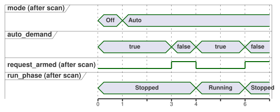

<!-- translation-source: examples/curriculum/pc-08-manual-auto.ghost.md -->
[Korean original](pc-08-manual-auto.ghost.md)
> Reading translation. Compile the linked original `.ghost.md` file.

# PC-08 — Manual/automatic modes and common permission

<!-- ghostflow:anchor id=GF-INT-PC08-MANUAL-AUTO-REARM-V1 kind=intent status=confirmed origin=imported -->
> Learning scenario: run one pump in either manual or automatic mode, and handle
> the stop/overload permissions that apply to both modes. A fresh run request is
> required, so a mode change or a permission recovery can never quietly restart
> the equipment.

The linked Korean `.ghost.md` file is the only canonical, executable literate
source for PC-08. It combines two earlier lessons without replacing them:
[PC-03 manual start and latching](./pc-03-motor-contactor.ghost.en.md) and
[PC-07 automatic demand](./pc-07-tank-hysteresis.ghost.en.md). Two other
examples, the [station mode rules](../station-rules.ghost.md) and the
[shared pump example](../tutorial/04-extra-valves.ghost.md), are kept as they
are: they cover a separate, more advanced topic, arbitration between several
controls.

## Intent and normalization

An operator might say: "Run the pump when I start it manually or when there is
automatic demand. Stop immediately if stop or overload permission is lost, and
don't restart by itself when permission comes back." This document turns that
request into precise rules (*normalizes* it):

- **Mode selection.** `manual_mode_request` and `auto_mode_request` are
  maintained mode-selection inputs.

  | `manual_mode_request` | `auto_mode_request` | Mode |
  | --- | --- | --- |
  | false | false | `Off` |
  | true | false | `Manual` |
  | false | true | `Auto` |
  | true | true | `ModeConflict` (outputs always off) |

- **Manual start.** `manual_start` is a momentary manual-start event. Once it is
  accepted, the pump stays `Running` in Manual mode. Holding the button down is
  not reused as a restart event after permission comes back.
- **Automatic demand.** `auto_demand` is a maintained automatic demand. It can
  start the pump only after Auto mode is stable, has seen the demand false once
  (this *re-arms* the request), and then sees it become true again.
- **Common permission.** `stop_ok` and `overload_ok` apply to both modes. If
  either is not true, the pump stops at once. Restoring permission alone never
  restarts it.

`Mode` and `RunPhase` are logical states. `pump_contactor` is a logical coil
command that reflects the next scan's state. Real contactor closure,
main-circuit voltage, and pump rotation are outside this example's evidence. A
real installation needs independent hardware protection, such as an emergency
stop, a thermal overload relay, and electrical interlocks.

## GhostFlow source

**Input quality.** This revision reads the quality that each input's producer
reports. It does not diagnose physical button faults.

- A healthy `false` (Good(false)) is a normal observation.
- An unknown request or mode observation does not establish a new request, a
  released request, or a mode. Where no observation justifies a transition, the
  current state is kept.
- Protection permission requires a confirmed Good(true).
- No new START input or global restart policy is added.

```ghost
// Source revision: issue531-producer-quality-pc08-v1
control ManualAutoPump {
  input manual_mode_request, auto_mode_request, manual_start, auto_demand, stop_ok, overload_ok: Bool;
  output pump_contactor: Bool;

  type Mode = Off | Manual | Auto | ModeConflict;
  // ghostflow:link id=GF-INT-PC08-MANUAL-AUTO-REARM-V1 relation=implements
  state mode: Mode = Off;

  type RunPhase = Stopped | Running;
  // ghostflow:link id=GF-INT-PC08-MANUAL-AUTO-REARM-V1 relation=implements
  state run_phase: RunPhase = Stopped;
  // ghostflow:link id=GF-INT-PC08-MANUAL-AUTO-REARM-V1 relation=implements
  state request_armed: Bool = false;

  let manual_mode_request_true = case manual_mode_request { ok(value) => value; fault(_) => false; };
  let manual_mode_request_false = case manual_mode_request { ok(value) => !value; fault(_) => false; };
  let auto_mode_request_true = case auto_mode_request { ok(value) => value; fault(_) => false; };
  let auto_mode_request_false = case auto_mode_request { ok(value) => !value; fault(_) => false; };
  let manual_start_true = case manual_start { ok(value) => value; fault(_) => false; };
  let manual_start_false = case manual_start { ok(value) => !value; fault(_) => false; };
  let auto_demand_true = case auto_demand { ok(value) => value; fault(_) => false; };
  let auto_demand_false = case auto_demand { ok(value) => !value; fault(_) => false; };
  let stop_ok_true = case stop_ok { ok(value) => value; fault(_) => false; };
  let stop_ok_false = case stop_ok { ok(value) => !value; fault(_) => false; };
  let overload_ok_true = case overload_ok { ok(value) => value; fault(_) => false; };
  let overload_ok_false = case overload_ok { ok(value) => !value; fault(_) => false; };
  let modes_good = case manual_mode_request { ok(_) => case auto_mode_request { ok(_) => true; fault(_) => false; }; fault(_) => false; };

  let permit = stop_ok_true && overload_ok_true;
  let requested_mode = if !modes_good then mode else if manual_mode_request_true && auto_mode_request_true then ModeConflict
    else if manual_mode_request_true then Manual
    else if auto_mode_request_true then Auto
    else Off;
  let mode_changed = requested_mode != mode;
  let selected_request = if requested_mode == Manual then manual_start_true
    else if requested_mode == Auto then auto_demand_true
    else false;
  let request_released = if requested_mode == Manual then manual_start_false
    else if requested_mode == Auto then auto_demand_false
    else false;
  let request_event = modes_good && request_armed && selected_request;

  mode' = requested_mode;

  request_armed' = if !modes_good || mode_changed || !permit || requested_mode == Off || requested_mode == ModeConflict then false
    else if request_released then true
    else false;

  run_phase' = case run_phase {
    Stopped =>
      if mode_changed || requested_mode == Off || requested_mode == ModeConflict || !permit then Stopped
      else if request_event then Running
      else Stopped;

    Running =>
      if mode_changed || requested_mode == Off || requested_mode == ModeConflict || !permit then Stopped
      else if requested_mode == Auto && auto_demand_false then Stopped
      else Running;
  };

  pump_contactor <- run_phase' == Running;
}
```

**Mode changes always stop first.** On a scan where the mode selection changes,
`mode'` records the new mode, but `run_phase'` must become `Stopped`.

**Fresh demand is required.** An `auto_demand` that is already true when Auto is
entered does not start the pump. Auto must first see the demand false once, which
sets `request_armed`; only then does a new true value start the pump. The same
`request_armed` logic detects a fresh Manual START. So a START button held down
while permission is lost and restored is not treated as a restart. If the
demand disappears during Auto operation, the pump stops on that scan, and the
control waits for the next fresh demand.

The timeline below follows these rules scan by scan. The demand is already true
when Auto is selected at scan 1, so the pump stays stopped. The demand drops at
scan 3, which arms the request, and the new demand at scan 4 starts the pump.
When the demand drops again at scan 6, the pump stops.



## Comparison with relays and PLCs

In relay or PLC logic, mode-selection contacts, START latching contacts, and the
common stop/overload NC (normally closed) path are often repeated across several
rungs. GhostFlow keeps `mode` and `run_phase` as separate states and puts one
shared `permit` in front of every operating path. This lets you answer "why did
the pump turn on in this mode?" by following one chain: mode selection → fresh
start event / re-arming → common permission → next state → coil output.

This lesson covers only modes and common permission. Timers, sequential valves,
resource conflicts between machines, timeout/fault latching, UI, firmware
export, and physical-output guarantees belong to later lessons. They are not
quietly added to this source.

## Verification boundary

`tools/check-pc-08.mjs` creates a fresh WASM `ControlRuntime` for each scenario.
Every scenario uses the same existing compiler, literate extractor, adapter, and
WASM artifact. The checker verifies `stateBefore`, `stateAfter`, `requested`,
`safe`, and that `nowMs` never decreases. It then prints SHA-256 hashes of the
expected records and the relevant executables. A checker PASS means the
virtual/compiler/WASM logical trace matches. It does not mean that a real relay
or pump operated.
