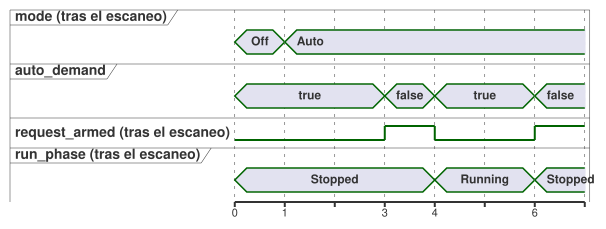

<!-- translation-source: examples/curriculum/pc-08-manual-auto.ghost.en.md -->
[Original en inglés](pc-08-manual-auto.ghost.en.md)

> Traducción de lectura. Para compilar, use el archivo original `.ghost.md`
> enlazado: [original en coreano](pc-08-manual-auto.ghost.md).

# PC-08 — Modos manual/automático y permiso común

<!-- ghostflow:anchor id=GF-INT-PC08-MANUAL-AUTO-REARM-V1 kind=intent status=confirmed origin=imported -->
> Escenario de aprendizaje: hacer funcionar una bomba en modo manual o
> automático y gestionar los permisos de paro/sobrecarga que se aplican a ambos
> modos. Se exige una solicitud de marcha nueva, de modo que un cambio de modo o
> la recuperación de un permiso nunca puedan rearrancar el equipo en silencio.

El archivo `.ghost.md` en coreano enlazado es la única fuente literaria
(literate) canónica y ejecutable de PC-08. Combina dos lecciones anteriores sin
sustituirlas:
[arranque manual y autorretención de PC-03](./pc-03-motor-contactor.ghost.es.md) y
[demanda automática de PC-07](./pc-07-tank-hysteresis.ghost.es.md). Otros dos
ejemplos, las [reglas de modo de la estación](../station-rules.ghost.es.md) y el
[ejemplo de bomba compartida](../tutorial/04-extra-valves.ghost.es.md), se
conservan tal cual: tratan un tema aparte y más avanzado, el arbitraje entre
varios controles.

## Intención y normalización

Un operador podría decir: "Haz funcionar la bomba cuando la arranque a mano o
cuando haya demanda automática. Detenla de inmediato si se pierde el permiso de
paro o de sobrecarga, y no la vuelvas a arrancar por sí sola cuando vuelva el
permiso". Este documento convierte esa petición en reglas precisas (la
*normaliza*):

- **Selección de modo.** `manual_mode_request` y `auto_mode_request` son
  entradas mantenidas de selección de modo.

  | `manual_mode_request` | `auto_mode_request` | Modo |
  | --- | --- | --- |
  | false | false | `Off` |
  | true | false | `Manual` |
  | false | true | `Auto` |
  | true | true | `ModeConflict` (salidas siempre apagadas) |

- **Arranque manual.** `manual_start` es un evento momentáneo de arranque
  manual. Una vez aceptado, la bomba permanece en `Running` en modo Manual.
  Mantener pulsado el botón no se reutiliza como evento de rearranque cuando
  vuelve el permiso.
- **Demanda automática.** `auto_demand` es una demanda automática mantenida.
  Solo puede arrancar la bomba después de que el modo Auto esté estable, haya
  visto la demanda en false una vez (esto *rearma* la solicitud) y luego la vea
  volver a true.
- **Permiso común.** `stop_ok` y `overload_ok` se aplican a ambos modos. Si
  alguno no es true, la bomba se detiene de inmediato. Restablecer el permiso
  por sí solo nunca la vuelve a arrancar.

`Mode` y `RunPhase` son estados lógicos. `pump_contactor` es un comando lógico
de bobina que refleja el estado del siguiente escaneo. El cierre real del
contactor, la tensión del circuito principal y la rotación de la bomba quedan
fuera de la evidencia de este ejemplo. Una instalación real necesita
protección de hardware independiente, como una parada de emergencia, un relé
térmico de sobrecarga y enclavamientos eléctricos.

## Fuente GhostFlow

**Calidad de las entradas.** Esta revisión lee la calidad que informa el
productor de cada entrada. No diagnostica fallos físicos de los botones.

- Un `false` sano (Good(false)) es una observación normal.
- Una solicitud o una observación de modo desconocida no establece una
  solicitud nueva, una solicitud liberada ni un modo. Cuando ninguna
  observación justifica una transición, se mantiene el estado actual.
- El permiso de protección exige un Good(true) confirmado.
- No se añade ninguna entrada START nueva ni ninguna política global de
  rearranque.

```ghost
// Source revision: issue531-producer-quality-pc08-v1
control ManualAutoPump {
  input manual_mode_request, auto_mode_request, manual_start, auto_demand, stop_ok, overload_ok: Bool;
  output pump_contactor: Bool;

  type Mode = Off | Manual | Auto | ModeConflict;
  // ghostflow:link id=GF-INT-PC08-MANUAL-AUTO-REARM-V1 relation=implements
  state mode: Mode = Off;

  type RunPhase = Stopped | Running;
  // ghostflow:link id=GF-INT-PC08-MANUAL-AUTO-REARM-V1 relation=implements
  state run_phase: RunPhase = Stopped;
  // ghostflow:link id=GF-INT-PC08-MANUAL-AUTO-REARM-V1 relation=implements
  state request_armed: Bool = false;

  let manual_mode_request_true = case manual_mode_request { ok(value) => value; fault(_) => false; };
  let manual_mode_request_false = case manual_mode_request { ok(value) => !value; fault(_) => false; };
  let auto_mode_request_true = case auto_mode_request { ok(value) => value; fault(_) => false; };
  let auto_mode_request_false = case auto_mode_request { ok(value) => !value; fault(_) => false; };
  let manual_start_true = case manual_start { ok(value) => value; fault(_) => false; };
  let manual_start_false = case manual_start { ok(value) => !value; fault(_) => false; };
  let auto_demand_true = case auto_demand { ok(value) => value; fault(_) => false; };
  let auto_demand_false = case auto_demand { ok(value) => !value; fault(_) => false; };
  let stop_ok_true = case stop_ok { ok(value) => value; fault(_) => false; };
  let stop_ok_false = case stop_ok { ok(value) => !value; fault(_) => false; };
  let overload_ok_true = case overload_ok { ok(value) => value; fault(_) => false; };
  let overload_ok_false = case overload_ok { ok(value) => !value; fault(_) => false; };
  let modes_good = case manual_mode_request { ok(_) => case auto_mode_request { ok(_) => true; fault(_) => false; }; fault(_) => false; };

  let permit = stop_ok_true && overload_ok_true;
  let requested_mode = if !modes_good then mode else if manual_mode_request_true && auto_mode_request_true then ModeConflict
    else if manual_mode_request_true then Manual
    else if auto_mode_request_true then Auto
    else Off;
  let mode_changed = requested_mode != mode;
  let selected_request = if requested_mode == Manual then manual_start_true
    else if requested_mode == Auto then auto_demand_true
    else false;
  let request_released = if requested_mode == Manual then manual_start_false
    else if requested_mode == Auto then auto_demand_false
    else false;
  let request_event = modes_good && request_armed && selected_request;

  mode' = requested_mode;

  request_armed' = if !modes_good || mode_changed || !permit || requested_mode == Off || requested_mode == ModeConflict then false
    else if request_released then true
    else false;

  run_phase' = case run_phase {
    Stopped =>
      if mode_changed || requested_mode == Off || requested_mode == ModeConflict || !permit then Stopped
      else if request_event then Running
      else Stopped;

    Running =>
      if mode_changed || requested_mode == Off || requested_mode == ModeConflict || !permit then Stopped
      else if requested_mode == Auto && auto_demand_false then Stopped
      else Running;
  };

  pump_contactor <- run_phase' == Running;
}
```

**Un cambio de modo siempre detiene primero.** En un escaneo en el que cambia la
selección de modo, `mode'` registra el nuevo modo, pero `run_phase'` debe pasar
a `Stopped`.

**Se exige una demanda nueva.** Un `auto_demand` que ya es true al entrar en
Auto no arranca la bomba. Auto debe ver primero la demanda en false una vez, lo
que activa `request_armed`; solo entonces un nuevo valor true arranca la bomba.
La misma lógica de `request_armed` detecta un START Manual nuevo. Así, un botón
START mantenido pulsado mientras el permiso se pierde y se restablece no se
trata como un rearranque. Si la demanda desaparece durante la operación en Auto,
la bomba se detiene en ese escaneo y el control espera la siguiente demanda
nueva.

La cronología siguiente sigue estas reglas escaneo a escaneo. La demanda ya es
true cuando se selecciona Auto en el escaneo 1, así que la bomba sigue detenida.
La demanda cae en el escaneo 3, lo que rearma la solicitud, y la nueva demanda
en el escaneo 4 arranca la bomba. Cuando la demanda vuelve a caer en el escaneo
6, la bomba se detiene.



## Comparación con relés y PLC

En la lógica de relés o de PLC, los contactos de selección de modo, los
contactos de autorretención de START y el camino NC (normalmente cerrado) común
de paro/sobrecarga suelen repetirse en varios peldaños. GhostFlow mantiene
`mode` y `run_phase` como estados separados y coloca un único `permit`
compartido delante de cada camino de operación. Esto permite responder a "¿por
qué se encendió la bomba en este modo?" siguiendo una sola cadena: selección de
modo → evento de arranque nuevo / rearme → permiso común → estado siguiente →
salida de bobina.

Esta lección cubre solo los modos y el permiso común. Los temporizadores, las
válvulas secuenciales, los conflictos de recursos entre máquinas, el
timeout/latch de fallo, la UI, la exportación de firmware y las garantías sobre
salidas físicas pertenecen a lecciones posteriores. No se añaden en silencio a
esta fuente.

## Límite de la verificación

`tools/check-pc-08.mjs` crea un `ControlRuntime` WASM nuevo para cada
escenario. Todos los escenarios usan el mismo compilador, extractor literario,
adaptador y artefacto WASM existentes. El verificador comprueba `stateBefore`,
`stateAfter`, `requested`, `safe` y que `nowMs` nunca disminuya. Después
imprime los hashes SHA-256 de los registros esperados y de los ejecutables
relevantes. Un PASS del verificador significa que la traza lógica
virtual/compilador/WASM coincide. No significa que un relé o una bomba reales
hayan funcionado.
