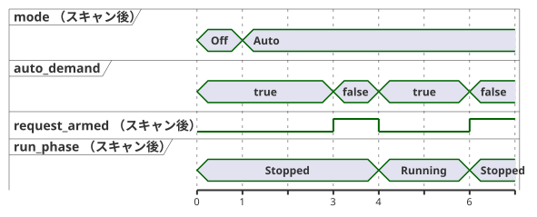

<!-- translation-source: examples/curriculum/pc-08-manual-auto.ghost.en.md -->
[英語の原文](pc-08-manual-auto.ghost.en.md)
> 閲覧用の翻訳です。コンパイルには、リンク先の韓国語の原本 [`pc-08-manual-auto.ghost.md`](pc-08-manual-auto.ghost.md) を使用してください。

# PC-08 — 手動/自動モードと共通の許可

<!-- ghostflow:anchor id=GF-INT-PC08-MANUAL-AUTO-REARM-V1 kind=intent status=confirmed origin=imported -->
> 学習シナリオ：1 台のポンプを手動モードまたは自動モードで運転し、両方のモードに共通して適用される停止/過負荷の許可を扱います。新たな運転要求を必須とするため、モードの切り替えや許可の復旧によって設備が黙って再起動することは決してありません。

リンク先の韓国語の `.ghost.md` ファイルが、PC-08 の唯一の正本であり、実行可能な文芸的ソース（literate source）です。このレッスンは、2 つの既存レッスンを置き換えることなく組み合わせます。[PC-03 手動起動と自己保持](./pc-03-motor-contactor.ghost.ja.md) と [PC-07 自動要求](./pc-07-tank-hysteresis.ghost.ja.md) です。他の 2 つの例、[ステーションのモード規則](../station-rules.ghost.ja.md) と [共有ポンプの例](../tutorial/04-extra-valves.ghost.ja.md) はそのまま残します。これらは、複数の `control` 間の調停（アービトレーション）という、別のより高度なトピックを扱っています。

## 意図と正規化

オペレーターは次のように言うかもしれません。「手動で起動したとき、または自動の要求があるときにポンプを運転してほしい。停止や過負荷の許可が失われたら直ちに止め、許可が戻っても勝手に再起動しないでほしい。」この文書は、その要求を厳密な規則に変換します（*正規化*します）。

- **モード選択。** `manual_mode_request` と `auto_mode_request` は維持型のモード選択入力です。

  | `manual_mode_request` | `auto_mode_request` | モード |
  | --- | --- | --- |
  | false | false | `Off` |
  | true | false | `Manual` |
  | false | true | `Auto` |
  | true | true | `ModeConflict`（出力は常にオフ） |

- **手動起動。** `manual_start` はモーメンタリな手動起動イベントです。一度受け付けられると、Manual モードではポンプは `Running` のままになります。ボタンを押し続けていても、許可が戻った後の再起動イベントとして再利用されることはありません。
- **自動要求。** `auto_demand` は維持型の自動要求です。ポンプを起動できるのは、Auto モードが安定し、要求が一度 false になるのを確認し（これで要求が*再アーム*されます）、その後に再び true になるのを確認した場合だけです。
- **共通の許可。** `stop_ok` と `overload_ok` は両方のモードに適用されます。どちらかが true でなければ、ポンプは直ちに停止します。許可が復旧しただけで再起動することは決してありません。

`Mode` と `RunPhase` は論理状態です。`pump_contactor` は、次のスキャンの状態を反映する論理的なコイルコマンドです。実際の接触器の閉路、主回路の電圧、ポンプの回転は、この例の証拠の範囲外です。実際の設備には、非常停止、サーマルリレー（過負荷継電器）、電気的インターロックなど、独立したハードウェア保護が必要です。

## GhostFlow ソース

**入力品質。** このリビジョンでは、各入力の producer が報告する品質を読み取ります。物理的なボタンの故障は診断しません。

- 正常な `false`（Good(false)）は通常の観測です。
- 不明な要求やモードの観測は、新しい要求、解除された要求、モードのいずれも確立しません。遷移を正当化する観測がない場合は、現在の状態を保持します。
- 保護の許可には、確定した Good(true) が必要です。
- 新しい START 入力や全体的な再起動ポリシーは追加しません。

```ghost
// Source revision: issue531-producer-quality-pc08-v1
control ManualAutoPump {
  input manual_mode_request, auto_mode_request, manual_start, auto_demand, stop_ok, overload_ok: Bool;
  output pump_contactor: Bool;

  type Mode = Off | Manual | Auto | ModeConflict;
  // ghostflow:link id=GF-INT-PC08-MANUAL-AUTO-REARM-V1 relation=implements
  state mode: Mode = Off;

  type RunPhase = Stopped | Running;
  // ghostflow:link id=GF-INT-PC08-MANUAL-AUTO-REARM-V1 relation=implements
  state run_phase: RunPhase = Stopped;
  // ghostflow:link id=GF-INT-PC08-MANUAL-AUTO-REARM-V1 relation=implements
  state request_armed: Bool = false;

  let manual_mode_request_true = case manual_mode_request { ok(value) => value; fault(_) => false; };
  let manual_mode_request_false = case manual_mode_request { ok(value) => !value; fault(_) => false; };
  let auto_mode_request_true = case auto_mode_request { ok(value) => value; fault(_) => false; };
  let auto_mode_request_false = case auto_mode_request { ok(value) => !value; fault(_) => false; };
  let manual_start_true = case manual_start { ok(value) => value; fault(_) => false; };
  let manual_start_false = case manual_start { ok(value) => !value; fault(_) => false; };
  let auto_demand_true = case auto_demand { ok(value) => value; fault(_) => false; };
  let auto_demand_false = case auto_demand { ok(value) => !value; fault(_) => false; };
  let stop_ok_true = case stop_ok { ok(value) => value; fault(_) => false; };
  let stop_ok_false = case stop_ok { ok(value) => !value; fault(_) => false; };
  let overload_ok_true = case overload_ok { ok(value) => value; fault(_) => false; };
  let overload_ok_false = case overload_ok { ok(value) => !value; fault(_) => false; };
  let modes_good = case manual_mode_request { ok(_) => case auto_mode_request { ok(_) => true; fault(_) => false; }; fault(_) => false; };

  let permit = stop_ok_true && overload_ok_true;
  let requested_mode = if !modes_good then mode else if manual_mode_request_true && auto_mode_request_true then ModeConflict
    else if manual_mode_request_true then Manual
    else if auto_mode_request_true then Auto
    else Off;
  let mode_changed = requested_mode != mode;
  let selected_request = if requested_mode == Manual then manual_start_true
    else if requested_mode == Auto then auto_demand_true
    else false;
  let request_released = if requested_mode == Manual then manual_start_false
    else if requested_mode == Auto then auto_demand_false
    else false;
  let request_event = modes_good && request_armed && selected_request;

  mode' = requested_mode;

  request_armed' = if !modes_good || mode_changed || !permit || requested_mode == Off || requested_mode == ModeConflict then false
    else if request_released then true
    else false;

  run_phase' = case run_phase {
    Stopped =>
      if mode_changed || requested_mode == Off || requested_mode == ModeConflict || !permit then Stopped
      else if request_event then Running
      else Stopped;

    Running =>
      if mode_changed || requested_mode == Off || requested_mode == ModeConflict || !permit then Stopped
      else if requested_mode == Auto && auto_demand_false then Stopped
      else Running;
  };

  pump_contactor <- run_phase' == Running;
}
```

**モードの切り替えでは必ず先に停止します。** モード選択が変わるスキャンでは、`mode'` に新しいモードが記録されますが、`run_phase'` は `Stopped` にならなければなりません。

**新たな要求が必要です。** Auto に入った時点ですでに true になっている `auto_demand` では、ポンプは起動しません。Auto はまず要求が一度 false になるのを確認しなければならず、これによって `request_armed` がセットされます。その後に新しく true になったときだけポンプが起動します。同じ `request_armed` のロジックで、Manual の新たな START も検出します。そのため、許可が失われて復旧する間ずっと押されている START ボタンは、再起動とは見なされません。Auto 運転中に要求が消えると、そのスキャンでポンプが停止し、`control` は次の新たな要求を待ちます。

次のタイムラインは、これらの規則をスキャンごとに追ったものです。スキャン 1 で Auto が選択されたときに要求はすでに true なので、ポンプは停止したままです。スキャン 3 で要求が下がると要求が再アームされ、スキャン 4 の新たな要求でポンプが起動します。スキャン 6 で要求が再び下がると、ポンプは停止します。



## リレーや PLC との比較

リレーや PLC のロジックでは、モード選択接点、START の自己保持接点、共通の停止/過負荷の NC（常時閉、b 接点）経路が、複数のラングにわたって繰り返されることがよくあります。GhostFlow は `mode` と `run_phase` を別々の状態として持ち、共有の `permit` を 1 つ、すべての運転経路の前に置きます。これにより、「このモードでなぜポンプがオンになったのか」という問いに、1 本の連鎖をたどって答えられます。モード選択 → 新たな起動イベント/再アーム → 共通の許可 → 次状態 → コイル出力、という連鎖です。

このレッスンで扱うのは、モードと共通の許可だけです。タイマー、順次動作するバルブ、機械間のリソース競合、タイムアウト/故障ラッチ、UI、ファームウェアのエクスポート、物理出力の保証は、後のレッスンで扱います。それらがこのソースに黙って追加されることはありません。

## 検証の範囲

`tools/check-pc-08.mjs` はシナリオごとに新しい WASM `ControlRuntime` を作成します。すべてのシナリオで、同じ既存のコンパイラ、文芸的ソース抽出器、アダプタ、WASM アーティファクトを使用します。チェッカーは `stateBefore`、`stateAfter`、`requested`、`safe` と、`nowMs` が決して減少しないことを検証します。その後、期待値のレコードと関連する実行ファイルの SHA-256 ハッシュを出力します。チェッカーの PASS は、仮想/コンパイラ/WASM の論理トレースが一致することを意味します。実際のリレーやポンプが動作したことを意味するものではありません。
