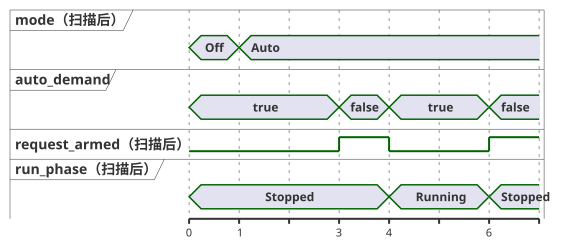

<!-- translation-source: examples/curriculum/pc-08-manual-auto.ghost.en.md -->
[英文原文](pc-08-manual-auto.ghost.en.md)
> 本文为阅读用译本。编译时请使用链接的原始 `.ghost.md` 文件：[韩文原文](pc-08-manual-auto.ghost.md)。

# PC-08 — 手动/自动模式与通用许可

<!-- ghostflow:anchor id=GF-INT-PC08-MANUAL-AUTO-REARM-V1 kind=intent status=confirmed origin=imported -->
> 学习场景：让一台泵以手动或自动模式运行，并处理两种模式共用的停止/过载许可。必须有新的运行请求，因此模式切换或许可恢复绝不会悄悄地让设备重新启动。

链接的韩文 `.ghost.md` 文件是 PC-08 唯一的规范、可执行的文学式源文件（literate source）。它组合了之前的两节课，但并不取代它们：[PC-03 手动启动与自锁](./pc-03-motor-contactor.ghost.zh.md) 和 [PC-07 自动需求](./pc-07-tank-hysteresis.ghost.zh.md)。另外两个示例——[站点模式规则](../station-rules.ghost.zh.md) 和 [共享泵示例](../tutorial/04-extra-valves.ghost.zh.md)——保持原样：它们讨论的是另一个更进阶的主题，即多个 `control` 之间的仲裁。

## 意图与规范化

操作员可能会这样说：“我手动启动时，或者有自动需求时，让泵运转。如果失去停止或过载许可，立即停止；许可恢复后不要自行重新启动。”本文档把这一要求转化为精确的规则（即对其进行*规范化*）：

- **模式选择。** `manual_mode_request` 和 `auto_mode_request` 是保持型的模式选择输入。

  | `manual_mode_request` | `auto_mode_request` | 模式 |
  | --- | --- | --- |
  | false | false | `Off` |
  | true | false | `Manual` |
  | false | true | `Auto` |
  | true | true | `ModeConflict`（输出始终关闭） |

- **手动启动。** `manual_start` 是瞬时的手动启动事件。一旦被接受，泵在 Manual 模式下保持 `Running`。许可恢复后，一直按住的按钮不会被再次当作重启事件。
- **自动需求。** `auto_demand` 是保持型的自动需求。只有在 Auto 模式稳定、曾经看到需求为 false 一次（这会使请求*重新就绪*），然后又看到它重新变为 true 之后，它才能启动泵。
- **通用许可。** `stop_ok` 和 `overload_ok` 适用于两种模式。只要其中任一不为 true，泵就立即停止。仅仅恢复许可绝不会让泵重新启动。

`Mode` 和 `RunPhase` 是逻辑状态。`pump_contactor` 是反映下一次扫描状态的逻辑线圈命令。接触器实际吸合、主回路电压和泵的转动都不在本示例的证据范围之内。真实设施需要独立的硬件保护，例如急停、热过载继电器和电气互锁。

## GhostFlow 源代码

**输入质量。** 本修订版读取每个输入的生产者所报告的质量。它不诊断物理按钮故障。

- 健康的 `false`（Good(false)）是正常观测。
- 未知的请求或模式观测既不能确立新请求、请求撤除，也不能确立模式。在没有观测能支持状态转换的地方，保持当前状态。
- 保护许可需要明确的 Good(true)。
- 不新增 START 输入，也不新增全局重启策略。

```ghost
// Source revision: issue531-producer-quality-pc08-v1
control ManualAutoPump {
  input manual_mode_request, auto_mode_request, manual_start, auto_demand, stop_ok, overload_ok: Bool;
  output pump_contactor: Bool;

  type Mode = Off | Manual | Auto | ModeConflict;
  // ghostflow:link id=GF-INT-PC08-MANUAL-AUTO-REARM-V1 relation=implements
  state mode: Mode = Off;

  type RunPhase = Stopped | Running;
  // ghostflow:link id=GF-INT-PC08-MANUAL-AUTO-REARM-V1 relation=implements
  state run_phase: RunPhase = Stopped;
  // ghostflow:link id=GF-INT-PC08-MANUAL-AUTO-REARM-V1 relation=implements
  state request_armed: Bool = false;

  let manual_mode_request_true = case manual_mode_request { ok(value) => value; fault(_) => false; };
  let manual_mode_request_false = case manual_mode_request { ok(value) => !value; fault(_) => false; };
  let auto_mode_request_true = case auto_mode_request { ok(value) => value; fault(_) => false; };
  let auto_mode_request_false = case auto_mode_request { ok(value) => !value; fault(_) => false; };
  let manual_start_true = case manual_start { ok(value) => value; fault(_) => false; };
  let manual_start_false = case manual_start { ok(value) => !value; fault(_) => false; };
  let auto_demand_true = case auto_demand { ok(value) => value; fault(_) => false; };
  let auto_demand_false = case auto_demand { ok(value) => !value; fault(_) => false; };
  let stop_ok_true = case stop_ok { ok(value) => value; fault(_) => false; };
  let stop_ok_false = case stop_ok { ok(value) => !value; fault(_) => false; };
  let overload_ok_true = case overload_ok { ok(value) => value; fault(_) => false; };
  let overload_ok_false = case overload_ok { ok(value) => !value; fault(_) => false; };
  let modes_good = case manual_mode_request { ok(_) => case auto_mode_request { ok(_) => true; fault(_) => false; }; fault(_) => false; };

  let permit = stop_ok_true && overload_ok_true;
  let requested_mode = if !modes_good then mode else if manual_mode_request_true && auto_mode_request_true then ModeConflict
    else if manual_mode_request_true then Manual
    else if auto_mode_request_true then Auto
    else Off;
  let mode_changed = requested_mode != mode;
  let selected_request = if requested_mode == Manual then manual_start_true
    else if requested_mode == Auto then auto_demand_true
    else false;
  let request_released = if requested_mode == Manual then manual_start_false
    else if requested_mode == Auto then auto_demand_false
    else false;
  let request_event = modes_good && request_armed && selected_request;

  mode' = requested_mode;

  request_armed' = if !modes_good || mode_changed || !permit || requested_mode == Off || requested_mode == ModeConflict then false
    else if request_released then true
    else false;

  run_phase' = case run_phase {
    Stopped =>
      if mode_changed || requested_mode == Off || requested_mode == ModeConflict || !permit then Stopped
      else if request_event then Running
      else Stopped;

    Running =>
      if mode_changed || requested_mode == Off || requested_mode == ModeConflict || !permit then Stopped
      else if requested_mode == Auto && auto_demand_false then Stopped
      else Running;
  };

  pump_contactor <- run_phase' == Running;
}
```

**模式切换总是先停止。** 在模式选择发生变化的扫描中，`mode'` 记录新模式，但 `run_phase'` 必须变为 `Stopped`。

**必须有新的需求。** 进入 Auto 时已经为 true 的 `auto_demand` 不会启动泵。Auto 必须先看到需求为 false 一次，这会设置 `request_armed`；只有在此之后，新的 true 值才会启动泵。同一个 `request_armed` 逻辑也用于检测新的 Manual START。因此，在许可失去又恢复期间一直按住的 START 按钮不会被当作重启。如果在 Auto 运行期间需求消失，泵在该次扫描中停止，`control` 等待下一个新的需求。

下面的时间线逐次扫描地展示了这些规则。在扫描 1 选择 Auto 时需求已经为 true，因此泵保持停止。需求在扫描 3 降为 false，使请求重新就绪；扫描 4 出现的新需求启动了泵。需求在扫描 6 再次降为 false 时，泵停止。



## 与继电器和 PLC 的比较

在继电器或 PLC 逻辑中，模式选择触点、START 自锁触点以及通用的停止/过载 NC（常闭）回路，常常在多个梯级中重复出现。GhostFlow 将 `mode` 和 `run_phase` 作为两个独立的状态，并在每条运行路径前放置一个共享的 `permit`。这样，要回答“泵为什么在这个模式下开启？”时，只需沿一条链追溯：模式选择 → 新的启动事件 / 重新就绪 → 通用许可 → 下一状态 → 线圈输出。

本课只涉及模式和通用许可。定时器、顺序阀门、设备之间的资源冲突、超时/故障锁存、UI、固件导出以及物理输出保证都属于后续课程，不会被悄悄加入本源文件。

## 验证边界

`tools/check-pc-08.mjs` 为每个场景创建一个新的 WASM `ControlRuntime`。所有场景使用同一套现有的编译器、文学式提取器、适配器和 WASM 制品。检查器验证 `stateBefore`、`stateAfter`、`requested`、`safe`，以及 `nowMs` 从不减小。随后它输出期望记录和相关可执行文件的 SHA-256 哈希。检查器 PASS 表示虚拟/编译器/WASM 的逻辑追踪一致，并不表示真实的继电器或泵已经动作。
