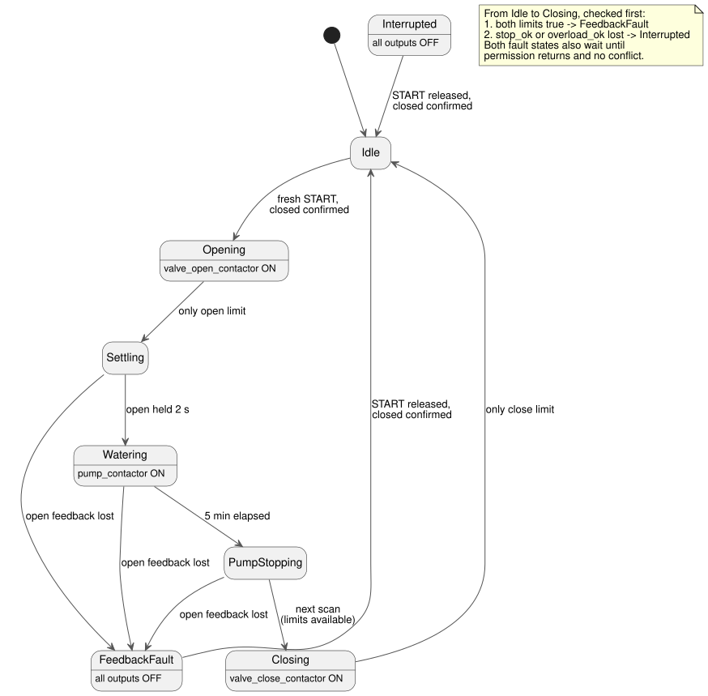

<!-- translation-source: examples/curriculum/pc-09-sequential-water-supply.ghost.md -->
[Korean original](pc-09-sequential-water-supply.ghost.md)
> Reading translation. Compile the linked original `.ghost.md` file.

# PC-09 — Sequential valve and pump water supply

<!-- ghostflow:anchor id=GF-INT-PC09-SEQUENTIAL-WATERING-V1 kind=intent status=confirmed origin=imported -->
> Learning scenario: confirm that the valve is open before running the pump.
> When the watering time ends, stop the pump first and then close the valve.
> Keep output commands separate from the device's physical position.

The linked Korean `.ghost.md` file is the only canonical, executable literate
source for PC-09. It keeps, and is compared with, two tutorials:

- [tutorial/02 time-based sequencing](../tutorial/02-watering.ghost.md) is a
  basic example that moves from stage to stage by time alone.
- [tutorial/04 shared pump](../tutorial/04-extra-valves.ghost.md) covers a
  separate problem: arbitration when several controls share one pump.

This lesson replaces neither. Within a single watering sequence, it adds valve
position feedback and the rule "stop the pump before closing the valve".

## Intent and normalization

An operator might say: "When watering starts, open the valve. Once it is
confirmed open, run the pump for five minutes. Then stop the pump first, and
close the valve." GhostFlow turns that request into precise rules (*normalizes*
it):

- **Fresh start.** `start_request` is a momentary request for a new watering
  run. It is accepted only after the valve is confirmed closed **and** a stable
  scan has seen the request released. A new press after that starts the run.
- **Position comes from feedback.** `open_limit` and `close_limit` observe the
  device's position. An energized contactor output alone does not mean the
  valve actually moved.
- **Settle, then water.** After the valve opens, the open feedback must stay
  true for `settle_delay` (2 s) before the pump starts. The pump then runs for
  `watering_time` (5 min).
- **Pump first, then valve.** On the scan where the watering time expires, the
  pump turns off and the phase becomes `PumpStopping`, with every output off.
  The next scan moves from `PumpStopping` to `Closing` (if the limits are
  available), and only then does the valve close command turn on.
- **Faults stop everything.** If `stop_ok` or `overload_ok` is lost, the phase
  becomes `Interrupted` immediately. If both limits are true, `FeedbackFault`
  takes priority. All outputs turn off. Restoring the conditions alone does not
  restart the run.

## GhostFlow source

**Input quality.** This revision reads the quality that each input's producer
reports. It does not diagnose physical button faults.

- A healthy `false` (Good(false)) is a normal observation.
- An unknown request does not count as a new request or a release. An unknown
  limit does not establish a position or a conflict.
- The existing watering deadline still stops the pump.
- In `PumpStopping`, unavailable limits postpone closing, with all outputs off.
- In `Closing`, unavailable limits keep the phase in `Closing` but block the
  close command. If healthy closed feedback returns, the sequence ends in
  `Idle`; other healthy, non-conflicting feedback lets closing resume.
- This lesson adds no opening or closing timeout.
- Protection permission requires a confirmed Good(true).
- No new START input or global restart policy is added.

```ghost
// Source revision: issue531-producer-quality-pc09-v1
control SequentialWaterSupply {
  input start_request, open_limit, close_limit, stop_ok, overload_ok: Bool;
  output valve_open_contactor, valve_close_contactor, pump_contactor: Bool;

  let start_request_true = case start_request { ok(value) => value; fault(_) => false; };
  let start_request_false = case start_request { ok(value) => !value; fault(_) => false; };
  let open_limit_true = case open_limit { ok(value) => value; fault(_) => false; };
  let open_limit_false = case open_limit { ok(value) => !value; fault(_) => false; };
  let close_limit_true = case close_limit { ok(value) => value; fault(_) => false; };
  let close_limit_false = case close_limit { ok(value) => !value; fault(_) => false; };
  let stop_ok_true = case stop_ok { ok(value) => value; fault(_) => false; };
  let stop_ok_false = case stop_ok { ok(value) => !value; fault(_) => false; };
  let overload_ok_true = case overload_ok { ok(value) => value; fault(_) => false; };
  let overload_ok_false = case overload_ok { ok(value) => !value; fault(_) => false; };
  let limits_good = case open_limit { ok(_) => case close_limit { ok(_) => true; fault(_) => false; }; fault(_) => false; };

  let settle_delay = 2s;
  let watering_time = 5min;

  type Phase = Idle | Opening | Settling | Watering | PumpStopping | Closing | FeedbackFault | Interrupted;
  // ghostflow:link id=GF-INT-PC09-SEQUENTIAL-WATERING-V1 relation=implements
  state phase: Phase = Idle;
  // ghostflow:link id=GF-INT-PC09-SEQUENTIAL-WATERING-V1 relation=implements
  state request_armed: Bool = false;
  // ghostflow:link id=GF-INT-PC09-SEQUENTIAL-WATERING-V1 relation=implements
  timer age = elapsed(phase);

  let permit = stop_ok_true && overload_ok_true;
  let conflict = open_limit_true && close_limit_true;
  let known_closed = close_limit_true && open_limit_false;
  let start_event = request_armed && start_request_true;

  request_armed' = phase == Idle && permit && !conflict && known_closed && start_request_false;

  phase' = case phase {
    Idle =>
      if conflict then FeedbackFault
      else if !permit then Interrupted
      else if start_event && known_closed then Opening
      else Idle;

    Opening =>
      if conflict then FeedbackFault
      else if !permit then Interrupted
      else if open_limit_true && close_limit_false then Settling
      else Opening;

    Settling =>
      if conflict then FeedbackFault
      else if !permit then Interrupted
      else if limits_good && (open_limit_false || close_limit_true) then FeedbackFault
      else if limits_good && age >= settle_delay then Watering
      else Settling;

    Watering =>
      if conflict then FeedbackFault
      else if !permit then Interrupted
      else if limits_good && (open_limit_false || close_limit_true) then FeedbackFault
      else if age >= watering_time then PumpStopping
      else Watering;

    PumpStopping =>
      if conflict then FeedbackFault
      else if !permit then Interrupted
      else if limits_good && (open_limit_false || close_limit_true) then FeedbackFault
      else if limits_good then Closing
      else PumpStopping;

    Closing =>
      if conflict then FeedbackFault
      else if !permit then Interrupted
      else if close_limit_true && open_limit_false then Idle
      else Closing;

    FeedbackFault =>
      if conflict || !permit then FeedbackFault
      else if start_request_false && known_closed then Idle
      else FeedbackFault;

    Interrupted =>
      if conflict || !permit then Interrupted
      else if start_request_false && known_closed then Idle
      else Interrupted;
  };

  valve_open_contactor <- phase' == Opening;
  valve_close_contactor <- phase' == Closing && limits_good;
  pump_contactor <- phase' == Watering;
  mutex(valve_open_contactor, valve_close_contactor);
}
```

The state diagram below shows the normal sequence and the fault paths. The note
lists the checks that run first.



**Commands versus positions.** `Opening`, `Settling`, `Watering`,
`PumpStopping`, and `Closing` are logical phases. `valve_open_contactor` and
`valve_close_contactor` are commands to their contactors. `open_limit` and
`close_limit` report the observed physical position. So if the control stays in
`Opening` for a long time, it means two things: the open command is still being
requested, and opening has not been confirmed. It does not guarantee that the
valve actually moved.

**Compared with the tutorials.** In tutorial/02's time-only sequence, the next
phase starts when time passes. In PC-09, starting the pump also requires
open-position feedback and a settling interval. Tutorial/04's shared pump shows a
different need: global arbitration when several controls request the same
output. In this lesson, `pump_contactor` belongs to one sequential control. The
lesson does not claim to solve arbitration with other controls.

**Known gap: no timeout.** If feedback never arrives, this lesson stays in
`Opening` or `Closing`. Timeout, fault latching, alarm, reset, and a safe
valve-closing policy after a fault are covered in PC-10. `mutex` and logical
outputs do not replace hardware interlocks, an emergency stop, or overload
protection.

## Verification boundary

`tools/check-pc-09.mjs` creates a fresh WASM `ControlRuntime` for each scenario
and does not rebuild the existing WASM artifact. It checks `stateBefore`,
`stateAfter`, `requested`, `safe`, and that `nowMs` never decreases. PASS means
the compiler/WASM virtual trace matches expectations. It is not physical
evidence of contactor closure, valve movement, pump rotation, or water flow.
