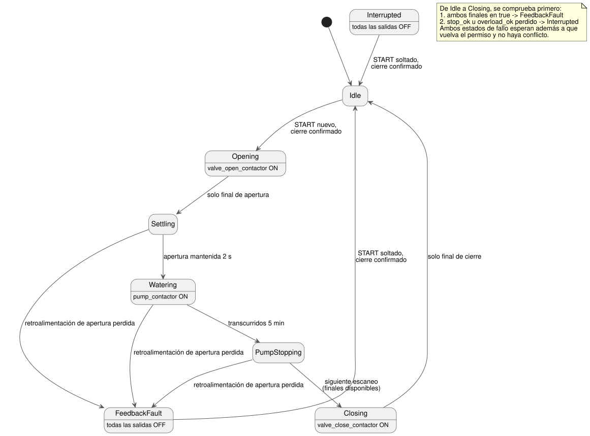

<!-- translation-source: examples/curriculum/pc-09-sequential-water-supply.ghost.en.md -->
[Original en inglés](pc-09-sequential-water-supply.ghost.en.md)

> Traducción de lectura. Para compilar, use el archivo original `.ghost.md`
> enlazado: [original en coreano](pc-09-sequential-water-supply.ghost.md).

# PC-09 — Suministro de agua secuencial con válvula y bomba

<!-- ghostflow:anchor id=GF-INT-PC09-SEQUENTIAL-WATERING-V1 kind=intent status=confirmed origin=imported -->
> Escenario de aprendizaje: confirmar que la válvula está abierta antes de hacer
> funcionar la bomba. Cuando termina el tiempo de riego, detener primero la bomba
> y después cerrar la válvula. Mantener los comandos de salida separados de la
> posición física del dispositivo.

El archivo `.ghost.md` en coreano enlazado es la única fuente literaria
(literate) canónica y ejecutable de PC-09. Conserva dos tutoriales y se compara
con ellos:

- [tutorial/02, secuenciación basada en tiempo](../tutorial/02-watering.ghost.es.md)
  es un ejemplo básico que pasa de una etapa a otra solo por tiempo.
- [tutorial/04, bomba compartida](../tutorial/04-extra-valves.ghost.es.md) trata un
  problema aparte: el arbitraje cuando varios controles comparten una bomba.

Esta lección no sustituye a ninguno. Dentro de una única secuencia de riego,
añade la retroalimentación de posición de la válvula y la regla "detener la
bomba antes de cerrar la válvula".

## Intención y normalización

Un operador podría decir: "Cuando empiece el riego, abre la válvula. Una vez
confirmado que está abierta, haz funcionar la bomba cinco minutos. Después
detén primero la bomba y cierra la válvula". GhostFlow convierte esa petición en
reglas precisas (la *normaliza*):

- **Arranque nuevo.** `start_request` es una solicitud momentánea para una nueva
  tanda de riego. Se acepta solo después de que la válvula esté confirmada como
  cerrada **y** un escaneo estable haya visto la solicitud liberada. Una nueva
  pulsación a partir de ahí inicia la tanda.
- **La posición viene de la retroalimentación.** `open_limit` y `close_limit`
  observan la posición del dispositivo. Una salida de contactor energizada por
  sí sola no significa que la válvula se haya movido realmente.
- **Estabilizar y luego regar.** Después de que la válvula se abra, la
  retroalimentación de apertura debe mantenerse en true durante `settle_delay`
  (2 s) antes de que arranque la bomba. Luego la bomba funciona durante
  `watering_time` (5 min).
- **Primero la bomba, luego la válvula.** En el escaneo en el que vence el
  tiempo de riego, la bomba se apaga y la fase pasa a `PumpStopping`, con todas
  las salidas apagadas. El siguiente escaneo pasa de `PumpStopping` a `Closing`
  (si los finales de carrera están disponibles), y solo entonces se activa el
  comando de cierre de la válvula.
- **Los fallos lo detienen todo.** Si se pierde `stop_ok` u `overload_ok`, la
  fase pasa a `Interrupted` de inmediato. Si ambos finales de carrera son true,
  `FeedbackFault` tiene prioridad. Todas las salidas se apagan. Restablecer las
  condiciones por sí solo no reinicia la tanda.

## Fuente GhostFlow

**Calidad de las entradas.** Esta revisión lee la calidad que informa el
productor de cada entrada. No diagnostica fallos físicos de los botones.

- Un `false` sano (Good(false)) es una observación normal.
- Una solicitud desconocida no cuenta como una solicitud nueva ni como una
  liberación. Un final de carrera desconocido no establece una posición ni un
  conflicto.
- El plazo de riego existente sigue deteniendo la bomba.
- En `PumpStopping`, los finales de carrera no disponibles posponen el cierre,
  con todas las salidas apagadas.
- En `Closing`, los finales de carrera no disponibles mantienen la fase en
  `Closing` pero bloquean el comando de cierre. Si vuelve una retroalimentación
  sana de cierre, la secuencia termina en `Idle`; cualquier otra
  retroalimentación sana y sin conflicto permite reanudar el cierre.
- Esta lección no añade ningún timeout de apertura ni de cierre.
- El permiso de protección exige un Good(true) confirmado.
- No se añade ninguna entrada START nueva ni ninguna política global de
  rearranque.

```ghost
// Source revision: issue531-producer-quality-pc09-v1
control SequentialWaterSupply {
  input start_request, open_limit, close_limit, stop_ok, overload_ok: Bool;
  output valve_open_contactor, valve_close_contactor, pump_contactor: Bool;

  let start_request_true = case start_request { ok(value) => value; fault(_) => false; };
  let start_request_false = case start_request { ok(value) => !value; fault(_) => false; };
  let open_limit_true = case open_limit { ok(value) => value; fault(_) => false; };
  let open_limit_false = case open_limit { ok(value) => !value; fault(_) => false; };
  let close_limit_true = case close_limit { ok(value) => value; fault(_) => false; };
  let close_limit_false = case close_limit { ok(value) => !value; fault(_) => false; };
  let stop_ok_true = case stop_ok { ok(value) => value; fault(_) => false; };
  let stop_ok_false = case stop_ok { ok(value) => !value; fault(_) => false; };
  let overload_ok_true = case overload_ok { ok(value) => value; fault(_) => false; };
  let overload_ok_false = case overload_ok { ok(value) => !value; fault(_) => false; };
  let limits_good = case open_limit { ok(_) => case close_limit { ok(_) => true; fault(_) => false; }; fault(_) => false; };

  let settle_delay = 2s;
  let watering_time = 5min;

  type Phase = Idle | Opening | Settling | Watering | PumpStopping | Closing | FeedbackFault | Interrupted;
  // ghostflow:link id=GF-INT-PC09-SEQUENTIAL-WATERING-V1 relation=implements
  state phase: Phase = Idle;
  // ghostflow:link id=GF-INT-PC09-SEQUENTIAL-WATERING-V1 relation=implements
  state request_armed: Bool = false;
  // ghostflow:link id=GF-INT-PC09-SEQUENTIAL-WATERING-V1 relation=implements
  timer age = elapsed(phase);

  let permit = stop_ok_true && overload_ok_true;
  let conflict = open_limit_true && close_limit_true;
  let known_closed = close_limit_true && open_limit_false;
  let start_event = request_armed && start_request_true;

  request_armed' = phase == Idle && permit && !conflict && known_closed && start_request_false;

  phase' = case phase {
    Idle =>
      if conflict then FeedbackFault
      else if !permit then Interrupted
      else if start_event && known_closed then Opening
      else Idle;

    Opening =>
      if conflict then FeedbackFault
      else if !permit then Interrupted
      else if open_limit_true && close_limit_false then Settling
      else Opening;

    Settling =>
      if conflict then FeedbackFault
      else if !permit then Interrupted
      else if limits_good && (open_limit_false || close_limit_true) then FeedbackFault
      else if limits_good && age >= settle_delay then Watering
      else Settling;

    Watering =>
      if conflict then FeedbackFault
      else if !permit then Interrupted
      else if limits_good && (open_limit_false || close_limit_true) then FeedbackFault
      else if age >= watering_time then PumpStopping
      else Watering;

    PumpStopping =>
      if conflict then FeedbackFault
      else if !permit then Interrupted
      else if limits_good && (open_limit_false || close_limit_true) then FeedbackFault
      else if limits_good then Closing
      else PumpStopping;

    Closing =>
      if conflict then FeedbackFault
      else if !permit then Interrupted
      else if close_limit_true && open_limit_false then Idle
      else Closing;

    FeedbackFault =>
      if conflict || !permit then FeedbackFault
      else if start_request_false && known_closed then Idle
      else FeedbackFault;

    Interrupted =>
      if conflict || !permit then Interrupted
      else if start_request_false && known_closed then Idle
      else Interrupted;
  };

  valve_open_contactor <- phase' == Opening;
  valve_close_contactor <- phase' == Closing && limits_good;
  pump_contactor <- phase' == Watering;
  mutex(valve_open_contactor, valve_close_contactor);
}
```

El diagrama de estados siguiente muestra la secuencia normal y los caminos de
fallo. La nota enumera las comprobaciones que se ejecutan primero.



**Comandos frente a posiciones.** `Opening`, `Settling`, `Watering`,
`PumpStopping` y `Closing` son fases lógicas. `valve_open_contactor` y
`valve_close_contactor` son comandos a sus contactores. `open_limit` y
`close_limit` informan de la posición física observada. Así, si el control
permanece mucho tiempo en `Opening`, eso significa dos cosas: el comando de
apertura se sigue solicitando y la apertura no se ha confirmado. No garantiza
que la válvula se haya movido realmente.

**Comparación con los tutoriales.** En la secuencia solo por tiempo de
tutorial/02, la siguiente fase empieza cuando pasa el tiempo. En PC-09, arrancar
la bomba exige además la retroalimentación de posición abierta y un intervalo de
estabilización. La bomba compartida de tutorial/04 muestra una necesidad
distinta: el arbitraje global cuando varios controles solicitan la misma
salida. En esta lección, `pump_contactor` pertenece a un único control
secuencial. La lección no pretende resolver el arbitraje con otros controles.

**Limitación conocida: sin timeout.** Si la retroalimentación nunca llega, esta
lección permanece en `Opening` o `Closing`. El timeout, el latch de fallo, la
alarma, el reinicio y una política segura de cierre de la válvula tras un fallo
se tratan en PC-10. `mutex` y las salidas lógicas no sustituyen a los
enclavamientos de hardware, a una parada de emergencia ni a la protección contra
sobrecarga.

## Límite de la verificación

`tools/check-pc-09.mjs` crea un `ControlRuntime` WASM nuevo para cada escenario
y no recompila el artefacto WASM existente. Comprueba `stateBefore`,
`stateAfter`, `requested`, `safe` y que `nowMs` nunca disminuya. PASS significa
que la traza virtual del compilador/WASM coincide con lo esperado. No es
evidencia física del cierre del contactor, del movimiento de la válvula, de la
rotación de la bomba ni del flujo de agua.
