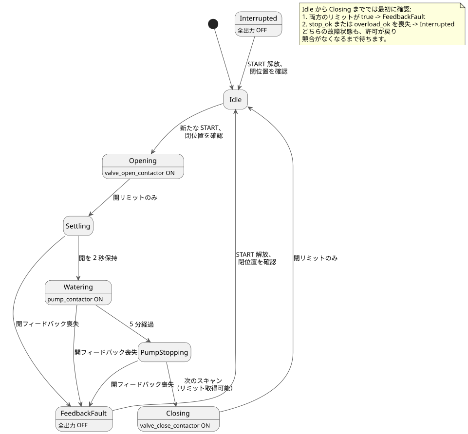

<!-- translation-source: examples/curriculum/pc-09-sequential-water-supply.ghost.en.md -->
[英語の原文](pc-09-sequential-water-supply.ghost.en.md)
> 閲覧用の翻訳です。コンパイルには、リンク先の韓国語の原本 [`pc-09-sequential-water-supply.ghost.md`](pc-09-sequential-water-supply.ghost.md) を使用してください。

# PC-09 — バルブとポンプによる順次給水

<!-- ghostflow:anchor id=GF-INT-PC09-SEQUENTIAL-WATERING-V1 kind=intent status=confirmed origin=imported -->
> 学習シナリオ：ポンプを運転する前に、バルブが開いていることを確認します。灌水時間が終わったら、先にポンプを止めてからバルブを閉じます。出力コマンドと機器の物理的な位置を区別して扱います。

リンク先の韓国語の `.ghost.md` ファイルが、PC-09 の唯一の正本であり、実行可能な文芸的ソース（literate source）です。このレッスンは、次の 2 つのチュートリアルをそのまま残し、それらと比較します。

- [tutorial/02 時間ベースのシーケンス](../tutorial/02-watering.ghost.ja.md) は、時間だけで段階から段階へ進む基本的な例です。
- [tutorial/04 共有ポンプ](../tutorial/04-extra-valves.ghost.ja.md) は、複数の `control` が 1 台のポンプを共有するときの調停（アービトレーション）という、別の問題を扱います。

このレッスンはどちらも置き換えません。1 つの灌水シーケンスの中に、バルブの位置フィードバックと「バルブを閉じる前にポンプを止める」という規則を追加します。

## 意図と正規化

オペレーターは次のように言うかもしれません。「灌水が始まったらバルブを開けてほしい。開いたことが確認できたら、ポンプを 5 分間運転してほしい。その後、先にポンプを止めてからバルブを閉じてほしい。」GhostFlow は、その要求を厳密な規則に変換します（*正規化*します）。

- **新たな起動。** `start_request` は、新しい灌水運転のためのモーメンタリな要求です。受け付けられるのは、バルブが閉じていることが確認され、**かつ**安定したスキャンで要求の解除が確認された後だけです。その後の新たな押下で運転が始まります。
- **位置はフィードバックから得ます。** `open_limit` と `close_limit` は機器の位置を観測します。接触器出力が励磁されているだけでは、バルブが実際に動いたことにはなりません。
- **安定させてから灌水。** バルブが開いた後、ポンプが始動する前に、開フィードバックが `settle_delay`（2 秒）の間 true であり続けなければなりません。その後、ポンプは `watering_time`（5 分）の間運転します。
- **ポンプが先、バルブが後。** 灌水時間が満了したスキャンで、ポンプはオフになり、phase は `PumpStopping` になって、すべての出力がオフになります。次のスキャンで（リミットが取得可能なら）`PumpStopping` から `Closing` へ移り、そこで初めてバルブの閉コマンドがオンになります。
- **故障ではすべてを止めます。** `stop_ok` または `overload_ok` を失うと、phase は直ちに `Interrupted` になります。両方のリミットが true なら `FeedbackFault` が優先されます。すべての出力がオフになります。条件が復旧しただけでは、運転は再開しません。

## GhostFlow ソース

**入力品質。** このリビジョンでは、各入力の producer が報告する品質を読み取ります。物理的なボタンの故障は診断しません。

- 正常な `false`（Good(false)）は通常の観測です。
- 不明な要求は、新しい要求とも解除とも見なしません。不明なリミットは、位置も競合も確立しません。
- 既存の灌水期限によって、引き続きポンプは停止します。
- `PumpStopping` では、リミットが取得不能なら、すべての出力をオフにしたまま閉止を延期します。
- `Closing` では、リミットが取得不能なら phase は `Closing` のままですが、閉コマンドはブロックされます。正常な閉フィードバックが戻れば、シーケンスは `Idle` で終わります。それ以外の正常で競合のないフィードバックが戻れば、閉止を再開できます。
- このレッスンでは、開閉のタイムアウトを追加しません。
- 保護の許可には、確定した Good(true) が必要です。
- 新しい START 入力や全体的な再起動ポリシーは追加しません。

```ghost
// Source revision: issue531-producer-quality-pc09-v1
control SequentialWaterSupply {
  input start_request, open_limit, close_limit, stop_ok, overload_ok: Bool;
  output valve_open_contactor, valve_close_contactor, pump_contactor: Bool;

  let start_request_true = case start_request { ok(value) => value; fault(_) => false; };
  let start_request_false = case start_request { ok(value) => !value; fault(_) => false; };
  let open_limit_true = case open_limit { ok(value) => value; fault(_) => false; };
  let open_limit_false = case open_limit { ok(value) => !value; fault(_) => false; };
  let close_limit_true = case close_limit { ok(value) => value; fault(_) => false; };
  let close_limit_false = case close_limit { ok(value) => !value; fault(_) => false; };
  let stop_ok_true = case stop_ok { ok(value) => value; fault(_) => false; };
  let stop_ok_false = case stop_ok { ok(value) => !value; fault(_) => false; };
  let overload_ok_true = case overload_ok { ok(value) => value; fault(_) => false; };
  let overload_ok_false = case overload_ok { ok(value) => !value; fault(_) => false; };
  let limits_good = case open_limit { ok(_) => case close_limit { ok(_) => true; fault(_) => false; }; fault(_) => false; };

  let settle_delay = 2s;
  let watering_time = 5min;

  type Phase = Idle | Opening | Settling | Watering | PumpStopping | Closing | FeedbackFault | Interrupted;
  // ghostflow:link id=GF-INT-PC09-SEQUENTIAL-WATERING-V1 relation=implements
  state phase: Phase = Idle;
  // ghostflow:link id=GF-INT-PC09-SEQUENTIAL-WATERING-V1 relation=implements
  state request_armed: Bool = false;
  // ghostflow:link id=GF-INT-PC09-SEQUENTIAL-WATERING-V1 relation=implements
  timer age = elapsed(phase);

  let permit = stop_ok_true && overload_ok_true;
  let conflict = open_limit_true && close_limit_true;
  let known_closed = close_limit_true && open_limit_false;
  let start_event = request_armed && start_request_true;

  request_armed' = phase == Idle && permit && !conflict && known_closed && start_request_false;

  phase' = case phase {
    Idle =>
      if conflict then FeedbackFault
      else if !permit then Interrupted
      else if start_event && known_closed then Opening
      else Idle;

    Opening =>
      if conflict then FeedbackFault
      else if !permit then Interrupted
      else if open_limit_true && close_limit_false then Settling
      else Opening;

    Settling =>
      if conflict then FeedbackFault
      else if !permit then Interrupted
      else if limits_good && (open_limit_false || close_limit_true) then FeedbackFault
      else if limits_good && age >= settle_delay then Watering
      else Settling;

    Watering =>
      if conflict then FeedbackFault
      else if !permit then Interrupted
      else if limits_good && (open_limit_false || close_limit_true) then FeedbackFault
      else if age >= watering_time then PumpStopping
      else Watering;

    PumpStopping =>
      if conflict then FeedbackFault
      else if !permit then Interrupted
      else if limits_good && (open_limit_false || close_limit_true) then FeedbackFault
      else if limits_good then Closing
      else PumpStopping;

    Closing =>
      if conflict then FeedbackFault
      else if !permit then Interrupted
      else if close_limit_true && open_limit_false then Idle
      else Closing;

    FeedbackFault =>
      if conflict || !permit then FeedbackFault
      else if start_request_false && known_closed then Idle
      else FeedbackFault;

    Interrupted =>
      if conflict || !permit then Interrupted
      else if start_request_false && known_closed then Idle
      else Interrupted;
  };

  valve_open_contactor <- phase' == Opening;
  valve_close_contactor <- phase' == Closing && limits_good;
  pump_contactor <- phase' == Watering;
  mutex(valve_open_contactor, valve_close_contactor);
}
```

次の状態図は、通常のシーケンスと故障の経路を示しています。注記には、最初に実行される確認を列挙しています。



**コマンドと位置の違い。** `Opening`、`Settling`、`Watering`、`PumpStopping`、`Closing` は論理的な phase です。`valve_open_contactor` と `valve_close_contactor` は、それぞれの接触器へのコマンドです。`open_limit` と `close_limit` は、観測された物理的な位置を報告します。そのため、`control` が長い間 `Opening` にとどまっている場合、それは 2 つのことを意味します。開コマンドがまだ要求され続けていること、そして開いたことがまだ確認されていないことです。バルブが実際に動いたことを保証するものではありません。

**チュートリアルとの比較。** tutorial/02 の時間だけのシーケンスでは、時間が経過すると次の phase が始まります。PC-09 では、ポンプの始動に、開位置のフィードバックと安定化の時間も必要です。tutorial/04 の共有ポンプは別の必要性を示しています。複数の `control` が同じ出力を要求するときの全体的な調停です。このレッスンでは、`pump_contactor` は 1 つの順次制御に属します。このレッスンは、他の `control` との調停を解決するとは主張しません。

**既知の制限：タイムアウトなし。** フィードバックがいつまでも届かない場合、このレッスンは `Opening` または `Closing` にとどまります。タイムアウト、故障ラッチ、アラーム、リセット、故障後にバルブを安全に閉じるポリシーは、PC-10 で扱います。`mutex` と論理出力は、ハードウェアのインターロック、非常停止、過負荷保護の代わりにはなりません。

## 検証の範囲

`tools/check-pc-09.mjs` はシナリオごとに新しい WASM `ControlRuntime` を作成し、既存の WASM アーティファクトを再ビルドしません。`stateBefore`、`stateAfter`、`requested`、`safe` と、`nowMs` が決して減少しないことを確認します。PASS は、コンパイラ/WASM の仮想トレースが期待値と一致することを意味します。接触器の閉路、バルブの移動、ポンプの回転、水の流れの物理的な証拠ではありません。
