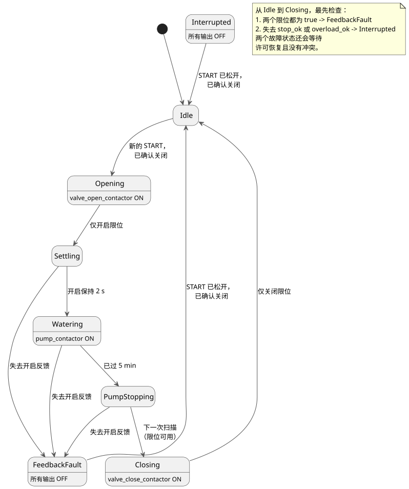

<!-- translation-source: examples/curriculum/pc-09-sequential-water-supply.ghost.en.md -->
[英文原文](pc-09-sequential-water-supply.ghost.en.md)
> 本文为阅读用译本。编译时请使用链接的原始 `.ghost.md` 文件：[韩文原文](pc-09-sequential-water-supply.ghost.md)。

# PC-09 — 阀门与泵的顺序供水

<!-- ghostflow:anchor id=GF-INT-PC09-SEQUENTIAL-WATERING-V1 kind=intent status=confirmed origin=imported -->
> 学习场景：在运行泵之前确认阀门已经打开。浇水时间结束时，先停泵，再关阀。将输出命令与设备的物理位置区分开来。

链接的韩文 `.ghost.md` 文件是 PC-09 唯一的规范、可执行的文学式源文件（literate source）。它保留了两个教程，并与之进行比较：

- [tutorial/02 基于时间的顺序控制](../tutorial/02-watering.ghost.zh.md) 是一个仅凭时间在各阶段之间推进的基础示例。
- [tutorial/04 共享泵](../tutorial/04-extra-valves.ghost.zh.md) 讨论的是另一个问题：多个 `control` 共享一台泵时的仲裁。

本课不取代其中任何一个。在单个浇水序列内，它加入了阀门位置反馈，以及“先停泵，再关阀”的规则。

## 意图与规范化

操作员可能会这样说：“开始浇水时，打开阀门。确认阀门打开后，让泵运行五分钟。然后先停泵，再关阀。”GhostFlow 把这一要求转化为精确的规则（即对其进行*规范化*）：

- **新的启动。** `start_request` 是一次新浇水运行的瞬时请求。只有在阀门已确认关闭，**并且**某次稳定的扫描看到请求已松开之后，它才会被接受。此后的新一次按下才会启动运行。
- **位置来自反馈。** `open_limit` 和 `close_limit` 观测设备的位置。仅有通电的接触器输出并不意味着阀门真的移动了。
- **先稳定，再浇水。** 阀门打开后，开启反馈必须保持为 true 达 `settle_delay`（2 s），泵才会启动。随后泵运行 `watering_time`（5 min）。
- **先停泵，再关阀。** 在浇水时间到期的那次扫描中，泵关闭，阶段变为 `PumpStopping`，所有输出关闭。下一次扫描从 `PumpStopping` 转到 `Closing`（如果限位可用），此时阀门关闭命令才会开启。
- **故障停止一切。** 如果失去 `stop_ok` 或 `overload_ok`，阶段立即变为 `Interrupted`。如果两个限位都为 true，`FeedbackFault` 优先。所有输出关闭。仅仅恢复条件不会重新启动运行。

## GhostFlow 源代码

**输入质量。** 本修订版读取每个输入的生产者所报告的质量。它不诊断物理按钮故障。

- 健康的 `false`（Good(false)）是正常观测。
- 未知的请求既不算作新请求，也不算作松开。未知的限位既不能确立位置，也不能确立冲突。
- 现有的浇水截止时间仍然会停泵。
- 在 `PumpStopping` 中，限位不可用时推迟关阀，所有输出保持关闭。
- 在 `Closing` 中，限位不可用时阶段保持 `Closing`，但关闭命令被阻止。如果健康的关闭反馈恢复，序列在 `Idle` 结束；其他健康且无冲突的反馈则让关阀继续进行。
- 本课不加入开阀或关阀超时。
- 保护许可需要明确的 Good(true)。
- 不新增 START 输入，也不新增全局重启策略。

```ghost
// Source revision: issue531-producer-quality-pc09-v1
control SequentialWaterSupply {
  input start_request, open_limit, close_limit, stop_ok, overload_ok: Bool;
  output valve_open_contactor, valve_close_contactor, pump_contactor: Bool;

  let start_request_true = case start_request { ok(value) => value; fault(_) => false; };
  let start_request_false = case start_request { ok(value) => !value; fault(_) => false; };
  let open_limit_true = case open_limit { ok(value) => value; fault(_) => false; };
  let open_limit_false = case open_limit { ok(value) => !value; fault(_) => false; };
  let close_limit_true = case close_limit { ok(value) => value; fault(_) => false; };
  let close_limit_false = case close_limit { ok(value) => !value; fault(_) => false; };
  let stop_ok_true = case stop_ok { ok(value) => value; fault(_) => false; };
  let stop_ok_false = case stop_ok { ok(value) => !value; fault(_) => false; };
  let overload_ok_true = case overload_ok { ok(value) => value; fault(_) => false; };
  let overload_ok_false = case overload_ok { ok(value) => !value; fault(_) => false; };
  let limits_good = case open_limit { ok(_) => case close_limit { ok(_) => true; fault(_) => false; }; fault(_) => false; };

  let settle_delay = 2s;
  let watering_time = 5min;

  type Phase = Idle | Opening | Settling | Watering | PumpStopping | Closing | FeedbackFault | Interrupted;
  // ghostflow:link id=GF-INT-PC09-SEQUENTIAL-WATERING-V1 relation=implements
  state phase: Phase = Idle;
  // ghostflow:link id=GF-INT-PC09-SEQUENTIAL-WATERING-V1 relation=implements
  state request_armed: Bool = false;
  // ghostflow:link id=GF-INT-PC09-SEQUENTIAL-WATERING-V1 relation=implements
  timer age = elapsed(phase);

  let permit = stop_ok_true && overload_ok_true;
  let conflict = open_limit_true && close_limit_true;
  let known_closed = close_limit_true && open_limit_false;
  let start_event = request_armed && start_request_true;

  request_armed' = phase == Idle && permit && !conflict && known_closed && start_request_false;

  phase' = case phase {
    Idle =>
      if conflict then FeedbackFault
      else if !permit then Interrupted
      else if start_event && known_closed then Opening
      else Idle;

    Opening =>
      if conflict then FeedbackFault
      else if !permit then Interrupted
      else if open_limit_true && close_limit_false then Settling
      else Opening;

    Settling =>
      if conflict then FeedbackFault
      else if !permit then Interrupted
      else if limits_good && (open_limit_false || close_limit_true) then FeedbackFault
      else if limits_good && age >= settle_delay then Watering
      else Settling;

    Watering =>
      if conflict then FeedbackFault
      else if !permit then Interrupted
      else if limits_good && (open_limit_false || close_limit_true) then FeedbackFault
      else if age >= watering_time then PumpStopping
      else Watering;

    PumpStopping =>
      if conflict then FeedbackFault
      else if !permit then Interrupted
      else if limits_good && (open_limit_false || close_limit_true) then FeedbackFault
      else if limits_good then Closing
      else PumpStopping;

    Closing =>
      if conflict then FeedbackFault
      else if !permit then Interrupted
      else if close_limit_true && open_limit_false then Idle
      else Closing;

    FeedbackFault =>
      if conflict || !permit then FeedbackFault
      else if start_request_false && known_closed then Idle
      else FeedbackFault;

    Interrupted =>
      if conflict || !permit then Interrupted
      else if start_request_false && known_closed then Idle
      else Interrupted;
  };

  valve_open_contactor <- phase' == Opening;
  valve_close_contactor <- phase' == Closing && limits_good;
  pump_contactor <- phase' == Watering;
  mutex(valve_open_contactor, valve_close_contactor);
}
```

下面的状态图展示了正常序列和故障路径。注释列出了最先执行的检查。



**命令与位置。** `Opening`、`Settling`、`Watering`、`PumpStopping` 和 `Closing` 是逻辑阶段。`valve_open_contactor` 和 `valve_close_contactor` 是发送给各自接触器的命令。`open_limit` 和 `close_limit` 报告观测到的物理位置。因此，如果 `control` 长时间停留在 `Opening`，这意味着两件事：开启命令仍在被请求，并且开启尚未得到确认。它并不保证阀门真的移动了。

**与教程的比较。** 在 tutorial/02 仅基于时间的序列中，时间一到就开始下一阶段。在 PC-09 中，启动泵还需要开启位置反馈和一段稳定间隔。tutorial/04 的共享泵展示了另一种需求：多个 `control` 请求同一输出时的全局仲裁。在本课中，`pump_contactor` 属于一个顺序 `control`。本课并不声称解决了与其他 `control` 之间的仲裁问题。

**已知缺口：没有超时。** 如果反馈始终没有到达，本课会停留在 `Opening` 或 `Closing`。超时、故障锁存、报警、复位以及故障后安全关阀的策略在 PC-10 中讲解。`mutex` 和逻辑输出不能取代硬件互锁、急停或过载保护。

## 验证边界

`tools/check-pc-09.mjs` 为每个场景创建一个新的 WASM `ControlRuntime`，不会重新构建现有的 WASM 制品。它检查 `stateBefore`、`stateAfter`、`requested`、`safe`，以及 `nowMs` 从不减小。PASS 表示编译器/WASM 的虚拟追踪符合预期。它不是接触器吸合、阀门移动、泵转动或水流的物理证据。
