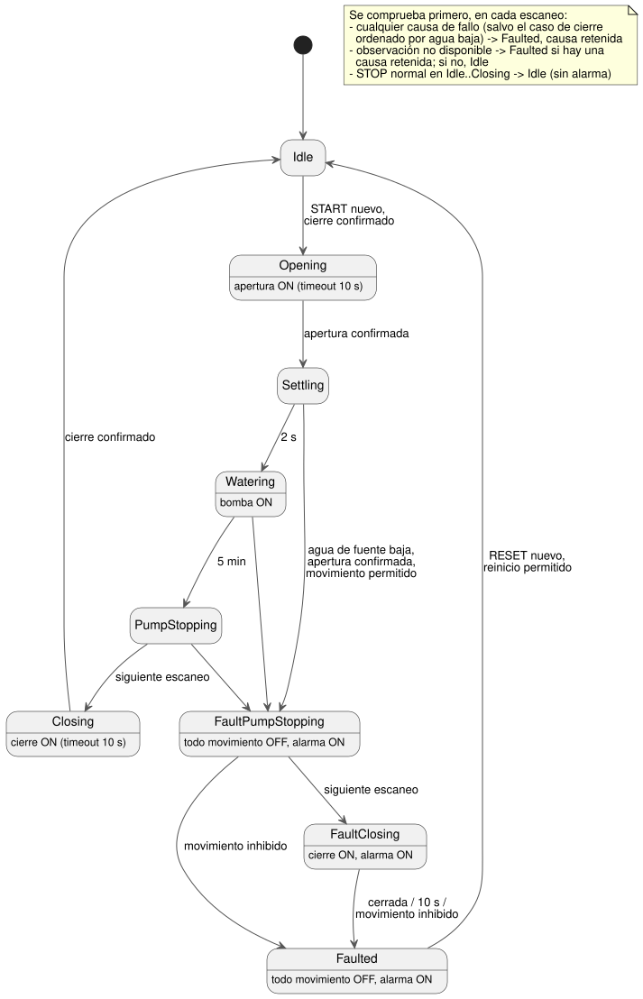

<!-- translation-source: examples/curriculum/pc-10-fault-alarm-reset.ghost.en.md -->
[Original en inglés](pc-10-fault-alarm-reset.ghost.en.md)

> Traducción de lectura. Para compilar, use el archivo original `.ghost.md`
> enlazado: [original en coreano](pc-10-fault-alarm-reset.ghost.md).

# PC-10 — Suministro de agua secuencial con fallo, alarma y reinicio

<!-- ghostflow:anchor id=GF-INT-PC10-FAULT-ALARM-RESET-V1 kind=intent status=confirmed origin=imported -->
> Escenario de aprendizaje: abrir la válvula y confirmarla antes de hacer
> funcionar la bomba. Un STOP normal detiene sin fallo. Una observación de parada
> de emergencia, una sobrecarga, un conflicto de sensores, la pérdida de
> retroalimentación, un accionamiento de válvula no disponible o un timeout de
> movimiento retienen su causa y detienen de forma segura. El agua de fuente
> baja es un caso especial: solo cuando la válvula está confirmada como abierta
> puede la bomba detenerse primero y la válvula cerrarse después.

El archivo `.ghost.md` en coreano enlazado es la única fuente literaria
(literate) canónica y ejecutable de PC-10. Dos lecciones anteriores se mantienen
tal cual:
[PC-09, suministro de agua secuencial con válvula y bomba](pc-09-sequential-water-supply.ghost.es.md)
conserva la secuencia normal y la retroalimentación, y
[PC-05, retroalimentación de final de carrera](pc-05-limit-feedback.ghost.es.md) conserva las
observaciones de posición de la válvula. Esta lección no sustituye a ninguna.
Añade un timeout, la retención (latch) de la causa del fallo, una alarma y
reglas de reinicio.

Términos clave que se usan a continuación:

- **Latch (retención)**: recordar un valor (aquí, la primera causa de fallo)
  hasta que un reinicio explícito lo borre, aunque la entrada en vivo vuelva a
  cambiar.
- **Salidas de movimiento**: las tres salidas que mueven el equipo:
  `valve_open_contactor`, `valve_close_contactor` y `pump_contactor`.
- **Pulsación nueva**: un botón que se ha visto soltado y luego se vuelve a
  pulsar. Mantener pulsado un botón nunca cuenta dos veces.

## E/S de aprendizaje y el primer presupuesto del armario de control

Este ejemplo **no es un esquema de cableado ni un contrato de firmware que pueda
asignarse uno a uno a un primer dispositivo de 8 DI (entradas digitales).** Es
una interfaz de aprendizaje independiente. Sus entradas se separan por
significado para que se pueda seguir la intención de control.

```text
Entradas (9 Bool)
  start_request, reset_request, stop_ok, emergency_stop_ok, overload_ok,
  source_water_ok, valve_drive_ok, open_limit, close_limit

Salidas (4 Bool)
  valve_open_contactor, valve_close_contactor, pump_contactor, alarm
```

**Presupuesto de señales para un armario completo.** Un armario de control de
riego completo típico ya tiene **ocho** señales: `START`, `STOP`, `MODE`, tanque
bajo, tanque alto, final de carrera de apertura, final de carrera de cierre y
sobrecarga. Necesita **tres** más: `RESET`, una observación del estado de la
parada de emergencia y agua de fuente baja. Separar `valve_drive_ok` da **12
significados** en total. Las nueve entradas de este ejemplo son los
significados que PC-10 necesita para su comportamiento de seguridad. `MODE` y
los límites superior/inferior del tanque pertenecen a PC-08 y PC-07; no se
fusionan aquí de forma engañosa.

Cada instalación real debe elegir una de las siguientes opciones. Esa elección
todavía no se ha hecho para ninguna instalación concreta.

- Combinar varias causas en una cadena de seguridad externa. Sin embargo, sin
  observaciones separadas, GhostFlow no puede informar de cada causa por
  separado.
- Enviar START/MODE/RESET como comandos de host autenticados, y mantener STOP y
  el circuito de seguridad físico como señales cableadas.
- Añadir más DI para que cada causa se observe directamente.

La parada de emergencia es una **cadena de seguridad cableada externa** que
corta la energía. `emergency_stop_ok` solo observa su estado. Ni las salidas de
GhostFlow ni la alarma garantizan que se corte la energía del contactor.

## Intención y reglas de seguridad establecidas

- **Un STOP normal no es un fallo.** Cuando `stop_ok == false`, el control
  vuelve a `Idle` de inmediato, con todas las salidas de movimiento del MCU
  apagadas y la alarma apagada. Para volver a funcionar, la posición cerrada
  debe confirmarse externamente, y START debe soltarse y volver a pulsarse.
  Nunca rearranca automáticamente.
- **Se retiene la primera causa.** `FaultCause` retiene la primera causa. Si
  ocurren varias causas en el mismo escaneo, la causa se elige en este orden:
  `EmergencyStop > Overload > ValveDriveUnavailable > SensorConflict > FeedbackLost > OpenTimeout/CloseTimeout > LowSourceWater`.
  Los cambios posteriores en las entradas en vivo no cambian la causa retenida.
  La condición actual que impide el cierre se puede seguir viendo por separado
  en la traza.
- **Timeout de movimiento.** `Opening` y `Closing` vencen cada uno tras 10
  segundos. Si el final de carrera de destino se observa en el escaneo de
  exactamente 10 segundos, el final de carrera prevalece sobre el timeout. El
  control nunca salta varios estados en un solo escaneo.
- **Cierre ordenado solo por agua de fuente baja.** Solo `LowSourceWater`
  permite un cierre ordenado y condicional. Se aplica cuando la posición
  abierta ya está confirmada y las condiciones de STOP, parada de emergencia,
  sobrecarga, accionamiento de válvula y sensores permiten cerrar. Entonces el
  control:
  1. apaga todas las salidas de movimiento durante un escaneo lógico en `FaultPumpStopping`;
  2. ordena el cierre solo en `FaultClosing`.

  En caso contrario, pasa directamente a `Faulted` con todo apagado.
  `FaultClosing` termina cuando se ve el final de carrera de cierre, vence el
  timeout de cierre o se inhibe el movimiento. La causa original del fallo se
  conserva en todos los casos.
- **El reinicio exige una planta despejada y una pulsación nueva.** El reinicio
  se permite solo cuando la causa retenida **y** todas las condiciones de fallo
  actuales están despejadas, y `known_closed` es true. Una vez que se cumplen
  esas condiciones, RESET debe soltarse y volver a pulsarse. Mantener RESET
  pulsado mientras se despejan las condiciones no reinicia. El reinicio solo
  vuelve a `Idle`/OFF; no sustituye a START.

El diagrama de estados siguiente muestra la secuencia normal, el cierre ordenado
por agua baja y el camino de reinicio. La nota enumera las comprobaciones que se
ejecutan primero en cada escaneo.



## Fuente GhostFlow

**Calidad de las entradas.** Esta revisión lee la calidad que informa el
productor de cada entrada. No diagnostica fallos físicos de los botones.

- Un `false` sano (Good(false)) es una observación normal.
- Las observaciones desconocidas de permiso de movimiento o de posición no
  permiten ningún movimiento, ningún cierre condicional por fallo, ningún
  reinicio y ningún rearme de solicitudes.
- Una causa de fallo existente sigue retenida. Si no hay causa de fallo, se usa
  el camino existente `Idle`/OFF.
- Solo las observaciones conocidas pueden fijar las etiquetas de causa de las
  condiciones físicas. Sin embargo, si la posición de destino sigue sin
  confirmarse en el plazo estricto existente, todavía se puede fijar
  `OpenTimeout` o `CloseTimeout`.
- No se añade ninguna entrada START nueva ni ninguna política global de
  rearranque.

```ghost
// Source revision: issue531-producer-quality-pc10-v1
control FaultAlarmResetWaterSupply {
  input start_request, reset_request, stop_ok, emergency_stop_ok, overload_ok,
    source_water_ok, valve_drive_ok, open_limit, close_limit: Bool;
  output valve_open_contactor, valve_close_contactor, pump_contactor, alarm: Bool;

  let start_request_true = start_request |> recover(false);
  let start_request_false = !(start_request |> recover(true));
  let reset_request_true = reset_request |> recover(false);
  let reset_request_false = !(reset_request |> recover(true));
  let stop_ok_true = stop_ok |> recover(false);
  let stop_ok_false = !(stop_ok |> recover(true));
  let emergency_stop_ok_true = emergency_stop_ok |> recover(false);
  let emergency_stop_ok_false = !(emergency_stop_ok |> recover(true));
  let overload_ok_true = overload_ok |> recover(false);
  let overload_ok_false = !(overload_ok |> recover(true));
  let source_water_ok_true = source_water_ok |> recover(false);
  let source_water_ok_false = !(source_water_ok |> recover(true));
  let valve_drive_ok_true = valve_drive_ok |> recover(false);
  let valve_drive_ok_false = !(valve_drive_ok |> recover(true));
  let open_limit_true = open_limit |> recover(false);
  let open_limit_false = !(open_limit |> recover(true));
  let close_limit_true = close_limit |> recover(false);
  let close_limit_false = !(close_limit |> recover(true));
  let stop_ok_good = case stop_ok { ok(_) => true; fault(_) => false; };
  let emergency_stop_ok_good = case emergency_stop_ok { ok(_) => true; fault(_) => false; };
  let overload_ok_good = case overload_ok { ok(_) => true; fault(_) => false; };
  let source_water_ok_good = case source_water_ok { ok(_) => true; fault(_) => false; };
  let valve_drive_ok_good = case valve_drive_ok { ok(_) => true; fault(_) => false; };
  let open_limit_good = case open_limit { ok(_) => true; fault(_) => false; };
  let close_limit_good = case close_limit { ok(_) => true; fault(_) => false; };
  let motion_observations_good = stop_ok_good && emergency_stop_ok_good && overload_ok_good && source_water_ok_good && valve_drive_ok_good && open_limit_good && close_limit_good;

  let settle_delay = 2s;
  let watering_time = 5min;
  let opening_timeout = 10s;
  let closing_timeout = 10s;

  type Phase = Idle | Opening | Settling | Watering | PumpStopping | Closing |
    FaultPumpStopping | FaultClosing | Faulted;
  type FaultCause = None | EmergencyStop | Overload | LowSourceWater |
    ValveDriveUnavailable | SensorConflict | FeedbackLost | OpenTimeout | CloseTimeout;

  // ghostflow:link id=GF-INT-PC10-FAULT-ALARM-RESET-V1 relation=implements
  state phase: Phase = Idle;
  // ghostflow:link id=GF-INT-PC10-FAULT-ALARM-RESET-V1 relation=implements
  state fault_cause: FaultCause = None;
  // ghostflow:link id=GF-INT-PC10-FAULT-ALARM-RESET-V1 relation=implements
  state request_armed: Bool = false;
  // ghostflow:link id=GF-INT-PC10-FAULT-ALARM-RESET-V1 relation=implements
  state reset_armed: Bool = false;
  // ghostflow:link id=GF-INT-PC10-FAULT-ALARM-RESET-V1 relation=implements
  timer age = elapsed(phase);

  let normal_permit = stop_ok_true && emergency_stop_ok_true && overload_ok_true && source_water_ok_true && valve_drive_ok_true;
  let fault_motion_permit = stop_ok_true && emergency_stop_ok_true && overload_ok_true && valve_drive_ok_true;
  let conflict = open_limit_true && close_limit_true;
  let known_closed = close_limit_true && open_limit_false;
  let known_open = open_limit_true && close_limit_false;
  let start_event = request_armed && start_request_true;
  let reset_event = reset_armed && reset_request_true;
  let fault_cleared = case fault_cause {
    None => true;
    EmergencyStop => emergency_stop_ok_true;
    Overload => overload_ok_true;
    LowSourceWater => source_water_ok_true;
    ValveDriveUnavailable => valve_drive_ok_true;
    SensorConflict => !conflict;
    FeedbackLost => known_closed;
    OpenTimeout => known_closed;
    CloseTimeout => known_closed;
  };
  let fault_free_now = emergency_stop_ok_true && overload_ok_true && source_water_ok_true &&
    valve_drive_ok_true && !conflict;
  // Every FaultCause-specific clear condition is implied by fault_free_now and known_closed.
  let reset_allowed = stop_ok_good && fault_cause != None && fault_free_now && known_closed;
  let immediate_cause =
    if emergency_stop_ok_false then EmergencyStop
    else if overload_ok_false then Overload
    else if valve_drive_ok_false then ValveDriveUnavailable
    else if conflict then SensorConflict
    else if phase in {Settling, Watering, PumpStopping} && open_limit_good && close_limit_good && !known_open then FeedbackLost
    else if phase == Opening && !open_limit_true && age >= opening_timeout then OpenTimeout
    else if phase == Closing && !close_limit_true && age >= closing_timeout then CloseTimeout
    else if source_water_ok_false && phase in {Idle, Opening, Settling, Watering, PumpStopping} then LowSourceWater
    else None;

  let any_immediate_cause = emergency_stop_ok_false || overload_ok_false || valve_drive_ok_false || conflict ||
    (phase in {Settling, Watering, PumpStopping} && open_limit_good && close_limit_good && !known_open) ||
    (phase == Opening && !open_limit_true && age >= opening_timeout) ||
    (phase == Closing && !close_limit_true && age >= closing_timeout) ||
    (source_water_ok_false && phase in {Idle, Opening, Settling, Watering, PumpStopping});

  request_armed' = phase == Idle && fault_cause == None && normal_permit && !conflict && known_closed && start_request_false;
  reset_armed' = phase == Faulted && reset_allowed && reset_request_false;
  fault_cause' =
    if phase == Faulted && reset_event && reset_allowed then None
    else if fault_cause != None then fault_cause
    else immediate_cause;

  phase' = if source_water_ok_false && phase in {Settling, Watering, PumpStopping} && known_open && fault_motion_permit then FaultPumpStopping
    else if any_immediate_cause then Faulted
    else if !motion_observations_good then if fault_cause != None then Faulted else Idle
    else if phase in {Idle, Opening, Settling, Watering, PumpStopping, Closing} && stop_ok_false then Idle
    else case phase {
    Idle =>
      if start_event && known_closed then Opening
      else Idle;

    Opening =>
      if known_open then Settling
      else Opening;

    Settling =>
      if age >= settle_delay then Watering
      else Settling;

    Watering =>
      if age >= watering_time then PumpStopping
      else Watering;

    PumpStopping =>
      Closing;

    Closing =>
      if known_closed then Idle
      else Closing;

    FaultPumpStopping =>
      if !fault_motion_permit || conflict then Faulted
      else FaultClosing;

    FaultClosing =>
      if !fault_motion_permit || conflict then Faulted
      else if known_closed then Faulted
      else if age >= closing_timeout then Faulted
      else FaultClosing;

    Faulted =>
      if reset_event && reset_allowed then Idle
      else Faulted;
  };

  // Exact next-phase projections avoid expanding the full phase decision once per output.
  let transition_permitted = !any_immediate_cause && motion_observations_good &&
    !(phase in {Idle, Opening, Settling, Watering, PumpStopping, Closing} && stop_ok_false);
  let next_open = transition_permitted &&
    ((phase == Idle && start_event && known_closed) || (phase == Opening && !known_open));
  let next_close = transition_permitted &&
    (phase == PumpStopping || (phase == Closing && !known_closed) ||
      (phase == FaultPumpStopping && fault_motion_permit && !conflict) ||
      (phase == FaultClosing && fault_motion_permit && !conflict && !known_closed && age < closing_timeout));
  let next_pump = transition_permitted &&
    ((phase == Settling && age >= settle_delay) || (phase == Watering && age < watering_time));
  let next_alarm = if any_immediate_cause then true
    else if !motion_observations_good then fault_cause != None
    else if phase in {FaultPumpStopping, FaultClosing} then true
    else if phase == Faulted then !(reset_event && reset_allowed)
    else false;

  valve_open_contactor <- next_open;
  valve_close_contactor <- next_close;
  pump_contactor <- next_pump;
  alarm <- next_alarm;
  mutex(valve_open_contactor, valve_close_contactor);
  require !(pump_contactor && valve_open_contactor);
  require !(pump_contactor && valve_close_contactor);
}
```

**Cómo leer las salidas de fallo.** En `FaultPumpStopping`, la alarma ya está
activa, lo que indica que la causa se ha notificado. Las tres salidas de
movimiento están apagadas durante un escaneo lógico, de modo que la bomba se
detiene antes de que se cierre la válvula. El comando de cierre en
`FaultClosing` es solo una solicitud de software. No afirma que la cadena
cableada de parada de emergencia haya cortado la energía ni que la válvula se
haya movido físicamente.

## Límite de la verificación

`tools/check-pc-10.mjs` crea un `ControlRuntime` nuevo para cada escenario y no
recompila el artefacto WASM existente. Un PASS de la traza del compilador/WASM
demuestra que el cálculo virtual de estados y salidas de GhostFlow coincide con
lo esperado. La UX web, la carga al MCU, el cierre del contactor, el movimiento
de la válvula, la rotación de la bomba, el caudal y la aceptación física de la
cadena de seguridad externa quedan fuera de este ejemplo y de su verificador.
