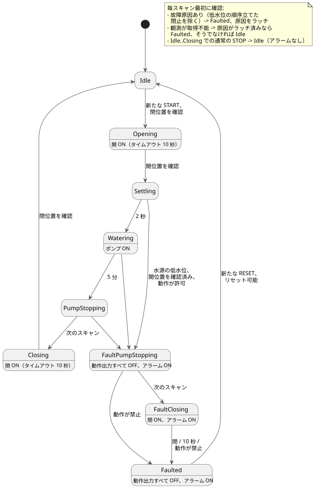

<!-- translation-source: examples/curriculum/pc-10-fault-alarm-reset.ghost.en.md -->
[英語の原文](pc-10-fault-alarm-reset.ghost.en.md)
> 閲覧用の翻訳です。コンパイルには、リンク先の韓国語の原本 [`pc-10-fault-alarm-reset.ghost.md`](pc-10-fault-alarm-reset.ghost.md) を使用してください。

# PC-10 — 故障・アラーム・リセット付きの順次給水

<!-- ghostflow:anchor id=GF-INT-PC10-FAULT-ALARM-RESET-V1 kind=intent status=confirmed origin=imported -->
> 学習シナリオ：バルブを開き、それを確認してからポンプを運転します。通常の STOP は故障なしで停止します。非常停止の観測、過負荷、センサの競合、フィードバックの喪失、バルブ駆動の利用不能、移動のタイムアウトは、その原因をラッチして安全に停止します。水源の低水位は特別な場合です。バルブが開いていることが確認されているときに限り、先にポンプを停止し、その後にバルブを閉じてもかまいません。

リンク先の韓国語の `.ghost.md` ファイルが、PC-10 の唯一の正本であり、実行可能な文芸的ソース（literate source）です。2 つの既存レッスンはそのまま残します。[PC-09 バルブ/ポンプの順次給水](pc-09-sequential-water-supply.ghost.ja.md) は通常のシーケンスとフィードバックを、[PC-05 リミットフィードバック](pc-05-limit-feedback.ghost.ja.md) はバルブ位置の観測を、それぞれ引き続き担います。このレッスンはどちらも置き換えません。タイムアウト、故障原因のラッチ、アラーム、リセットの規則を追加します。

以下で使う主な用語：

- **ラッチ（latch）** — 値（ここでは最初の故障原因）を、明示的なリセットで消去されるまで記憶しておくことです。ライブの入力が元に戻っても記憶し続けます。
- **動作出力** — 機器を動かす 3 つの出力、`valve_open_contactor`、`valve_close_contactor`、`pump_contactor` のことです。
- **新たな押下** — 離されたことが確認された後に、再び押されたボタンのことです。ボタンを押し続けても、2 回数えられることは決してありません。

## 学習用の入出力と最初の制御盤の予算

この例は、**最初の 8-DI（デジタル入力）デバイスに一対一で対応付けられる配線図やファームウェア契約ではありません。** 独立した学習用インタフェースです。制御の意図を追えるよう、入力は意味ごとに分けてあります。

```text
入力 (Bool × 9)
  start_request, reset_request, stop_ok, emergency_stop_ok, overload_ok,
  source_water_ok, valve_drive_ok, open_limit, close_limit

出力 (Bool × 4)
  valve_open_contactor, valve_close_contactor, pump_contactor, alarm
```

**完全な制御盤の信号予算。** 一般的な完全な灌水制御盤には、すでに**8 個**の信号があります。`START`、`STOP`、`MODE`、タンク低水位、タンク高水位、開リミット、閉リミット、過負荷です。さらに**3 個**、`RESET`、非常停止の状態観測、水源の低水位が必要です。`valve_drive_ok` を分けると、合計で**12 個の意味**になります。この例の 9 個の入力は、PC-10 が安全上の振る舞いのために必要とする意味です。`MODE` とタンクの上限/下限は PC-08 と PC-07 に属し、ここに誤って統合されてはいません。

実際の設備ごとに、次のいずれかを選ばなければなりません。特定の設備について、その選択はまだ行われていません。

- 外部の安全チェーンで複数の原因をまとめる。ただし、個別の観測がなければ、GhostFlow は原因を個別に報告できません。
- START/MODE/RESET を認証済みのホストコマンドとして送り、STOP と物理的な安全回路は配線された信号のままにする。
- DI を増やし、各原因を直接観測する。

非常停止は、エネルギーを遮断する**外部のハードワイヤード安全チェーン**です。`emergency_stop_ok` はその状態を観測するだけです。GhostFlow の出力もアラームも、接触器のエネルギーが遮断されることを保証しません。

## 意図と確定した安全規則

- **通常の STOP は故障ではありません。** `stop_ok == false` のとき、`control` は直ちに `Idle` へ戻り、MCU の動作出力はすべてオフ、アラームもオフになります。再び運転するには、閉位置が外部で確認され、START が離されてから再び押されなければなりません。自動で再起動することは決してありません。
- **最初の原因をラッチします。** `FaultCause` は最初の原因をラッチします。同じスキャンで複数の原因が発生した場合は、次の順序で原因を選びます：
  `EmergencyStop > Overload > ValveDriveUnavailable > SensorConflict > FeedbackLost > OpenTimeout/CloseTimeout > LowSourceWater`。
  その後ライブの入力が変わっても、ラッチされた原因は変わりません。閉止を妨げている現在の条件は、トレースで別途確認できます。
- **移動のタイムアウト。** `Opening` と `Closing` は、それぞれ 10 秒でタイムアウトします。ちょうど 10 秒のスキャンで目標のリミットが観測された場合は、タイムアウトよりリミットが優先されます。`control` が 1 回のスキャンで複数の状態を飛び越えることは決してありません。
- **順序立てた閉止は水源の低水位の場合だけ。** 条件付きの順序立てた閉止が許されるのは `LowSourceWater` だけです。これは、開位置がすでに確認されており、STOP、非常停止、過負荷、バルブ駆動、センサの各条件がすべて閉止を許す場合に適用されます。このとき `control` は次のように動作します。
  1. `FaultPumpStopping` で 1 論理スキャンの間、すべての動作出力をオフにします。
  2. `FaultClosing` でのみ閉止をコマンドします。

  それ以外の場合は、すべてオフのまま直ちに `Faulted` へ移ります。`FaultClosing` は、閉リミットが観測されたとき、閉止のタイムアウトが満了したとき、または動作が禁止されたときに終了します。どの場合も、元の故障原因は保持されます。
- **リセットには、正常なプラントと新たな押下が必要です。** リセットが許されるのは、ラッチされた原因**と**現在のすべての故障条件が解消し、かつ `known_closed` が true のときだけです。これらの条件が成り立ったら、RESET を離してから再び押さなければなりません。条件が解消する間ずっと RESET を押し続けていても、リセットはされません。リセットは `Idle`/OFF に戻るだけで、START の代わりにはなりません。

次の状態図は、通常のシーケンス、低水位時の順序立てた閉止、リセットの経路を示しています。注記には、毎スキャン最初に実行される確認を列挙しています。



## GhostFlow ソース

**入力品質。** このリビジョンでは、各入力の producer が報告する品質を読み取ります。物理的なボタンの故障は診断しません。

- 正常な `false`（Good(false)）は通常の観測です。
- 動作の許可や位置の観測が不明な場合は、動作、条件付きの故障時閉止、リセット、要求の再アームのいずれも許されません。
- 既存の故障原因はラッチされたままです。故障原因がない場合は、既存の `Idle`/OFF の経路を使います。
- 物理的な条件に対する原因ラベルを設定できるのは、既知の観測だけです。ただし、既存の絶対的な期限の時点で目標位置がまだ確認されていない場合は、`OpenTimeout` または `CloseTimeout` が設定されることがあります。
- 新しい START 入力や全体的な再起動ポリシーは追加しません。

```ghost
// Source revision: issue531-producer-quality-pc10-v1
control FaultAlarmResetWaterSupply {
  input start_request, reset_request, stop_ok, emergency_stop_ok, overload_ok,
    source_water_ok, valve_drive_ok, open_limit, close_limit: Bool;
  output valve_open_contactor, valve_close_contactor, pump_contactor, alarm: Bool;

  let start_request_true = start_request |> recover(false);
  let start_request_false = !(start_request |> recover(true));
  let reset_request_true = reset_request |> recover(false);
  let reset_request_false = !(reset_request |> recover(true));
  let stop_ok_true = stop_ok |> recover(false);
  let stop_ok_false = !(stop_ok |> recover(true));
  let emergency_stop_ok_true = emergency_stop_ok |> recover(false);
  let emergency_stop_ok_false = !(emergency_stop_ok |> recover(true));
  let overload_ok_true = overload_ok |> recover(false);
  let overload_ok_false = !(overload_ok |> recover(true));
  let source_water_ok_true = source_water_ok |> recover(false);
  let source_water_ok_false = !(source_water_ok |> recover(true));
  let valve_drive_ok_true = valve_drive_ok |> recover(false);
  let valve_drive_ok_false = !(valve_drive_ok |> recover(true));
  let open_limit_true = open_limit |> recover(false);
  let open_limit_false = !(open_limit |> recover(true));
  let close_limit_true = close_limit |> recover(false);
  let close_limit_false = !(close_limit |> recover(true));
  let stop_ok_good = case stop_ok { ok(_) => true; fault(_) => false; };
  let emergency_stop_ok_good = case emergency_stop_ok { ok(_) => true; fault(_) => false; };
  let overload_ok_good = case overload_ok { ok(_) => true; fault(_) => false; };
  let source_water_ok_good = case source_water_ok { ok(_) => true; fault(_) => false; };
  let valve_drive_ok_good = case valve_drive_ok { ok(_) => true; fault(_) => false; };
  let open_limit_good = case open_limit { ok(_) => true; fault(_) => false; };
  let close_limit_good = case close_limit { ok(_) => true; fault(_) => false; };
  let motion_observations_good = stop_ok_good && emergency_stop_ok_good && overload_ok_good && source_water_ok_good && valve_drive_ok_good && open_limit_good && close_limit_good;

  let settle_delay = 2s;
  let watering_time = 5min;
  let opening_timeout = 10s;
  let closing_timeout = 10s;

  type Phase = Idle | Opening | Settling | Watering | PumpStopping | Closing |
    FaultPumpStopping | FaultClosing | Faulted;
  type FaultCause = None | EmergencyStop | Overload | LowSourceWater |
    ValveDriveUnavailable | SensorConflict | FeedbackLost | OpenTimeout | CloseTimeout;

  // ghostflow:link id=GF-INT-PC10-FAULT-ALARM-RESET-V1 relation=implements
  state phase: Phase = Idle;
  // ghostflow:link id=GF-INT-PC10-FAULT-ALARM-RESET-V1 relation=implements
  state fault_cause: FaultCause = None;
  // ghostflow:link id=GF-INT-PC10-FAULT-ALARM-RESET-V1 relation=implements
  state request_armed: Bool = false;
  // ghostflow:link id=GF-INT-PC10-FAULT-ALARM-RESET-V1 relation=implements
  state reset_armed: Bool = false;
  // ghostflow:link id=GF-INT-PC10-FAULT-ALARM-RESET-V1 relation=implements
  timer age = elapsed(phase);

  let normal_permit = stop_ok_true && emergency_stop_ok_true && overload_ok_true && source_water_ok_true && valve_drive_ok_true;
  let fault_motion_permit = stop_ok_true && emergency_stop_ok_true && overload_ok_true && valve_drive_ok_true;
  let conflict = open_limit_true && close_limit_true;
  let known_closed = close_limit_true && open_limit_false;
  let known_open = open_limit_true && close_limit_false;
  let start_event = request_armed && start_request_true;
  let reset_event = reset_armed && reset_request_true;
  let fault_cleared = case fault_cause {
    None => true;
    EmergencyStop => emergency_stop_ok_true;
    Overload => overload_ok_true;
    LowSourceWater => source_water_ok_true;
    ValveDriveUnavailable => valve_drive_ok_true;
    SensorConflict => !conflict;
    FeedbackLost => known_closed;
    OpenTimeout => known_closed;
    CloseTimeout => known_closed;
  };
  let fault_free_now = emergency_stop_ok_true && overload_ok_true && source_water_ok_true &&
    valve_drive_ok_true && !conflict;
  // Every FaultCause-specific clear condition is implied by fault_free_now and known_closed.
  let reset_allowed = stop_ok_good && fault_cause != None && fault_free_now && known_closed;
  let immediate_cause =
    if emergency_stop_ok_false then EmergencyStop
    else if overload_ok_false then Overload
    else if valve_drive_ok_false then ValveDriveUnavailable
    else if conflict then SensorConflict
    else if phase in {Settling, Watering, PumpStopping} && open_limit_good && close_limit_good && !known_open then FeedbackLost
    else if phase == Opening && !open_limit_true && age >= opening_timeout then OpenTimeout
    else if phase == Closing && !close_limit_true && age >= closing_timeout then CloseTimeout
    else if source_water_ok_false && phase in {Idle, Opening, Settling, Watering, PumpStopping} then LowSourceWater
    else None;

  let any_immediate_cause = emergency_stop_ok_false || overload_ok_false || valve_drive_ok_false || conflict ||
    (phase in {Settling, Watering, PumpStopping} && open_limit_good && close_limit_good && !known_open) ||
    (phase == Opening && !open_limit_true && age >= opening_timeout) ||
    (phase == Closing && !close_limit_true && age >= closing_timeout) ||
    (source_water_ok_false && phase in {Idle, Opening, Settling, Watering, PumpStopping});

  request_armed' = phase == Idle && fault_cause == None && normal_permit && !conflict && known_closed && start_request_false;
  reset_armed' = phase == Faulted && reset_allowed && reset_request_false;
  fault_cause' =
    if phase == Faulted && reset_event && reset_allowed then None
    else if fault_cause != None then fault_cause
    else immediate_cause;

  phase' = if source_water_ok_false && phase in {Settling, Watering, PumpStopping} && known_open && fault_motion_permit then FaultPumpStopping
    else if any_immediate_cause then Faulted
    else if !motion_observations_good then if fault_cause != None then Faulted else Idle
    else if phase in {Idle, Opening, Settling, Watering, PumpStopping, Closing} && stop_ok_false then Idle
    else case phase {
    Idle =>
      if start_event && known_closed then Opening
      else Idle;

    Opening =>
      if known_open then Settling
      else Opening;

    Settling =>
      if age >= settle_delay then Watering
      else Settling;

    Watering =>
      if age >= watering_time then PumpStopping
      else Watering;

    PumpStopping =>
      Closing;

    Closing =>
      if known_closed then Idle
      else Closing;

    FaultPumpStopping =>
      if !fault_motion_permit || conflict then Faulted
      else FaultClosing;

    FaultClosing =>
      if !fault_motion_permit || conflict then Faulted
      else if known_closed then Faulted
      else if age >= closing_timeout then Faulted
      else FaultClosing;

    Faulted =>
      if reset_event && reset_allowed then Idle
      else Faulted;
  };

  // Exact next-phase projections avoid expanding the full phase decision once per output.
  let transition_permitted = !any_immediate_cause && motion_observations_good &&
    !(phase in {Idle, Opening, Settling, Watering, PumpStopping, Closing} && stop_ok_false);
  let next_open = transition_permitted &&
    ((phase == Idle && start_event && known_closed) || (phase == Opening && !known_open));
  let next_close = transition_permitted &&
    (phase == PumpStopping || (phase == Closing && !known_closed) ||
      (phase == FaultPumpStopping && fault_motion_permit && !conflict) ||
      (phase == FaultClosing && fault_motion_permit && !conflict && !known_closed && age < closing_timeout));
  let next_pump = transition_permitted &&
    ((phase == Settling && age >= settle_delay) || (phase == Watering && age < watering_time));
  let next_alarm = if any_immediate_cause then true
    else if !motion_observations_good then fault_cause != None
    else if phase in {FaultPumpStopping, FaultClosing} then true
    else if phase == Faulted then !(reset_event && reset_allowed)
    else false;

  valve_open_contactor <- next_open;
  valve_close_contactor <- next_close;
  pump_contactor <- next_pump;
  alarm <- next_alarm;
  mutex(valve_open_contactor, valve_close_contactor);
  require !(pump_contactor && valve_open_contactor);
  require !(pump_contactor && valve_close_contactor);
}
```

**故障時の出力の読み方。** `FaultPumpStopping` ではアラームがすでにオンであり、原因が報告されたことを示しています。3 つの動作出力は 1 論理スキャンの間オフになるので、バルブが閉じる前にポンプが停止します。`FaultClosing` の閉コマンドはソフトウェア上の要求にすぎません。非常停止のハードワイヤードチェーンがエネルギーを遮断したことや、バルブが物理的に動いたことを主張するものではありません。

## 検証の範囲

`tools/check-pc-10.mjs` はシナリオごとに新しい `ControlRuntime` を作成し、既存の WASM アーティファクトを再ビルドしません。コンパイラ/WASM のトレースの PASS は、GhostFlow の仮想的な状態と出力の計算が期待値と一致することを証明します。Web UX、MCU へのアップロード、接触器の閉路、バルブの移動、ポンプの回転、流量、外部安全チェーンの物理的な受け入れ検査は、この例とそのチェッカーの範囲外です。
