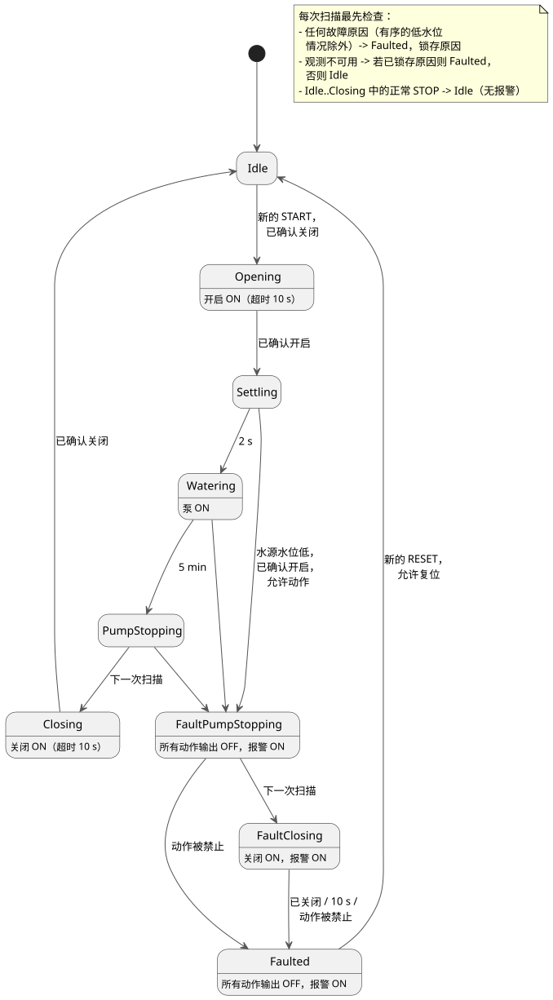

<!-- translation-source: examples/curriculum/pc-10-fault-alarm-reset.ghost.en.md -->
[英文原文](pc-10-fault-alarm-reset.ghost.en.md)
> 本文为阅读用译本。编译时请使用链接的原始 `.ghost.md` 文件：[韩文原文](pc-10-fault-alarm-reset.ghost.md)。

# PC-10 — 带故障、报警和复位的顺序供水

<!-- ghostflow:anchor id=GF-INT-PC10-FAULT-ALARM-RESET-V1 kind=intent status=confirmed origin=imported -->
> 学习场景：先打开阀门并确认开启，再运行泵。正常的 STOP 停机不产生故障。急停观测、过载、传感器冲突、反馈丢失、阀门驱动不可用或动作超时，会锁存其原因并安全停止。水源水位低是一种特殊情况：只有在阀门已确认开启时，才可以先停泵、再关阀。

链接的韩文 `.ghost.md` 文件是 PC-10 唯一的规范、可执行的文学式源文件（literate source）。之前的两节课保持原样：[PC-09 阀门/泵顺序供水](pc-09-sequential-water-supply.ghost.zh.md) 保留正常序列和反馈，[PC-05 限位反馈](pc-05-limit-feedback.ghost.zh.md) 保留阀门位置观测。本课不取代其中任何一个。它加入了超时、故障原因锁存、报警和复位规则。

下文使用的关键术语：

- **锁存（latch）** — 记住一个值（这里是第一个故障原因），直到显式复位将其清除，即使实时输入已经变回原值。
- **动作输出** — 驱动设备动作的三个输出：`valve_open_contactor`、`valve_close_contactor` 和 `pump_contactor`。
- **新的按下** — 按钮先被看到已松开，然后再次被按下。一直按住按钮绝不会被计为两次。

## 学习用 I/O 与第一个控制柜的信号预算

本示例**不是可以一对一映射到首台 8-DI（数字输入）设备上的接线图或固件契约**。它是一个独立的学习接口。其输入按含义拆分，便于你理解控制意图。

```text
输入（9 个 Bool）
  start_request, reset_request, stop_ok, emergency_stop_ok, overload_ok,
  source_water_ok, valve_drive_ok, open_limit, close_limit

输出（4 个 Bool）
  valve_open_contactor, valve_close_contactor, pump_contactor, alarm
```

**完整控制柜的信号预算。** 一个典型的完整浇水控制柜已经有**八个**信号：`START`、`STOP`、`MODE`、水箱低位、水箱高位、开启限位、关闭限位和过载。它还需要**三个**信号：`RESET`、急停状态观测和水源水位低。再把 `valve_drive_ok` 单独拆分出来，总共是 **12 种含义**。本示例的九个输入是 PC-10 的安全行为所需要的含义。`MODE` 以及水箱上/下限属于 PC-08 和 PC-07；这里没有把它们虚假地合并进来。

每个真实设施都必须从以下选项中选择一种。目前尚未针对任何具体设施做出这一选择。

- 在外部安全链中合并多个原因。但是，没有单独的观测，GhostFlow 就无法逐一报告每个原因。
- 将 START/MODE/RESET 作为经过认证的宿主命令发送，而 STOP 和物理安全回路保留为接线信号。
- 增加 DI，使每个原因都能被直接观测。

急停是切断能量的**外部硬接线安全链**。`emergency_stop_ok` 只观测它的状态。GhostFlow 的输出和报警都不能保证接触器的能量已被切断。

## 意图与已确定的安全规则

- **正常 STOP 不是故障。** 当 `stop_ok == false` 时，`control` 立即回到 `Idle`，所有 MCU 动作输出关闭，报警关闭。要再次运行，必须由外部确认关闭位置，并且 START 必须先松开再重新按下。它绝不会自动重新启动。
- **锁存第一个原因。** `FaultCause` 锁存第一个原因。如果同一次扫描中出现多个原因，按以下顺序选择：
  `EmergencyStop > Overload > ValveDriveUnavailable > SensorConflict > FeedbackLost > OpenTimeout/CloseTimeout > LowSourceWater`。
  实时输入之后的变化不会改变已锁存的原因。当前阻止关闭的条件仍可在追踪中单独看到。
- **动作超时。** `Opening` 和 `Closing` 各自在 10 秒后超时。如果恰好在第 10 秒的扫描中观测到目标限位，限位优先于超时。`control` 绝不会在一次扫描中跳过多个状态。
- **只有水源水位低才有序关阀。** 只有 `LowSourceWater` 允许有条件的有序关阀。它适用于开启位置已经确认，且 STOP、急停、过载、阀门驱动和传感器条件都允许关阀的情况。此时 `control`：
  1. 在 `FaultPumpStopping` 中，将所有动作输出关闭一个逻辑扫描；
  2. 只在 `FaultClosing` 中发出关闭命令。

  否则它直接进入 `Faulted`，所有输出关闭。`FaultClosing` 在看到关闭限位、关阀超时到期或动作被禁止时结束。在所有情况下，原始故障原因都会被保留。
- **复位需要设备状态正常并有新的按下。** 只有当已锁存的原因**以及**所有当前故障条件都已清除，并且 `known_closed` 为 true 时，才允许复位。在这些条件成立之后，RESET 必须先松开再重新按下。在条件清除期间一直按住 RESET 不会复位。复位只会回到 `Idle`/OFF；它不能代替 START。

下面的状态图展示了正常序列、低水位时的有序关阀以及复位路径。注释列出了每次扫描最先执行的检查。



## GhostFlow 源代码

**输入质量。** 本修订版读取每个输入的生产者所报告的质量。它不诊断物理按钮故障。

- 健康的 `false`（Good(false)）是正常观测。
- 未知的动作许可或位置观测不允许任何动作、有条件的故障关阀、复位，也不允许请求重新就绪。
- 已有的故障原因保持锁存。如果没有故障原因，则使用现有的 `Idle`/OFF 路径。
- 只有已知的观测才能设置物理条件的原因标签。但是，如果在现有的硬性截止时间到达时目标位置仍未确认，仍然可以设置 `OpenTimeout` 或 `CloseTimeout`。
- 不新增 START 输入，也不新增全局重启策略。

```ghost
// Source revision: issue531-producer-quality-pc10-v1
control FaultAlarmResetWaterSupply {
  input start_request, reset_request, stop_ok, emergency_stop_ok, overload_ok,
    source_water_ok, valve_drive_ok, open_limit, close_limit: Bool;
  output valve_open_contactor, valve_close_contactor, pump_contactor, alarm: Bool;

  let start_request_true = start_request |> recover(false);
  let start_request_false = !(start_request |> recover(true));
  let reset_request_true = reset_request |> recover(false);
  let reset_request_false = !(reset_request |> recover(true));
  let stop_ok_true = stop_ok |> recover(false);
  let stop_ok_false = !(stop_ok |> recover(true));
  let emergency_stop_ok_true = emergency_stop_ok |> recover(false);
  let emergency_stop_ok_false = !(emergency_stop_ok |> recover(true));
  let overload_ok_true = overload_ok |> recover(false);
  let overload_ok_false = !(overload_ok |> recover(true));
  let source_water_ok_true = source_water_ok |> recover(false);
  let source_water_ok_false = !(source_water_ok |> recover(true));
  let valve_drive_ok_true = valve_drive_ok |> recover(false);
  let valve_drive_ok_false = !(valve_drive_ok |> recover(true));
  let open_limit_true = open_limit |> recover(false);
  let open_limit_false = !(open_limit |> recover(true));
  let close_limit_true = close_limit |> recover(false);
  let close_limit_false = !(close_limit |> recover(true));
  let stop_ok_good = case stop_ok { ok(_) => true; fault(_) => false; };
  let emergency_stop_ok_good = case emergency_stop_ok { ok(_) => true; fault(_) => false; };
  let overload_ok_good = case overload_ok { ok(_) => true; fault(_) => false; };
  let source_water_ok_good = case source_water_ok { ok(_) => true; fault(_) => false; };
  let valve_drive_ok_good = case valve_drive_ok { ok(_) => true; fault(_) => false; };
  let open_limit_good = case open_limit { ok(_) => true; fault(_) => false; };
  let close_limit_good = case close_limit { ok(_) => true; fault(_) => false; };
  let motion_observations_good = stop_ok_good && emergency_stop_ok_good && overload_ok_good && source_water_ok_good && valve_drive_ok_good && open_limit_good && close_limit_good;

  let settle_delay = 2s;
  let watering_time = 5min;
  let opening_timeout = 10s;
  let closing_timeout = 10s;

  type Phase = Idle | Opening | Settling | Watering | PumpStopping | Closing |
    FaultPumpStopping | FaultClosing | Faulted;
  type FaultCause = None | EmergencyStop | Overload | LowSourceWater |
    ValveDriveUnavailable | SensorConflict | FeedbackLost | OpenTimeout | CloseTimeout;

  // ghostflow:link id=GF-INT-PC10-FAULT-ALARM-RESET-V1 relation=implements
  state phase: Phase = Idle;
  // ghostflow:link id=GF-INT-PC10-FAULT-ALARM-RESET-V1 relation=implements
  state fault_cause: FaultCause = None;
  // ghostflow:link id=GF-INT-PC10-FAULT-ALARM-RESET-V1 relation=implements
  state request_armed: Bool = false;
  // ghostflow:link id=GF-INT-PC10-FAULT-ALARM-RESET-V1 relation=implements
  state reset_armed: Bool = false;
  // ghostflow:link id=GF-INT-PC10-FAULT-ALARM-RESET-V1 relation=implements
  timer age = elapsed(phase);

  let normal_permit = stop_ok_true && emergency_stop_ok_true && overload_ok_true && source_water_ok_true && valve_drive_ok_true;
  let fault_motion_permit = stop_ok_true && emergency_stop_ok_true && overload_ok_true && valve_drive_ok_true;
  let conflict = open_limit_true && close_limit_true;
  let known_closed = close_limit_true && open_limit_false;
  let known_open = open_limit_true && close_limit_false;
  let start_event = request_armed && start_request_true;
  let reset_event = reset_armed && reset_request_true;
  let fault_cleared = case fault_cause {
    None => true;
    EmergencyStop => emergency_stop_ok_true;
    Overload => overload_ok_true;
    LowSourceWater => source_water_ok_true;
    ValveDriveUnavailable => valve_drive_ok_true;
    SensorConflict => !conflict;
    FeedbackLost => known_closed;
    OpenTimeout => known_closed;
    CloseTimeout => known_closed;
  };
  let fault_free_now = emergency_stop_ok_true && overload_ok_true && source_water_ok_true &&
    valve_drive_ok_true && !conflict;
  // Every FaultCause-specific clear condition is implied by fault_free_now and known_closed.
  let reset_allowed = stop_ok_good && fault_cause != None && fault_free_now && known_closed;
  let immediate_cause =
    if emergency_stop_ok_false then EmergencyStop
    else if overload_ok_false then Overload
    else if valve_drive_ok_false then ValveDriveUnavailable
    else if conflict then SensorConflict
    else if phase in {Settling, Watering, PumpStopping} && open_limit_good && close_limit_good && !known_open then FeedbackLost
    else if phase == Opening && !open_limit_true && age >= opening_timeout then OpenTimeout
    else if phase == Closing && !close_limit_true && age >= closing_timeout then CloseTimeout
    else if source_water_ok_false && phase in {Idle, Opening, Settling, Watering, PumpStopping} then LowSourceWater
    else None;

  let any_immediate_cause = emergency_stop_ok_false || overload_ok_false || valve_drive_ok_false || conflict ||
    (phase in {Settling, Watering, PumpStopping} && open_limit_good && close_limit_good && !known_open) ||
    (phase == Opening && !open_limit_true && age >= opening_timeout) ||
    (phase == Closing && !close_limit_true && age >= closing_timeout) ||
    (source_water_ok_false && phase in {Idle, Opening, Settling, Watering, PumpStopping});

  request_armed' = phase == Idle && fault_cause == None && normal_permit && !conflict && known_closed && start_request_false;
  reset_armed' = phase == Faulted && reset_allowed && reset_request_false;
  fault_cause' =
    if phase == Faulted && reset_event && reset_allowed then None
    else if fault_cause != None then fault_cause
    else immediate_cause;

  phase' = if source_water_ok_false && phase in {Settling, Watering, PumpStopping} && known_open && fault_motion_permit then FaultPumpStopping
    else if any_immediate_cause then Faulted
    else if !motion_observations_good then if fault_cause != None then Faulted else Idle
    else if phase in {Idle, Opening, Settling, Watering, PumpStopping, Closing} && stop_ok_false then Idle
    else case phase {
    Idle =>
      if start_event && known_closed then Opening
      else Idle;

    Opening =>
      if known_open then Settling
      else Opening;

    Settling =>
      if age >= settle_delay then Watering
      else Settling;

    Watering =>
      if age >= watering_time then PumpStopping
      else Watering;

    PumpStopping =>
      Closing;

    Closing =>
      if known_closed then Idle
      else Closing;

    FaultPumpStopping =>
      if !fault_motion_permit || conflict then Faulted
      else FaultClosing;

    FaultClosing =>
      if !fault_motion_permit || conflict then Faulted
      else if known_closed then Faulted
      else if age >= closing_timeout then Faulted
      else FaultClosing;

    Faulted =>
      if reset_event && reset_allowed then Idle
      else Faulted;
  };

  // Exact next-phase projections avoid expanding the full phase decision once per output.
  let transition_permitted = !any_immediate_cause && motion_observations_good &&
    !(phase in {Idle, Opening, Settling, Watering, PumpStopping, Closing} && stop_ok_false);
  let next_open = transition_permitted &&
    ((phase == Idle && start_event && known_closed) || (phase == Opening && !known_open));
  let next_close = transition_permitted &&
    (phase == PumpStopping || (phase == Closing && !known_closed) ||
      (phase == FaultPumpStopping && fault_motion_permit && !conflict) ||
      (phase == FaultClosing && fault_motion_permit && !conflict && !known_closed && age < closing_timeout));
  let next_pump = transition_permitted &&
    ((phase == Settling && age >= settle_delay) || (phase == Watering && age < watering_time));
  let next_alarm = if any_immediate_cause then true
    else if !motion_observations_good then fault_cause != None
    else if phase in {FaultPumpStopping, FaultClosing} then true
    else if phase == Faulted then !(reset_event && reset_allowed)
    else false;

  valve_open_contactor <- next_open;
  valve_close_contactor <- next_close;
  pump_contactor <- next_pump;
  alarm <- next_alarm;
  mutex(valve_open_contactor, valve_close_contactor);
  require !(pump_contactor && valve_open_contactor);
  require !(pump_contactor && valve_close_contactor);
}
```

**解读故障输出。** 在 `FaultPumpStopping` 中，报警已经开启，表示原因已被报告。三个动作输出关闭一个逻辑扫描，因此泵会在阀门关闭之前停止。`FaultClosing` 中的关闭命令只是软件请求。它并不表示急停硬接线链已经切断能量，也不表示阀门已经物理移动。

## 验证边界

`tools/check-pc-10.mjs` 为每个场景创建一个新的 `ControlRuntime`，不会重新构建现有的 WASM 制品。编译器/WASM 追踪 PASS 证明 GhostFlow 的虚拟状态和输出计算符合预期。Web UX、MCU 上传、接触器吸合、阀门移动、泵转动、流量以及外部安全链的物理验收，都不在本示例及其检查器的范围之内。
