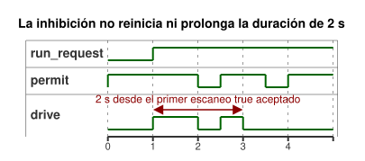

<!-- translation-source: examples/explicit-feedback-adoption.ghost.md -->
[Original en inglés](explicit-feedback-adoption.ghost.md)
> Traducción de lectura. Para compilar, use el archivo original `.ghost.md` enlazado.

# Inhibición por retroalimentación adoptada explícitamente

Revisión explícita de calidad de entrada del 2026-10-05: si la solicitud es desconocida, se conserva el estado de marcha ya establecido, y el plazo de dos segundos sigue aplicándose. La calidad de entrada no afirma un fallo físico.

Esta fuente es un documento independiente que **adopta explícitamente** una
regla permisiva de diagnóstico para su entrada `observation`:

- Una observación `true` sana permite la solicitud temporizada.
- Una observación `false` sana, o cualquier fallo del sensor, la inhibe.

Esta regla de parada es una política definida por el autor solo para este
ejemplo. No es una respuesta universal ante la falta de retroalimentación. El
[temporizador solo con observación](optional-feedback-timer.ghost.es.md)
sigue siendo válido sin retroalimentación física, y no otorga a la observación
ninguna autoridad de control.

El operador estableció una duración de comando ilustrativa de dos segundos. El
temporizador mide cuánto tiempo se ha mantenido la solicitud. No mide el
movimiento ni la aplicación por parte del renderizador. La inhibición no
reinicia ni prolonga esa duración:

- Si la observación se recupera antes del plazo, la parte restante de la
  solicitud puede ejecutarse.
- Si se recupera en el plazo o después, la solicitud no se reinicia.

La parada y el rearranque se comportan exactamente igual que en el ejemplo de
temporizador enlazado.

La línea de tiempo siguiente muestra una solicitud. `permit` cae brevemente
antes del plazo, por lo que `drive` se reanuda durante el tiempo restante; la
recuperación posterior llega después del plazo, así que `drive` permanece
apagado.



`observation` es un sensor Bool **obligatorio**. Todos los casos siguientes
mantienen la salida inhibida o rechazan la entrada; ninguno de ellos selecciona
el ejemplo solo con observación ni ninguna otra estrategia:

- En el host de referencia, una muestra ausente se acondiciona como `NotReady`.
  La rama `fault(_) => false` definida por el autor inhibe entonces la salida.
- Una lista vacía de capacidades opcionales no elimina esta declaración
  obligatoria.
- Se rechaza un rol de muestra desconocido o un tipo de capacidad que no
  coincide.
- Una trama de escaneo nativa incompleta se rechaza antes de tomar cualquier
  decisión.

La adopción queda registrada en esta revisión de la fuente canónica y en su
artefacto compilado. La reproducción (replay) usa el mismo documento, el mismo
bytecode y las tramas de solicitud y de muestra suministradas. El verificador
de mapas de fuente existente rechaza una revisión esperada que pertenezca al
documento solo con observación. No se presupone ningún servicio nuevo de
despliegue ni de reproducción.

Las intenciones solicitada y segura permanecen separadas de los comandos
aplicados y de la evidencia física independiente. Un Bool de diagnóstico no
establece movimiento ni posición.

```ghost
control ExplicitFeedbackAdoption {
  input run_request: Bool;
  output drive: Bool;
  input observation: Bool;

  // Illustrative operator-established command duration, not measured motion.
  let calibrated_duration = 2s;
  state run: Bool = false;
  let requested = case run_request { ok(value) => value; fault(_) => run; };
  run' = requested;
  timer age = elapsed(run);
  let run_age = if requested == run then age else 0s;
  let timed_request = requested && run_age < calibrated_duration;
  let permit = case observation { ok(value) => value; fault(_) => false; };
  drive <- timed_request && permit;
}
```

Contratos: [sensores obligatorios/opcionales y evidencia de salida](../docs/reference/04-sensors-constraints-control.es.md),
[permisos de observación](../docs/reference/05-settings-and-observation.es.md).
Regresión: [GhostFlow #384](https://github.com/callin2/ghostflow-language/issues/384).
