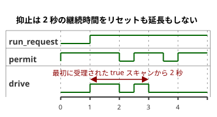

<!-- translation-source: examples/explicit-feedback-adoption.ghost.md -->
[英語の原文](explicit-feedback-adoption.ghost.md)
> 閲覧用の翻訳です。コンパイルには、リンク先の原本 `.ghost.md` ファイルを使用してください。

# 明示的に採用したフィードバックによる抑止

2026-10-05 の入力品質を明示するリビジョン：要求が不明な場合、確立済みの運転状態を維持し、2 秒の期限は引き続き適用されます。入力品質は物理的な故障を主張するものではありません。

このソースは、`observation` 入力に対する診断用の許可ルールを**明示的に採用する**別個の文書です。

- 正常な `true` の観測は、時間制限付きの要求を許可します。
- 正常な `false` の観測、またはあらゆるセンサ故障（fault）は、その要求を抑止します。

この停止ルールは、この例のためだけに作成されたポリシーです。フィードバックが欠けたときの普遍的な対応ではありません。[観測専用タイマー](optional-feedback-timer.ghost.ja.md)は物理フィードバックがなくても有効なままであり、観測には一切の制御権限を与えません。

オペレーターは、説明用のコマンド継続時間として 2 秒を定めました。タイマーが測定するのは、要求が維持されている時間です。動作やレンダラーによる適用を測定するものではありません。抑止によって、この継続時間がリセットされることも延長されることもありません。

- 期限より前に観測が復旧した場合、要求の残りの部分は実行できます。
- 期限ちょうど、または期限より後に復旧した場合、要求は再開しません。

停止と再起動の振る舞いは、リンク先のタイマーの例とまったく同じです。

次のタイムラインは 1 回の要求を示しています。`permit` が期限前に短時間下がるため、`drive` は残りの時間だけ再開します。その後の復旧は期限より後なので、`drive` はオフのままです。



`observation` は**必須**の Bool センサです。次のいずれの場合も、出力は抑止されたままになるか、入力が拒否されます。どの場合も、観測専用の例やほかの戦略が選択されることはありません。

- リファレンスホストでは、欠落したサンプルは `NotReady` に整えられます。その後、作成者が記述した `fault(_) => false` の分岐によって出力が抑止されます。
- 空のオプションのケイパビリティ（capability）一覧によって、この必須宣言が取り除かれることはありません。
- 不明なサンプルロールや、型が一致しないケイパビリティは拒否されます。
- 不完全なネイティブスキャンフレームは、判断が行われる前に拒否されます。

この採用は、この正本ソースのリビジョンとそのコンパイル済み成果物に記録されます。リプレイでは、同じ文書、同じバイトコード、そして供給された要求フレームとサンプルフレームを使用します。既存のソースマップ検証器は、観測専用文書に属するリビジョンが期待値として指定された場合、それを拒否します。新しいデプロイやリプレイのサービスを意味するものではありません。

要求意図（requested）と安全意図（safe）は、適用済み（applied）のコマンドからも、独立した物理的証拠からも切り離されたままです。診断用の Bool は、動作や位置を立証するものではありません。

```ghost
control ExplicitFeedbackAdoption {
  input run_request: Bool;
  output drive: Bool;
  input observation: Bool;

  // Illustrative operator-established command duration, not measured motion.
  let calibrated_duration = 2s;
  state run: Bool = false;
  let requested = case run_request { ok(value) => value; fault(_) => run; };
  run' = requested;
  timer age = elapsed(run);
  let run_age = if requested == run then age else 0s;
  let timed_request = requested && run_age < calibrated_duration;
  let permit = case observation { ok(value) => value; fault(_) => false; };
  drive <- timed_request && permit;
}
```

契約：[必須/オプションのセンサと出力の証拠](../docs/reference/04-sensors-constraints-control.ja.md)、[観測の権限](../docs/reference/05-settings-and-observation.ja.md)。
回帰テスト：[GhostFlow #384](https://github.com/callin2/ghostflow-language/issues/384)。
