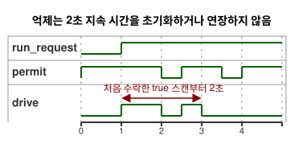

<!-- translation-source: examples/explicit-feedback-adoption.ghost.md -->
[영문 원문](explicit-feedback-adoption.ghost.md)

# 명시적으로 채택한 피드백 억제

2026-10-05 명시적 입력 품질 개정: 요청을 알 수 없으면 기존 운전 상태를 유지하며, 2초 기한은 그대로 적용됩니다. 입력 품질은 물리적인 고장을 뜻하지 않습니다.

이 소스는 `observation` 입력에 대한 진단용 허용 규칙을 **명시적으로 채택**하는
별도 문서입니다.

- 정상 `true` 관찰은 시간 제한 요청을 허용합니다.
- 정상 `false` 관찰이나 모든 센서 fault(고장)는 요청을 억제합니다.

이 정지 규칙은 이 예제에만 작성한 정책입니다. 피드백이 없을 때의 보편적인
대응이 아닙니다. [관찰 전용 타이머](optional-feedback-timer.ghost.ko.md)는
물리 피드백 없이도 유효하며, 관찰에 제어 권한을 주지 않습니다.

운영자는 설명용 명령 지속 시간을 2초로 정했습니다. 타이머는 요청이 유지된
시간을 측정합니다. 이동이나 renderer 적용을 측정하지 않습니다. 억제는 이 지속
시간을 초기화하지도, 연장하지도 않습니다.

- 기한 전에 관찰이 복구되면 요청의 남은 부분이 실행될 수 있습니다.
- 기한 시점이나 그 이후에 복구되면 요청은 다시 시작하지 않습니다.

정지와 재시작 동작은 연결한 타이머 예제와 정확히 같습니다.

아래 타임라인은 요청 하나를 보여 줍니다. `permit`이 기한 전에 잠시 떨어지므로
`drive`는 남은 시간 동안 다시 켜집니다. 나중의 복구는 기한 이후에 일어나므로
`drive`는 꺼진 상태로 남습니다.



`observation`은 **필수** Bool 센서입니다. 다음 경우는 모두 출력을 억제된 상태로
두거나 입력을 거부합니다. 어느 경우도 관찰 전용 예제나 다른 strategy를 선택하지
않습니다.

- 참조 호스트에서 샘플이 없으면 `NotReady`로 처리됩니다. 그러면 작성한
  `fault(_) => false` 분기가 출력을 억제합니다.
- 선택적 capability 목록이 비어 있어도 이 필수 선언은 제거되지 않습니다.
- 알 수 없는 샘플 역할이나 capability 타입 불일치는 거부됩니다.
- 불완전한 native 스캔 프레임은 판단 전에 거부됩니다.

채택 사실은 이 정본 소스 revision(판본)과 컴파일 산출물에 기록됩니다. 재생(replay)은
같은 문서, 같은 바이트코드, 제공된 요청 및 샘플 프레임을 사용합니다. 기존
source-map 검증기는 관찰 전용 문서에 속하는 예상 revision을 거부합니다. 새
배포나 재생 서비스를 뜻하지 않습니다.

요청 의도와 안전 의도는 적용된 명령, 그리고 독립적인 물리 증거와 구별됩니다.
진단용 Bool은 이동이나 위치를 입증하지 않습니다.

```ghost
control ExplicitFeedbackAdoption {
  input run_request: Bool;
  output drive: Bool;
  input observation: Bool;

  // Illustrative operator-established command duration, not measured motion.
  let calibrated_duration = 2s;
  state run: Bool = false;
  let requested = case run_request { ok(value) => value; fault(_) => run; };
  run' = requested;
  timer age = elapsed(run);
  let run_age = if requested == run then age else 0s;
  let timed_request = requested && run_age < calibrated_duration;
  let permit = case observation { ok(value) => value; fault(_) => false; };
  drive <- timed_request && permit;
}
```

계약: [필수·선택적 센서와 출력 증거](../docs/reference/04-sensors-constraints-control.md),
[관찰 권한](../docs/reference/05-settings-and-observation.md).
회귀 검증: [GhostFlow #384](https://github.com/callin2/ghostflow-language/issues/384).
