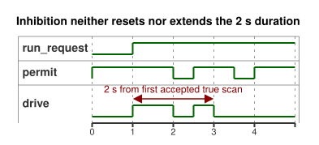

# Explicitly adopted feedback inhibition

2026-10-05 explicit input-quality revision: if the request is unknown, the established run state is kept, and the two-second deadline still applies. Input quality does not assert a physical failure.

This source is a separate document that **explicitly adopts** a diagnostic
permissive rule for its `observation` input:

- A healthy `true` observation permits the timed request.
- A healthy `false` observation, or any sensor fault, inhibits it.

This stop rule is authored policy for this example only. It is not a universal
response to missing feedback. The [observation-only timer](optional-feedback-timer.ghost.md)
remains valid without physical feedback, and it gives observation no control
authority.

The operator established an illustrative command duration of two seconds. The
timer measures how long the request has been maintained. It does not measure
movement or renderer application. Inhibition neither resets nor extends that
duration:

- If the observation recovers before the deadline, the remaining part of the
  request can run.
- If it recovers at or after the deadline, the request does not restart.

Stop and restart behave exactly as in the linked timer example.

The timeline below shows one request. `permit` drops briefly before the
deadline, so `drive` resumes for the remaining time; the later recovery comes
after the deadline, so `drive` stays off.



`observation` is a **required** Bool sensor. The following cases all keep the
output inhibited or reject the input; none of them selects the observation-only
example or any other strategy:

- In the reference host, a missing sample is conditioned to `NotReady`. The
  authored `fault(_) => false` branch then inhibits the output.
- An empty optional-capability list does not remove this required declaration.
- An unknown sample role or a mismatched capability type is rejected.
- An incomplete native scan frame is rejected before any decision is made.

The adoption is recorded in this canonical source revision and in its compiled
artifact. Replay uses the same document, the same bytecode, and the supplied
request and sample frames. The existing source-map verifier rejects an expected
revision that belongs to the observation-only document. No new deployment or
replay service is implied.

Requested and safe intents remain separate from applied commands and from
independent physical evidence. A diagnostic Bool does not establish movement or
position.

```ghost
control ExplicitFeedbackAdoption {
  input run_request: Bool;
  output drive: Bool;
  input observation: Bool;

  // Illustrative operator-established command duration, not measured motion.
  let calibrated_duration = 2s;
  state run: Bool = false;
  let requested = case run_request { ok(value) => value; fault(_) => run; };
  run' = requested;
  timer age = elapsed(run);
  let run_age = if requested == run then age else 0s;
  let timed_request = requested && run_age < calibrated_duration;
  let permit = case observation { ok(value) => value; fault(_) => false; };
  drive <- timed_request && permit;
}
```

Contracts: [required/optional sensors and output evidence](../docs/reference/04-sensors-constraints-control.en.md),
[observation permissions](../docs/reference/05-settings-and-observation.en.md).
Regression: [GhostFlow #384](https://github.com/callin2/ghostflow-language/issues/384).
