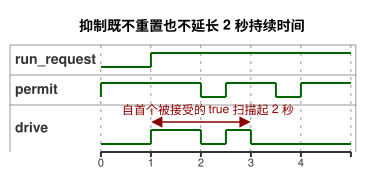

<!-- translation-source: examples/explicit-feedback-adoption.ghost.md -->
[英文原文](explicit-feedback-adoption.ghost.md)
> 本文为阅读用译本。编译时请使用上方链接的原始 `.ghost.md` 文件。

# 显式采纳的反馈抑制

2026-10-05 显式输入质量修订版：如果请求未知，则保持已确立的运行状态，两秒截止时间仍然适用。输入质量并不断言存在物理故障。

本源文件是一份独立文档，它为自身的 `observation` 输入**显式采纳**了一条诊断性许可规则：

- 正常的 `true` 观测允许定时请求。
- 正常的 `false` 观测或任何传感器故障都会抑制该请求。

这条停止规则仅是本示例中编写的策略，并不是对反馈缺失的通用响应。[仅观测定时器](optional-feedback-timer.ghost.zh.md)在没有物理反馈的情况下依然有效，并且不赋予观测任何控制权。

操作员确立了一个示意性的命令持续时间：两秒。定时器测量的是请求已被保持了多长时间，而不是测量运动或渲染器（renderer）的应用。抑制既不会重置也不会延长这段持续时间：

- 如果观测在截止时间之前恢复，请求的剩余部分可以继续运行。
- 如果观测在截止时间当时或之后恢复，请求不会重新开始。

停止和重新启动的行为与上面链接的定时器示例完全相同。

下面的时序图展示了一次请求。`permit` 在截止时间之前短暂下降，因此 `drive` 在剩余时间内恢复；之后的恢复发生在截止时间之后，因此 `drive` 保持关闭。



`observation` 是一个**必需的** Bool 传感器。以下情况都会使输出保持被抑制或拒绝该输入；它们都不会选择仅观测示例或任何其他策略：

- 在参考宿主（host）中，缺失的样本会被整理为 `NotReady`。随后，编写的 `fault(_) => false` 分支会抑制输出。
- 空的可选能力（capability）列表不会移除这一必需声明。
- 未知的样本角色或类型不匹配的能力会被拒绝。
- 不完整的原生扫描帧会在做出任何判定之前被拒绝。

这一采纳记录在本规范源修订版及其编译产物中。重放使用同一份文档、同一份字节码以及所提供的请求帧和样本帧。现有的源映射验证器会拒绝属于仅观测文档的预期修订版。这里并不意味着存在新的部署或重放服务。

请求意图和安全意图始终与已应用的命令以及独立的物理证据相互区分。诊断性的 Bool 不能证明运动或位置。

```ghost
control ExplicitFeedbackAdoption {
  input run_request: Bool;
  output drive: Bool;
  input observation: Bool;

  // Illustrative operator-established command duration, not measured motion.
  let calibrated_duration = 2s;
  state run: Bool = false;
  let requested = case run_request { ok(value) => value; fault(_) => run; };
  run' = requested;
  timer age = elapsed(run);
  let run_age = if requested == run then age else 0s;
  let timed_request = requested && run_age < calibrated_duration;
  let permit = case observation { ok(value) => value; fault(_) => false; };
  drive <- timed_request && permit;
}
```

契约：[必需/可选传感器与输出证据](../docs/reference/04-sensors-constraints-control.zh.md)、[观测权限](../docs/reference/05-settings-and-observation.zh.md)。
回归：[GhostFlow #384](https://github.com/callin2/ghostflow-language/issues/384)。
