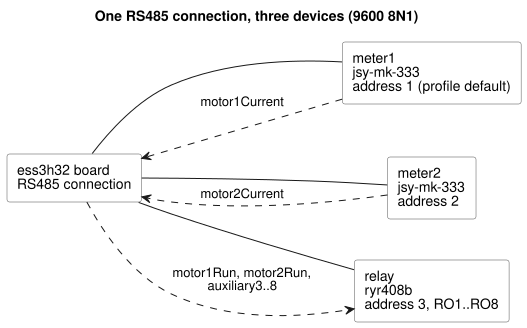

<!-- translation-source: examples/hardware/rs485-current-relay.ghost.md -->

[Korean original](rs485-current-relay.ghost.md)

---
profile: ess3h32@1

devices:
  meter1:
    profile: jsy-mk-333@1
  meter2:
    profile: jsy-mk-333@1
    params: { address: 2 }
  relay:
    profile: ryr408b@1
    params: { address: 3 }

bindings:
  motor1Current: meter1.currentA
  motor2Current: meter2.currentA
  motor1Run: relay.RO1
  motor2Run: relay.RO2
  auxiliary3: relay.RO3
  auxiliary4: relay.RO4
  auxiliary5: relay.RO5
  auxiliary6: relay.RO6
  auxiliary7: relay.RO7
  auxiliary8: relay.RO8
---

# RS485 Current Inputs and RYR408B 8-Channel Relay Outputs

[Korean original](rs485-current-relay.ghost.md) · [Design purpose](../../docs/PROFILE-FRONT-MATTER.en.md)

This canonical example extends the earlier two-current-meter design example by
adding an output device. It shows that logical inputs and outputs can bind to
different drivers that share one RS485 connection. It does not mean that the
physical installation of either current meter has been verified.

The diagram shows the three devices on the shared RS485 connection and which
logical names flow in each direction.



The relay model, confirmed by the user, is the **RYR408B**: 8 channels, address
3, 9600 bps. The attached material shows 9600 8 N 1. The board's default RS485
connection and the device profile both provide 9600/8N1, so the customer YAML
does not repeat `bus` or the communication settings. A speed mismatch produces
an error during interpretation. Address assignment:

| Address | Device |
|---|---|
| 1 | `meter1` (current meter; profile default) |
| 2 | `meter2` (current meter) |
| 3 | `relay` (RYR408B) |

The RYR408B's address and baud rate are set physically by the DIP switches on
the board. The YAML `address: 3` and the profile's `9600bps` configure
communication to match those DIP settings. The actual DIP values and the
declarations must agree. Compilation checks only that the supplied contracts
agree with each other.

The profile IDs and `RO1`–`RO8` shown here are **design and verification
contract names**. They are not profiles published for an actual product:

- The relay fixture is checked against an RS485/Modbus RTU contract.
- `ryr408b@1` is the proposed profile ID for the confirmed model.
- Before a driver or profile is published, the following must be confirmed:
  the protocol specification, per-channel registers, ON/OFF values, responses,
  and output-failure handling.
- The photograph's initial example uses address 1. That is not an instruction
  to change the current address 3.

This document sends no commands to physical equipment.

<!-- ghostflow:anchor id=CURRENT-RELAY kind=assumption status=unconfirmed origin=ai -->
This example assumes the following behavior: if a motor's phase-A current is
at least 0.1 A, the control requests the matching relay output (1 or 2) ON. If
the current is below that threshold, or the input has an error, it requests
OFF. This is example behavior that demonstrates the bindings. It is not a
user-approved control policy.

<!-- ghostflow:anchor id=UNUSED-RELAYS kind=assumption status=unconfirmed origin=ai -->
This example assumes that the unused relay outputs 3–8 are always requested
OFF. An output request is not the same as confirmation of a physical contact.

```ghost
control CurrentRelayExample {
  // ghostflow:link id=CURRENT-RELAY relation=assumes
  input motor1Current, motor2Current: ElectricalCurrent;
  // ghostflow:link id=CURRENT-RELAY relation=assumes
  output motor1Run, motor2Run: Bool;
  // ghostflow:link id=UNUSED-RELAYS relation=assumes
  output auxiliary3, auxiliary4, auxiliary5, auxiliary6, auxiliary7, auxiliary8: Bool;

  // ghostflow:link id=CURRENT-RELAY relation=assumes
  motor1Run <- (motor1Current |> recover(0A)) >= 0.1A;
  // ghostflow:link id=CURRENT-RELAY relation=assumes
  motor2Run <- (motor2Current |> recover(0A)) >= 0.1A;
  // ghostflow:link id=UNUSED-RELAYS relation=assumes
  auxiliary3 <- false;
  // ghostflow:link id=UNUSED-RELAYS relation=assumes
  auxiliary4 <- false;
  // ghostflow:link id=UNUSED-RELAYS relation=assumes
  auxiliary5 <- false;
  // ghostflow:link id=UNUSED-RELAYS relation=assumes
  auxiliary6 <- false;
  // ghostflow:link id=UNUSED-RELAYS relation=assumes
  auxiliary7 <- false;
  // ghostflow:link id=UNUSED-RELAYS relation=assumes
  auxiliary8 <- false;
}
```
