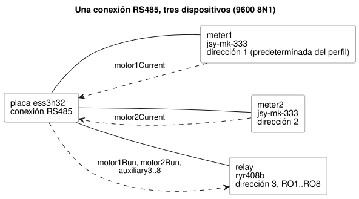

<!-- translation-source: examples/hardware/rs485-current-relay.ghost.en.md -->
[Original en inglés](rs485-current-relay.ghost.en.md)
> Traducción de lectura. Para compilar, use el archivo original en coreano [`rs485-current-relay.ghost.md`](rs485-current-relay.ghost.md).

# Entradas de corriente RS485 y salidas del relé de 8 canales RYR408B

[Original en coreano](rs485-current-relay.ghost.md) · [Propósito del diseño](../../docs/PROFILE-FRONT-MATTER.es.md)

Este ejemplo canónico amplía el ejemplo de diseño anterior con dos medidores de
corriente añadiendo un dispositivo de salida. Muestra que las entradas y
salidas lógicas pueden vincularse a drivers distintos que comparten una misma
conexión RS485. No significa que se haya verificado la instalación física de
ninguno de los dos medidores de corriente.

El diagrama muestra los tres dispositivos en la conexión RS485 compartida y qué
nombres lógicos fluyen en cada dirección.



El modelo de relé, confirmado por el usuario, es el **RYR408B**: 8 canales,
dirección 3, 9600 bps. El material adjunto indica 9600 8 N 1. La conexión
RS485 predeterminada de la placa y el perfil del dispositivo proporcionan
ambos 9600/8N1, por lo que el YAML del cliente no repite `bus` ni los ajustes
de comunicación. Una discrepancia de velocidad produce un error durante la
interpretación. Asignación de direcciones:

| Dirección | Dispositivo |
|---|---|
| 1 | `meter1` (medidor de corriente; predeterminado del perfil) |
| 2 | `meter2` (medidor de corriente) |
| 3 | `relay` (RYR408B) |

La dirección y la velocidad en baudios del RYR408B se fijan físicamente con los
interruptores DIP de la placa. El `address: 3` del YAML y los `9600bps` del
perfil configuran la comunicación para que coincida con esos ajustes DIP. Los
valores DIP reales y las declaraciones deben concordar. La compilación solo
comprueba que los contratos suministrados concuerdan entre sí.

Los ID de perfil y `RO1`–`RO8` que se muestran aquí son **nombres de contrato
de diseño y verificación**. No son perfiles publicados para un producto real:

- El fixture del relé se comprueba contra un contrato RS485/Modbus RTU.
- `ryr408b@1` es el ID de perfil propuesto para el modelo confirmado.
- Antes de publicar un driver o un perfil, debe confirmarse lo siguiente: la
  especificación del protocolo, los registros por canal, los valores ON/OFF,
  las respuestas y el tratamiento de fallos de salida.
- El ejemplo inicial de la fotografía usa la dirección 1. Eso no es una
  instrucción para cambiar la dirección actual 3.

Este documento no envía ningún comando al equipo físico.

<!-- ghostflow:anchor id=CURRENT-RELAY kind=assumption status=unconfirmed origin=ai -->
Este ejemplo supone el siguiente comportamiento: si la corriente de la fase A
de un motor es de al menos 0.1 A, el control solicita ON en la salida de relé
correspondiente (1 o 2). Si la corriente está por debajo de ese umbral, o la
entrada tiene un error, solicita OFF. Es un comportamiento de ejemplo que
ilustra las vinculaciones. No es una política de control aprobada por el
usuario.

<!-- ghostflow:anchor id=UNUSED-RELAYS kind=assumption status=unconfirmed origin=ai -->
Este ejemplo supone que las salidas de relé no utilizadas 3–8 se solicitan
siempre en OFF. Una solicitud de salida no equivale a la confirmación de un
contacto físico.

```ghost
control CurrentRelayExample {
  // ghostflow:link id=CURRENT-RELAY relation=assumes
  input motor1Current, motor2Current: ElectricalCurrent;
  // ghostflow:link id=CURRENT-RELAY relation=assumes
  output motor1Run, motor2Run: Bool;
  // ghostflow:link id=UNUSED-RELAYS relation=assumes
  output auxiliary3, auxiliary4, auxiliary5, auxiliary6, auxiliary7, auxiliary8: Bool;

  // ghostflow:link id=CURRENT-RELAY relation=assumes
  motor1Run <- (motor1Current |> recover(0A)) >= 0.1A;
  // ghostflow:link id=CURRENT-RELAY relation=assumes
  motor2Run <- (motor2Current |> recover(0A)) >= 0.1A;
  // ghostflow:link id=UNUSED-RELAYS relation=assumes
  auxiliary3 <- false;
  // ghostflow:link id=UNUSED-RELAYS relation=assumes
  auxiliary4 <- false;
  // ghostflow:link id=UNUSED-RELAYS relation=assumes
  auxiliary5 <- false;
  // ghostflow:link id=UNUSED-RELAYS relation=assumes
  auxiliary6 <- false;
  // ghostflow:link id=UNUSED-RELAYS relation=assumes
  auxiliary7 <- false;
  // ghostflow:link id=UNUSED-RELAYS relation=assumes
  auxiliary8 <- false;
}
```
