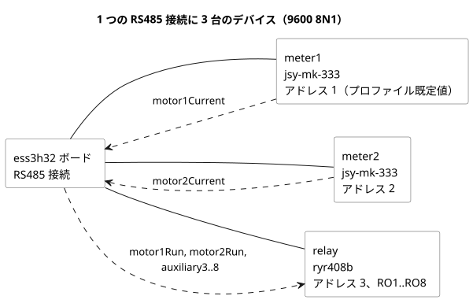

<!-- translation-source: examples/hardware/rs485-current-relay.ghost.en.md -->
[英語の原文](rs485-current-relay.ghost.en.md)
> 閲覧用の翻訳です。コンパイルには、リンク先の原本 `.ghost.md` ファイルを使用してください。

# RS485 電流入力と RYR408B 8 チャンネルリレー出力

[韓国語の原文](rs485-current-relay.ghost.md) · [設計目的](../../docs/PROFILE-FRONT-MATTER.ja.md)

この正本の例は、以前の 2 台の電流計による設計例に出力デバイスを追加して拡張したものです。論理的な入力と出力が、1 つの RS485 接続を共有する別々のドライバにバインドできることを示しています。いずれかの電流計の物理的な設置が検証済みであることを意味するものではありません。

次の図は、共有された RS485 接続上の 3 台のデバイスと、それぞれの方向にどの論理名が流れるかを示しています。



ユーザーが確認したリレーの機種は **RYR408B** で、8 チャンネル、アドレス 3、9600 bps です。添付資料には 9600 8 N 1 と記載されています。ボードの既定の RS485 接続とデバイスプロファイルの両方が 9600/8N1 を提供するため、顧客の YAML では `bus` や通信設定を繰り返し記述しません。速度が一致しない場合は、解釈の段階でエラーになります。アドレスの割り当ては次のとおりです。

| アドレス | デバイス |
|---|---|
| 1 | `meter1`（電流計、プロファイル既定値） |
| 2 | `meter2`（電流計） |
| 3 | `relay`（RYR408B） |

RYR408B のアドレスとボーレートは、ボード上の DIP スイッチで物理的に設定します。YAML の `address: 3` とプロファイルの `9600bps` は、それらの DIP 設定に合わせて通信を構成するものです。実際の DIP の値と宣言は一致していなければなりません。コンパイルで検査するのは、供給された契約どうしが互いに一致していることだけです。

ここに示したプロファイル ID と `RO1`～`RO8` は、**設計と検証のための契約名**です。実際の製品向けに公開されたプロファイルではありません。

- リレーのフィクスチャは、RS485/Modbus RTU の契約に照らして検査されます。
- `ryr408b@1` は、確認済みの機種に対して提案されたプロファイル ID です。
- ドライバやプロファイルを公開する前に、プロトコル仕様、チャンネルごとのレジスタ、ON/OFF の値、応答、出力失敗時の処理を確認しなければなりません。
- 写真に写っている初期の例ではアドレス 1 を使用していますが、これは現在のアドレス 3 を変更せよという指示ではありません。

この文書は、物理機器にコマンドを一切送信しません。

<!-- ghostflow:anchor id=CURRENT-RELAY kind=assumption status=unconfirmed origin=ai -->
この例では次の振る舞いを仮定しています。モーターの A 相電流が 0.1 A 以上であれば、制御は対応するリレー出力（1 または 2）の ON を要求します。電流がこのしきい値を下回るか、入力にエラーがある場合は OFF を要求します。これはバインディングを示すための例としての振る舞いであり、ユーザーが承認した制御ポリシーではありません。

<!-- ghostflow:anchor id=UNUSED-RELAYS kind=assumption status=unconfirmed origin=ai -->
この例では、未使用のリレー出力 3～8 には常に OFF を要求すると仮定しています。出力の要求は、物理的な接点の確認と同じではありません。

```ghost
control CurrentRelayExample {
  // ghostflow:link id=CURRENT-RELAY relation=assumes
  input motor1Current, motor2Current: ElectricalCurrent;
  // ghostflow:link id=CURRENT-RELAY relation=assumes
  output motor1Run, motor2Run: Bool;
  // ghostflow:link id=UNUSED-RELAYS relation=assumes
  output auxiliary3, auxiliary4, auxiliary5, auxiliary6, auxiliary7, auxiliary8: Bool;

  // ghostflow:link id=CURRENT-RELAY relation=assumes
  motor1Run <- (motor1Current |> recover(0A)) >= 0.1A;
  // ghostflow:link id=CURRENT-RELAY relation=assumes
  motor2Run <- (motor2Current |> recover(0A)) >= 0.1A;
  // ghostflow:link id=UNUSED-RELAYS relation=assumes
  auxiliary3 <- false;
  // ghostflow:link id=UNUSED-RELAYS relation=assumes
  auxiliary4 <- false;
  // ghostflow:link id=UNUSED-RELAYS relation=assumes
  auxiliary5 <- false;
  // ghostflow:link id=UNUSED-RELAYS relation=assumes
  auxiliary6 <- false;
  // ghostflow:link id=UNUSED-RELAYS relation=assumes
  auxiliary7 <- false;
  // ghostflow:link id=UNUSED-RELAYS relation=assumes
  auxiliary8 <- false;
}
```
