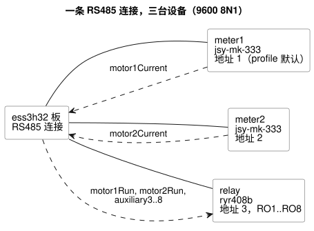

<!-- translation-source: examples/hardware/rs485-current-relay.ghost.en.md -->
[英文原文](rs485-current-relay.ghost.en.md)
> 本文为阅读用译本。编译时请使用原始文件 `rs485-current-relay.ghost.md`（韩文原文）。

# RS485 电流输入与 RYR408B 8 通道继电器输出

[韩文原文](rs485-current-relay.ghost.md) · [设计目的](../../docs/PROFILE-FRONT-MATTER.zh.md)

这个规范示例在先前的双电流表设计示例基础上增加了一台输出设备。它说明逻辑输入和逻辑输出可以绑定到共享同一条 RS485 连接的不同驱动程序。这并不意味着任何一台电流表的物理安装已经过验证。

下图展示了共享 RS485 连接上的三台设备，以及各个逻辑名称的流向。



用户确认的继电器型号为 **RYR408B**：8 通道，地址 3，9600 bps。所附资料显示为 9600 8 N 1。板卡默认的 RS485 连接和设备 profile 都提供 9600/8N1，因此客户 YAML 中不再重复 `bus` 或通信设置。速率不匹配会在解释阶段产生错误。地址分配如下：

| 地址 | 设备 |
|---|---|
| 1 | `meter1`（电流表；profile 默认值） |
| 2 | `meter2`（电流表） |
| 3 | `relay`（RYR408B） |

RYR408B 的地址和波特率由板上的 DIP 开关物理设定。YAML 中的 `address: 3` 和 profile 中的 `9600bps` 用于使通信设置与这些 DIP 设定一致。实际的 DIP 值必须与声明一致。编译只检查所提供的各项契约彼此一致。

这里出现的 profile ID 以及 `RO1`–`RO8` 是**设计与验证用的契约名称**，并不是针对实际产品发布的 profile：

- 继电器测试夹具按照 RS485/Modbus RTU 契约进行检查。
- `ryr408b@1` 是为已确认型号提议的 profile ID。
- 在发布驱动程序或 profile 之前，必须确认以下内容：协议规范、各通道寄存器、ON/OFF 值、响应以及输出失败的处理。
- 照片中的初始示例使用地址 1。这并不是要求更改当前的地址 3。

本文档不向物理设备发送任何命令。

<!-- ghostflow:anchor id=CURRENT-RELAY kind=assumption status=unconfirmed origin=ai -->
本示例假设以下行为：如果某台电机的 A 相电流至少为 0.1 A，则控制请求对应的继电器输出（1 或 2）为 ON。如果电流低于该阈值，或者输入出现错误，则请求 OFF。这是用于演示绑定的示例行为，并不是经用户批准的控制策略。

<!-- ghostflow:anchor id=UNUSED-RELAYS kind=assumption status=unconfirmed origin=ai -->
本示例假设未使用的继电器输出 3–8 始终被请求为 OFF。输出请求并不等同于物理触点的确认。

```ghost
control CurrentRelayExample {
  // ghostflow:link id=CURRENT-RELAY relation=assumes
  input motor1Current, motor2Current: ElectricalCurrent;
  // ghostflow:link id=CURRENT-RELAY relation=assumes
  output motor1Run, motor2Run: Bool;
  // ghostflow:link id=UNUSED-RELAYS relation=assumes
  output auxiliary3, auxiliary4, auxiliary5, auxiliary6, auxiliary7, auxiliary8: Bool;

  // ghostflow:link id=CURRENT-RELAY relation=assumes
  motor1Run <- (motor1Current |> recover(0A)) >= 0.1A;
  // ghostflow:link id=CURRENT-RELAY relation=assumes
  motor2Run <- (motor2Current |> recover(0A)) >= 0.1A;
  // ghostflow:link id=UNUSED-RELAYS relation=assumes
  auxiliary3 <- false;
  // ghostflow:link id=UNUSED-RELAYS relation=assumes
  auxiliary4 <- false;
  // ghostflow:link id=UNUSED-RELAYS relation=assumes
  auxiliary5 <- false;
  // ghostflow:link id=UNUSED-RELAYS relation=assumes
  auxiliary6 <- false;
  // ghostflow:link id=UNUSED-RELAYS relation=assumes
  auxiliary7 <- false;
  // ghostflow:link id=UNUSED-RELAYS relation=assumes
  auxiliary8 <- false;
}
```
