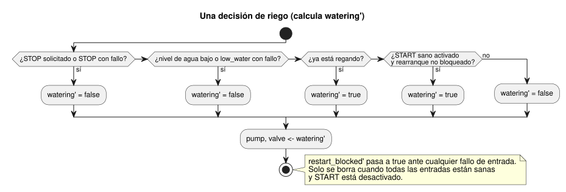

<!-- translation-source: examples/irrigation.ghost.md -->
[Original en inglés](irrigation.ghost.md)
> Traducción de lectura. Para compilar, use el archivo original `.ghost.md` enlazado.

# Fixture de runtime de riego

Este fixture literario (literate) canónico alimenta las pruebas del host del
núcleo portable. Es un fixture de control virtual. No constituye evidencia de
hardware ni de un despliegue.

El control decide a partir de tres entradas Bool (`start`, `stop`, `low_water`)
y acciona `pump` y `valve` conjuntamente. La entrada `moisture` está declarada
pero esta decisión no la usa. Esta revisión explícita,
issue531-approved-fault-restart-v1, define cómo afectan los fallos de entrada a
una marcha:

- Una solicitud de STOP sana y la detección de nivel de agua bajo siguen
  teniendo prioridad y detienen el riego.
- Un fallo en START inhibe los arranques nuevos. No detiene una marcha en curso.
- Un fallo en STOP o en el nivel de agua bajo libera (detiene) la marcha.
- Tras un fallo, un rearranque requiere una solicitud de START sana de apagado
  a encendido.

La calidad y el motivo del fallo permanecen en la traza de adquisición y de
`Result`. `low_fault` registra que la condición de protección estaba activa o
no disponible. La fuente predecesora exacta se conserva en
tests/fixtures/history/issue531. No se presupone ningún botón START físico ni
ninguna aceptación de hardware.

El diagrama resume una decisión. Las comprobaciones se ejecutan por orden de
prioridad; el indicador `restart_blocked` se actualiza junto con ellas.



```ghost
control irrigation {
  input start, stop, low_water: Bool;
  input moisture: Number;
  state watering: Bool = false;
  state low_fault: Bool = false;
  state restart_blocked: Bool = false;
  let start_good = case start { ok(_) => true; fault(_) => false; };
  let stop_good = case stop { ok(_) => true; fault(_) => false; };
  let low_good = case low_water { ok(_) => true; fault(_) => false; };
  let start_requested = start |> recover(false);
  let stop_requested = stop |> recover(true);
  let low_requested = low_water |> recover(true);
  output pump, valve: Bool;

  // Revision issue531-approved-fault-restart-v1: protection faults release the run.
  low_fault' = low_requested;
  restart_blocked' = if !start_good || !stop_good || !low_good then true
                     else if !start_requested then false else restart_blocked;
  watering' = if stop_requested || low_requested then false
              else watering || (start_requested && !restart_blocked);
  pump <- watering';
  valve <- watering';
}
```
