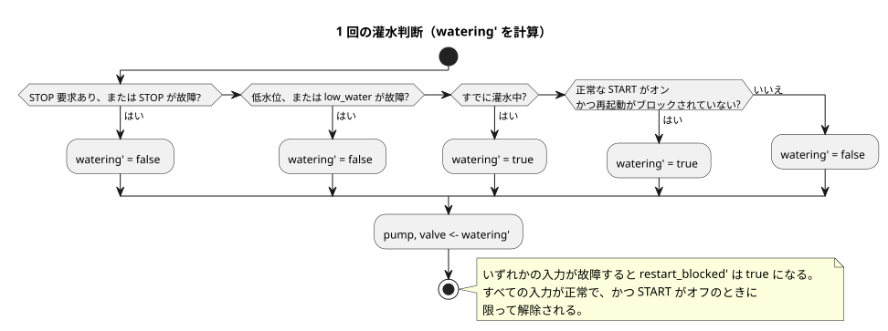

<!-- translation-source: examples/irrigation.ghost.md -->
[英語の原文](irrigation.ghost.md)
> 閲覧用の翻訳です。コンパイルには、リンク先の原本 `.ghost.md` ファイルを使用してください。

# 灌水ランタイムのフィクスチャ

この正本の文芸的（literate）フィクスチャは、ポータブルコアのホストテストに入力を供給します。これは仮想的な制御フィクスチャです。ハードウェアやデプロイの証拠ではありません。

この制御は 3 つの Bool 入力（`start`、`stop`、`low_water`）から判断し、`pump` と `valve` を同時に駆動します。`moisture` 入力は宣言されていますが、この判断には使われません。この明示的なリビジョン issue531-approved-fault-restart-v1 は、入力の故障が運転にどう影響するかを定義します。

- 正常な STOP 要求と低水位の検出は、引き続き優先され、灌水を停止します。
- START の故障は新たな起動を抑止します。進行中の運転を停止することはありません。
- STOP または低水位の故障は、運転を解除（停止）します。
- 故障の後で再起動するには、正常な START のオフからオンへの要求が必要です。

故障の品質と理由は、取得と `Result` のトレースに残ります。`low_fault` は、保護条件が成立していたか、または利用できなかったことを記録します。変更前のソースそのものは tests/fixtures/history/issue531 に保存されています。物理的な START ボタンやハードウェアの受け入れ検査を意味するものではありません。

次の図は 1 回の判断をまとめたものです。チェックは優先順位の順に実行され、`restart_blocked` フラグはそれと並行して更新されます。



```ghost
control irrigation {
  input start, stop, low_water: Bool;
  input moisture: Number;
  state watering: Bool = false;
  state low_fault: Bool = false;
  state restart_blocked: Bool = false;
  let start_good = case start { ok(_) => true; fault(_) => false; };
  let stop_good = case stop { ok(_) => true; fault(_) => false; };
  let low_good = case low_water { ok(_) => true; fault(_) => false; };
  let start_requested = start |> recover(false);
  let stop_requested = stop |> recover(true);
  let low_requested = low_water |> recover(true);
  output pump, valve: Bool;

  // Revision issue531-approved-fault-restart-v1: protection faults release the run.
  low_fault' = low_requested;
  restart_blocked' = if !start_good || !stop_good || !low_good then true
                     else if !start_requested then false else restart_blocked;
  watering' = if stop_requested || low_requested then false
              else watering || (start_requested && !restart_blocked);
  pump <- watering';
  valve <- watering';
}
```
