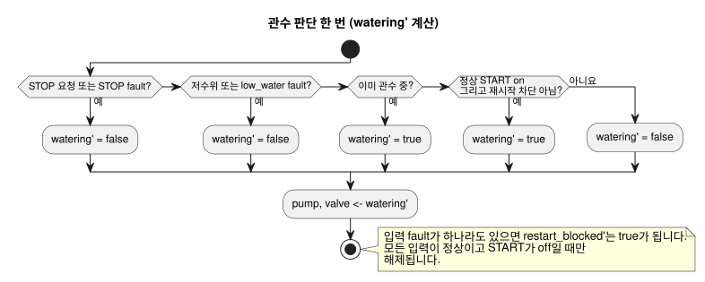

<!-- translation-source: examples/irrigation.ghost.md -->
[영문 원문](irrigation.ghost.md)

# 관수 런타임 픽스처

이 정본 문서형 소스(literate) 픽스처는 이식 가능한 코어(portable-core)의 호스트
테스트에 사용됩니다. 가상 제어 픽스처이며, 하드웨어나 배포의 증거가 아닙니다.

이 제어는 Bool 입력 세 개(`start`, `stop`, `low_water`)로 판단하고 `pump`와
`valve`를 함께 구동합니다. `moisture` 입력은 선언되어 있지만 이 판단에는 쓰이지
않습니다. 명시적 revision(판본) issue531-approved-fault-restart-v1은 입력 fault(고장)가
운전에 미치는 영향을 다음과 같이 정의합니다.

- 정상적인 STOP 요청과 저수위 감지는 여전히 우선하며 관수를 멈춥니다.
- START의 fault는 새 시작을 막습니다. 진행 중인 운전은 멈추지 않습니다.
- STOP이나 저수위 입력의 fault는 운전을 해제합니다(멈춥니다).
- fault 이후 재시작하려면 정상적인 START의 off→on 요청이 필요합니다.

fault의 품질과 이유는 취득 기록과 `Result` 추적(trace)에 남습니다. `low_fault`는
보호 조건이 발생했거나 사용할 수 없었음을 기록합니다. 정확한 이전 소스는
tests/fixtures/history/issue531에 보존되어 있습니다. 물리 START 버튼이나 하드웨어
인수 검증을 뜻하지 않습니다.

아래 다이어그램은 판단 한 번을 요약합니다. 검사는 우선순위 순서로 실행되며,
`restart_blocked` 플래그는 이와 함께 갱신됩니다.



```ghost
control irrigation {
  input start, stop, low_water: Bool;
  input moisture: Number;
  state watering: Bool = false;
  state low_fault: Bool = false;
  state restart_blocked: Bool = false;
  let start_good = case start { ok(_) => true; fault(_) => false; };
  let stop_good = case stop { ok(_) => true; fault(_) => false; };
  let low_good = case low_water { ok(_) => true; fault(_) => false; };
  let start_requested = start |> recover(false);
  let stop_requested = stop |> recover(true);
  let low_requested = low_water |> recover(true);
  output pump, valve: Bool;

  // Revision issue531-approved-fault-restart-v1: protection faults release the run.
  low_fault' = low_requested;
  restart_blocked' = if !start_good || !stop_good || !low_good then true
                     else if !start_requested then false else restart_blocked;
  watering' = if stop_requested || low_requested then false
              else watering || (start_requested && !restart_blocked);
  pump <- watering';
  valve <- watering';
}
```
