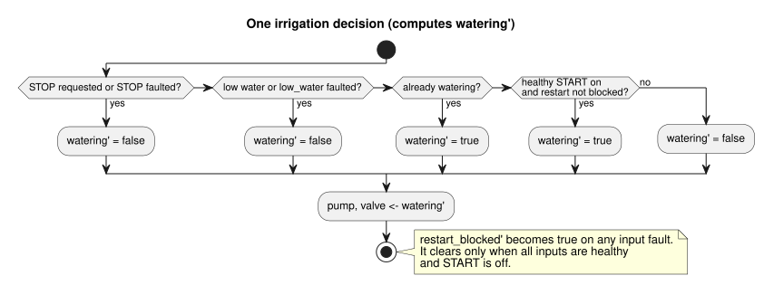

# Irrigation runtime fixture

This canonical literate fixture feeds the portable-core host tests. It is a
virtual control fixture. It is not evidence of hardware or of a deployment.

The control decides from three Bool inputs (`start`, `stop`, `low_water`) and
drives `pump` and `valve` together. The `moisture` input is declared but not
used by this decision. This explicit revision,
issue531-approved-fault-restart-v1, defines how input faults affect a run:

- A healthy STOP request and low-water detection still take priority and stop
  watering.
- A fault on START inhibits new starts. It does not stop a run in progress.
- A fault on STOP or on low water releases (stops) the run.
- After a fault, a restart requires a healthy START off-to-on request.

The fault's quality and reason remain in the acquisition and `Result` trace.
`low_fault` records that the protection condition was asserted or unavailable.
The exact predecessor source is retained under tests/fixtures/history/issue531.
No physical START button or hardware acceptance is implied.

The diagram summarizes one decision. The checks run in priority order; the
`restart_blocked` flag is updated alongside them.



```ghost
control irrigation {
  input start, stop, low_water: Bool;
  input moisture: Number;
  state watering: Bool = false;
  state low_fault: Bool = false;
  state restart_blocked: Bool = false;
  let start_good = case start { ok(_) => true; fault(_) => false; };
  let stop_good = case stop { ok(_) => true; fault(_) => false; };
  let low_good = case low_water { ok(_) => true; fault(_) => false; };
  let start_requested = start |> recover(false);
  let stop_requested = stop |> recover(true);
  let low_requested = low_water |> recover(true);
  output pump, valve: Bool;

  // Revision issue531-approved-fault-restart-v1: protection faults release the run.
  low_fault' = low_requested;
  restart_blocked' = if !start_good || !stop_good || !low_good then true
                     else if !start_requested then false else restart_blocked;
  watering' = if stop_requested || low_requested then false
              else watering || (start_requested && !restart_blocked);
  pump <- watering';
  valve <- watering';
}
```
