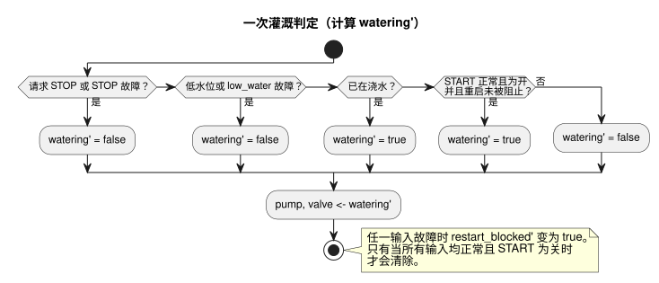

<!-- translation-source: examples/irrigation.ghost.md -->
[英文原文](irrigation.ghost.md)
> 本文为阅读用译本。编译时请使用上方链接的原始 `.ghost.md` 文件。

# 灌溉运行时测试夹具

这个规范的文学式源文件（literate）测试夹具为可移植核心的宿主测试提供输入。它是一个虚拟控制测试夹具，不能作为硬件或部署的证据。

该控制根据三个 Bool 输入（`start`、`stop`、`low_water`）做出判定，并同时驱动 `pump` 和 `valve`。`moisture` 输入已声明，但本判定并不使用它。显式修订版 issue531-approved-fault-restart-v1 定义了输入故障如何影响一次运行：

- 正常的 STOP 请求和低水位检测仍然优先，并会停止浇水。
- START 上的故障会抑制新的启动，但不会停止正在进行的运行。
- STOP 或低水位上的故障会释放（停止）运行。
- 发生故障后，重新启动需要一次正常的 START 由关到开的请求。

故障的质量和原因保留在采集记录和 `Result` 追踪中。`low_fault` 记录保护条件已被断言或不可用。确切的前一版源文件保存在 tests/fixtures/history/issue531 下。这里并不意味着存在物理 START 按钮或硬件验收。

下图概括了一次判定。各项检查按优先级顺序执行；`restart_blocked` 标志与它们同时更新。



```ghost
control irrigation {
  input start, stop, low_water: Bool;
  input moisture: Number;
  state watering: Bool = false;
  state low_fault: Bool = false;
  state restart_blocked: Bool = false;
  let start_good = case start { ok(_) => true; fault(_) => false; };
  let stop_good = case stop { ok(_) => true; fault(_) => false; };
  let low_good = case low_water { ok(_) => true; fault(_) => false; };
  let start_requested = start |> recover(false);
  let stop_requested = stop |> recover(true);
  let low_requested = low_water |> recover(true);
  output pump, valve: Bool;

  // Revision issue531-approved-fault-restart-v1: protection faults release the run.
  low_fault' = low_requested;
  restart_blocked' = if !start_good || !stop_good || !low_good then true
                     else if !start_requested then false else restart_blocked;
  watering' = if stop_requested || low_requested then false
              else watering || (start_requested && !restart_blocked);
  pump <- watering';
  valve <- watering';
}
```
