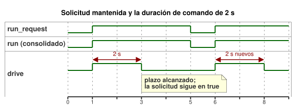

<!-- translation-source: examples/optional-feedback-timer.ghost.md -->
[Original en inglés](optional-feedback-timer.ghost.md)
> Traducción de lectura. Para compilar, use el archivo original `.ghost.md` enlazado.

# Control por temporizador con observación opcional

Revisión explícita de calidad de entrada del 2026-10-05: si la solicitud es desconocida, se conserva el estado de marcha ya establecido, y el plazo de dos segundos sigue aplicándose. La calidad de entrada no afirma un fallo físico.

El operador establece una duración de comando para este ejemplo: dos segundos. Es un valor ilustrativo. No es un tiempo de recorrido medido ni un ajuste aprobado para ninguna instalación concreta. Sustitúyalo únicamente por un valor de instalación establecido explícitamente. Calcular la intención de salida no requiere ninguna retroalimentación física.

`run_request` es una solicitud Bool mantenida. El temporizador se comporta así:

- El primer escaneo `true` aceptado inicia un intervalo nuevo.
- Los escaneos `true` repetidos no reinician el temporizador.
- A los dos segundos, `drive` solicitado y seguro pasan a `false`. Mantener la solicitud en `true` no lo reinicia.
- Un escaneo `false` detiene de inmediato y consolida `run = false`. Un escaneo `true` posterior inicia un intervalo nuevo.
- Un pulso `false`/`true` que cae entre escaneos aceptados no puede reiniciar el temporizador, porque el temporizador solo ve los escaneos aceptados.
- Un runtime nuevo inicializa de nuevo el estado y el temporizador, de modo que su primera solicitud `true` inicia un intervalo nuevo.

La línea de tiempo siguiente muestra estas reglas para una solicitud, una parada y una solicitud nueva.



`age` cronometra el estado Bool consolidado `run`. En una decisión en la que el estado solicitado difiere de `run`, `run_age` es cero, de modo que un arranque o una parada surte efecto en esa misma decisión. El temporizador usa el tiempo de escaneo monotónico suministrado. Si ningún escaneo cae exactamente en el límite, lo aplica el siguiente escaneo aceptado.

La capacidad opcional `observation` selecciona una estrategia: `Observed` cuando la capacidad está instalada y `Baseline` cuando está ausente. Ambas estrategias emiten exactamente la misma intención para el actuador. Este ejemplo no otorga a la observación ninguna autoridad de control.

El host de producción sigue devolviendo cada observación del sensor por separado: `true` sano, `false` sano, muestra ausente o fallo instalado. Para un sensor opcional ausente, el host devuelve una lectura de relleno `NotReady`; los metadatos de capacidad y la estrategia seleccionada establecen que está ausente. Suministrar una muestra no puede inventar una capacidad ausente, y un fallo no selecciona la estrategia de ausencia.

La finalización del temporizador marca el final de la duración de comando definida por el autor. No demuestra la aplicación por parte del renderizador, la actuación de un contacto de relé, el movimiento de la carga ni la posición. La intención solicitada, la intención segura, el comando aplicado y la evidencia física independiente permanecen separados.

```ghost
control OptionalFeedbackTimer {
  input run_request: Bool;
  output drive: Bool;
  input observation?: Bool;

  // Example value established by the operator; not a measured position.
  let calibrated_duration = 2s;
  state run: Bool = false;
  let requested = case run_request { ok(value) => value; fault(_) => run; };
  run' = requested;
  timer age = elapsed(run);
  let run_age = if requested == run then age else 0s;
  let timed_request = requested && run_age < calibrated_duration;

  adapt observation_policy {
    strategy Observed priority 10 match (observation: sensor<Bool>) {
      drive <- timed_request;
    }
    strategy Baseline priority 0 match always {
      drive <- timed_request;
    }
  }
}
```

Contratos relacionados: [sensores opcionales y evidencia de salida](../docs/reference/04-sensors-constraints-control.es.md), [observación y permisos](../docs/reference/05-settings-and-observation.es.md). Regresión y registro del flujo de trabajo: [GhostFlow #382](https://github.com/callin2/ghostflow-language/issues/382).
