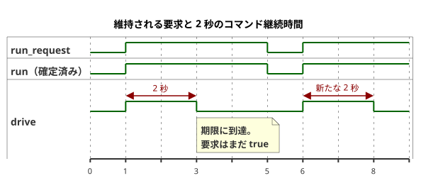

<!-- translation-source: examples/optional-feedback-timer.ghost.md -->
[英語の原文](optional-feedback-timer.ghost.md)
> 閲覧用の翻訳です。コンパイルには、リンク先の原本 `.ghost.md` ファイルを使用してください。

# オプションの観測を伴うタイマー制御

2026-10-05 の入力品質を明示するリビジョン：要求が不明な場合、確立済みの運転状態を維持し、2 秒の期限は引き続き適用されます。入力品質は物理的な故障を主張するものではありません。

オペレーターは、この例のコマンド継続時間を 2 秒と定めます。これは説明用の値です。測定した移動時間ではなく、特定の設備向けに承認された設定でもありません。置き換える場合は、明示的に確立された設備の値だけを使用してください。出力意図の計算に物理フィードバックは必要ありません。

`run_request` は維持される Bool の要求です。タイマーは次のように振る舞います。

- 最初に受理された `true` のスキャンで、新しい区間が始まります。
- `true` のスキャンが繰り返されても、タイマーはリセットされません。
- 2 秒に達すると、要求された `drive` と安全な `drive` は `false` になります。要求を `true` のまま維持しても再開しません。
- `false` のスキャンでは即座に停止し、`run = false` が確定します。その後の `true` のスキャンで、新しい区間が始まります。
- 受理されたスキャンとスキャンの間に収まる `false`/`true` のパルスでは、タイマーをリセットできません。タイマーは受理されたスキャンしか見ないためです。
- 新しいランタイムは状態とタイマーを再び初期化するので、その最初の `true` 要求で新しい区間が始まります。

次のタイムラインは、1 回の要求、停止、新しい要求について、これらのルールを示しています。



`age` は、確定済みの Bool 状態 `run` の時間を計ります。要求された状態が `run` と異なる判断では `run_age` が 0 になるため、起動や停止はその同じ判断で反映されます。タイマーは、供給された単調なスキャン時刻を使用します。ちょうど上限の時点にスキャンがない場合は、次に受理されたスキャンで上限が適用されます。

オプションの `observation` ケイパビリティ（capability）によって戦略が選択されます。ケイパビリティが設置されていれば `Observed`、存在しなければ `Baseline` です。どちらの戦略も、まったく同じアクチュエータ意図を出します。この例では、観測に一切の制御権限を与えません。

本番ホストは、引き続き各センサの観測を個別に返します。正常な `true`、正常な `false`、欠落したサンプル、設置済みセンサの故障のいずれかです。存在しないオプションのセンサについては、ホストは `NotReady` の読み取りプレースホルダーを返します。それが存在しないことを立証するのは、ケイパビリティのメタデータと選択された戦略です。サンプルを供給しても存在しないケイパビリティを作り出すことはできず、故障によって不在時の戦略が選択されることもありません。

タイマーの完了は、作成者が定めたコマンド継続時間の終わりを示します。レンダラーによる適用、リレー接点の動作、負荷の移動、位置を証明するものではありません。要求意図、安全意図、適用済みのコマンド、独立した物理的証拠は、それぞれ別のものとして扱われます。

```ghost
control OptionalFeedbackTimer {
  input run_request: Bool;
  output drive: Bool;
  input observation?: Bool;

  // Example value established by the operator; not a measured position.
  let calibrated_duration = 2s;
  state run: Bool = false;
  let requested = case run_request { ok(value) => value; fault(_) => run; };
  run' = requested;
  timer age = elapsed(run);
  let run_age = if requested == run then age else 0s;
  let timed_request = requested && run_age < calibrated_duration;

  adapt observation_policy {
    strategy Observed priority 10 match (observation: sensor<Bool>) {
      drive <- timed_request;
    }
    strategy Baseline priority 0 match always {
      drive <- timed_request;
    }
  }
}
```

関連する契約：[オプションのセンサと出力の証拠](../docs/reference/04-sensors-constraints-control.ja.md)、[観測と権限](../docs/reference/05-settings-and-observation.ja.md)。回帰テストとワークフローの登録：[GhostFlow #382](https://github.com/callin2/ghostflow-language/issues/382)。
