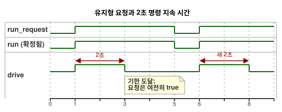

<!-- translation-source: examples/optional-feedback-timer.ghost.md -->
[영문 원문](optional-feedback-timer.ghost.md)

# 선택적 관찰을 포함한 타이머 제어

2026-10-05 명시적 입력 품질 개정: 요청을 알 수 없으면 기존 운전 상태를 유지하며, 2초 기한은 그대로 적용됩니다. 입력 품질은 물리적인 고장을 뜻하지 않습니다.

운영자는 이 예제의 명령 지속 시간을 2초로 정합니다. 설명을 위한 값입니다. 측정된 이동 시간이 아니며, 특정 설비에 승인된 설정값도 아닙니다. 설비에서 명시적으로 정한 값으로만 바꾸세요. 출력 의도를 계산하는 데 물리 피드백은 필요하지 않습니다.

`run_request`는 유지형 Bool 요청입니다. 타이머는 다음과 같이 동작합니다.

- 처음 수락한 `true` 스캔에서 새 구간을 시작합니다.
- 반복되는 `true` 스캔은 타이머를 초기화하지 않습니다.
- 2초가 되면 요청 의도와 안전 의도의 `drive`가 `false`가 됩니다. 요청을 `true`로 유지해도 다시 시작하지 않습니다.
- `false` 스캔은 즉시 정지하고 `run = false`를 확정합니다. 이후의 `true` 스캔은 새 구간을 시작합니다.
- 수락한 스캔 사이에 들어간 `false`/`true` 펄스는 타이머를 초기화할 수 없습니다. 타이머는 수락한 스캔만 보기 때문입니다.
- 새 런타임은 상태와 타이머를 다시 초기화하므로, 첫 `true` 요청이 새 구간을 시작합니다.

아래 타임라인은 요청 하나, 정지, 새 요청에 대해 이 규칙을 보여 줍니다.



`age`는 확정된 Bool 상태 `run`의 경과 시간을 잽니다. 요청한 상태가 `run`과 다른 판단에서는 `run_age`가 0이므로, 시작이나 정지는 바로 그 판단에서 효력이 생깁니다. 타이머는 공급된 단조 스캔 시간을 사용합니다. 정확히 한계 시점에 스캔이 없으면 다음에 수락한 스캔에서 한계를 적용합니다.

선택적 `observation` capability는 strategy를 선택합니다. capability가 설치되어 있으면 `Observed`, 없으면 `Baseline`입니다. 두 strategy는 정확히 같은 액추에이터 의도를 냅니다. 이 예제는 관찰에 제어 권한을 주지 않습니다.

운영 호스트는 여전히 각 센서 관찰을 따로 반환합니다. 정상 `true`, 정상 `false`, 샘플 없음, 설치된 센서의 fault(고장)입니다. 부재한 선택적 센서에 대해서는 호스트가 `NotReady` 읽기 자리표시값(placeholder)을 반환합니다. 부재 여부는 capability 메타데이터와 선택된 strategy가 정합니다. 샘플을 공급한다고 부재한 capability가 생기지 않으며, fault가 부재 strategy를 선택하지도 않습니다.

타이머 완료는 작성된 명령 지속 시간이 끝났음을 나타냅니다. renderer 적용, 릴레이 접점 동작, 부하 이동, 위치를 증명하지 않습니다. 요청 의도, 안전 의도, 적용된 명령, 독립적인 물리 증거는 서로 구별됩니다.

```ghost
control OptionalFeedbackTimer {
  input run_request: Bool;
  output drive: Bool;
  input observation?: Bool;

  // Example value established by the operator; not a measured position.
  let calibrated_duration = 2s;
  state run: Bool = false;
  let requested = case run_request { ok(value) => value; fault(_) => run; };
  run' = requested;
  timer age = elapsed(run);
  let run_age = if requested == run then age else 0s;
  let timed_request = requested && run_age < calibrated_duration;

  adapt observation_policy {
    strategy Observed priority 10 match (observation: sensor<Bool>) {
      drive <- timed_request;
    }
    strategy Baseline priority 0 match always {
      drive <- timed_request;
    }
  }
}
```

관련 계약: [선택적 센서와 출력 증거](../docs/reference/04-sensors-constraints-control.md), [관찰과 권한](../docs/reference/05-settings-and-observation.md). 회귀 검증과 workflow 등록: [GhostFlow #382](https://github.com/callin2/ghostflow-language/issues/382).
