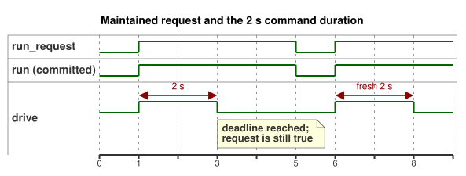

# Timer control with optional observation

2026-10-05 explicit input-quality revision: if the request is unknown, the established run state is kept, and the two-second deadline still applies. Input quality does not assert a physical failure.

The operator establishes a command duration for this example: two seconds. This is an illustrative value. It is not a measured travel time, and it is not an approved setting for any particular installation. Replace it only with an explicitly established installation value. Calculating the output intent requires no physical feedback.

`run_request` is a maintained Bool request. The timer behaves as follows:

- The first accepted `true` scan starts a new interval.
- Repeated `true` scans do not reset the timer.
- At two seconds, requested and safe `drive` become `false`. Keeping the request `true` does not restart it.
- A `false` scan stops immediately and commits `run = false`. A later `true` scan starts a fresh interval.
- A `false`/`true` pulse that falls between accepted scans cannot reset the timer, because the timer only sees accepted scans.
- A new runtime initializes state and timer again, so its first `true` request starts a new interval.

The timeline below shows these rules for one request, a stop, and a new request.



`age` times the committed Bool state `run`. On a decision where the requested state differs from `run`, `run_age` is zero, so a start or stop takes effect in that same decision. The timer uses the supplied monotonic scan time. If no scan falls exactly at the limit, the next accepted scan applies it.

The optional `observation` capability selects a strategy: `Observed` when the capability is installed, `Baseline` when it is absent. Both strategies issue exactly the same actuator intent. This example grants observation no control authority.

The production host still returns each sensor observation separately: healthy `true`, healthy `false`, missing sample, or installed fault. For an absent optional sensor, the host returns a `NotReady` reading placeholder; the capability metadata and the selected strategy establish that it is absent. Supplying a sample cannot invent an absent capability, and a fault does not select the absence strategy.

Timer completion marks the end of the authored command duration. It does not prove renderer application, relay contact operation, load movement, or position. Requested intent, safe intent, the applied command, and independent physical evidence remain separate.

```ghost
control OptionalFeedbackTimer {
  input run_request: Bool;
  output drive: Bool;
  input observation?: Bool;

  // Example value established by the operator; not a measured position.
  let calibrated_duration = 2s;
  state run: Bool = false;
  let requested = case run_request { ok(value) => value; fault(_) => run; };
  run' = requested;
  timer age = elapsed(run);
  let run_age = if requested == run then age else 0s;
  let timed_request = requested && run_age < calibrated_duration;

  adapt observation_policy {
    strategy Observed priority 10 match (observation: sensor<Bool>) {
      drive <- timed_request;
    }
    strategy Baseline priority 0 match always {
      drive <- timed_request;
    }
  }
}
```

Related contracts: [optional sensors and output evidence](../docs/reference/04-sensors-constraints-control.en.md), [observation and permissions](../docs/reference/05-settings-and-observation.en.md). Regression and workflow registration: [GhostFlow #382](https://github.com/callin2/ghostflow-language/issues/382).
