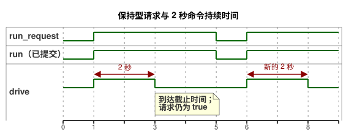

<!-- translation-source: examples/optional-feedback-timer.ghost.md -->
[英文原文](optional-feedback-timer.ghost.md)
> 本文为阅读用译本。编译时请使用上方链接的原始 `.ghost.md` 文件。

# 带可选观测的定时器控制

2026-10-05 显式输入质量修订版：如果请求未知，则保持已确立的运行状态，两秒截止时间仍然适用。输入质量并不断言存在物理故障。

操作员为本示例确立了一个命令持续时间：两秒。这是一个示意值，不是测得的行程时间，也不是针对任何特定设施批准的设置。只有在明确确立了设施的实际值时才可替换它。计算输出意图不需要任何物理反馈。

`run_request` 是一个保持型 Bool 请求。定时器的行为如下：

- 第一个被接受的 `true` 扫描开始一个新的区间。
- 重复的 `true` 扫描不会重置定时器。
- 到达两秒时，请求的和安全的 `drive` 变为 `false`。继续保持请求为 `true` 不会使其重新开始。
- `false` 扫描会立即停止，并提交 `run = false`。之后的 `true` 扫描会开始一个新的区间。
- 落在两次被接受扫描之间的 `false`/`true` 脉冲无法重置定时器，因为定时器只看到被接受的扫描。
- 新的运行时会重新初始化状态和定时器，因此它的第一个 `true` 请求会开始一个新的区间。

下面的时序图针对一次请求、一次停止和一次新请求展示了这些规则。



`age` 对已提交的 Bool 状态 `run` 计时。在请求状态与 `run` 不同的判定中，`run_age` 为零，因此启动或停止会在同一次判定中生效。定时器使用所提供的单调扫描时间。如果没有扫描恰好落在限值时刻，则由下一个被接受的扫描应用该限值。

可选的 `observation` 能力（capability）用于选择策略：安装了该能力时选择 `Observed`，缺失时选择 `Baseline`。两种策略发出完全相同的执行器意图。本示例不赋予观测任何控制权。

生产宿主（host）仍然分别返回每个传感器观测：正常的 `true`、正常的 `false`、缺失的样本或已安装传感器的故障。对于缺失的可选传感器，宿主返回一个 `NotReady` 读数占位符；由能力元数据和所选策略来确定它是缺失的。提供样本并不能凭空造出一个缺失的能力，故障也不会选择缺失策略。

定时器完成标志着所编写的命令持续时间结束。它并不能证明渲染器（renderer）已应用、继电器触点已动作、负载已移动或已到达某个位置。请求意图、安全意图、已应用的命令以及独立的物理证据始终相互区分。

```ghost
control OptionalFeedbackTimer {
  input run_request: Bool;
  output drive: Bool;
  input observation?: Bool;

  // Example value established by the operator; not a measured position.
  let calibrated_duration = 2s;
  state run: Bool = false;
  let requested = case run_request { ok(value) => value; fault(_) => run; };
  run' = requested;
  timer age = elapsed(run);
  let run_age = if requested == run then age else 0s;
  let timed_request = requested && run_age < calibrated_duration;

  adapt observation_policy {
    strategy Observed priority 10 match (observation: sensor<Bool>) {
      drive <- timed_request;
    }
    strategy Baseline priority 0 match always {
      drive <- timed_request;
    }
  }
}
```

相关契约：[可选传感器与输出证据](../docs/reference/04-sensors-constraints-control.zh.md)、[观测与权限](../docs/reference/05-settings-and-observation.zh.md)。回归与工作流注册：[GhostFlow #382](https://github.com/callin2/ghostflow-language/issues/382)。
