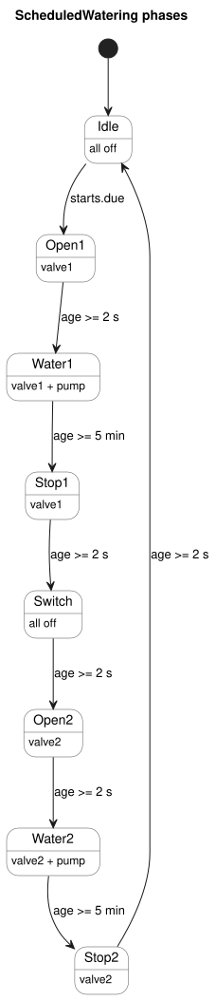

<!-- translation-source: examples/scheduled-watering.ghost.md -->
[Korean original](scheduled-watering.ghost.md)
> Reading translation. Compile the linked original `.ghost.md` file.

# Sequential watering by daily schedule

This document mixes explanation with GhostFlow code. The control/literate
compiler builds it, and the manifest-aware host runs it. It is a virtual
tutorial: it drives no physical outputs. The linked Korean original is the
canonical executable program; `scheduled-watering.ghost` is non-executable
historical evidence.

The task: at each selected time, water zone 1 and then zone 2. Both zones share
one pump.

```ghost
// Executable with ghostc and the manifest-aware virtual host; no GPIO driver.
control ScheduledWatering {
```

## When does watering start?

The schedule divides the day into 96 slots of 15 minutes each. You select the
slots you want. This example starts at 06:00, 06:15, 12:30, and 18:45 Korea
time.

```ghost
  schedule starts: DailySlots<15min> {
    timezone = "Asia/Seoul";
    selected = [06:00, 06:15, 12:30, 18:45];
  }
```

## How long does watering run?

The timing rules:

- Water each zone for five minutes.
- After opening a valve, wait two seconds before turning on the pump.
- After stopping the pump, keep that valve open for two more seconds.
- Between zones, wait two seconds with both valves closed.

These are configured durations. They are not sensor values that confirm what
the devices actually did.

```ghost
  let water1_time = 5min;
  let water2_time = 5min;
  let valve_delay = 2s;
  let pump_stop_delay = 2s;
  let switch_delay = 2s;

  output pump, valve1, valve2: Bool;
```

## How far has the sequence progressed?

`phase` is the current step, and `age` is the time spent in that step. When a
phase transition commits, `age` resets to zero. Ghost execution restores the
phase and the timer state together.

```ghost
  type Phase =
      Idle
    | Open1
    | Water1
    | Stop1
    | Switch
    | Open2
    | Water2
    | Stop2;

  state phase: Phase = Idle;
  timer age = elapsed(phase);
```

## What is the next step?

Schedule start signals are accepted only in `Idle`. A scheduled occurrence that
arrives while a cycle is running is skipped, not queued. Each phase only checks
its elapsed time, so the control loop is never blocked.

The state diagram shows the full cycle. Each arrow is labeled with its
condition, using the configured values (`valve_delay`, `pump_stop_delay` and
`switch_delay` are 2 s; `water1_time` and `water2_time` are 5 min).



```ghost
  phase' = case phase {
    Idle =>
      if starts.due then Open1 else Idle;

    Open1 =>
      if age >= valve_delay then Water1 else Open1;

    Water1 =>
      if age >= water1_time then Stop1 else Water1;

    Stop1 =>
      if age >= pump_stop_delay then Switch else Stop1;

    Switch =>
      if age >= switch_delay then Open2 else Switch;

    Open2 =>
      if age >= valve_delay then Water2 else Open2;

    Water2 =>
      if age >= water2_time then Stop2 else Water2;

    Stop2 =>
      if age >= pump_stop_delay then Idle else Stop2;
  };
```

## What outputs are requested?

This step computes the intended valves and pump for the next phase (`phase'`).
Output definitions do not run block by block. All candidate outputs for a tick
are calculated together, and then the constraints are applied: the pump needs
an open valve, and the two valves are never requested open at the same time.

```ghost
  valve1 <- phase' in {Open1, Water1, Stop1};
  valve2 <- phase' in {Open2, Water2, Stop2};
  pump   <- phase' in {Water1, Water2};

  require pump => (valve1 || valve2);
  require !(valve1 && valve2);
}
```

## Expected sequence

The table below is explanatory material. It is not executable code or program
input. By configuration, one cycle takes about 10 minutes 10 seconds. Actual
phase transitions also include tick-resolution error.

| Phase | Duration | Pump | Valve 1 | Valve 2 |
|---|---|---|---|---|
| Open1 | 2 seconds | Off | Request open | Request closed |
| Water1 | 5 minutes | On | Request open | Request closed |
| Stop1 | 2 seconds | Off | Request open | Request closed |
| Switch | 2 seconds | Off | Request closed | Request closed |
| Open2 | 2 seconds | Off | Request closed | Request open |
| Water2 | 5 minutes | On | Request closed | Request open |
| Stop2 | 2 seconds | Off | Request closed | Request open |
| Idle | Until next schedule | Off | Request closed | Request closed |
