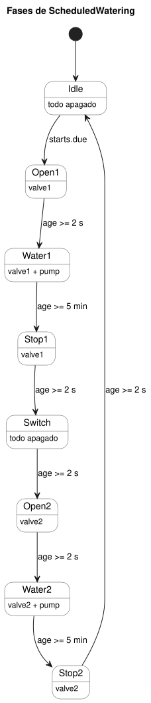

<!-- translation-source: examples/scheduled-watering.ghost.en.md -->
[Original en inglés](scheduled-watering.ghost.en.md)
> Traducción de lectura. Para compilar, use el archivo original en coreano [`scheduled-watering.ghost.md`](scheduled-watering.ghost.md).

# Riego secuencial según una programación diaria

Este documento combina explicaciones con código GhostFlow. El compilador de
control/fuente literaria lo construye, y el host que conoce el manifiesto lo
ejecuta. Es un tutorial virtual: no acciona ninguna salida física. El original
en coreano enlazado es el programa ejecutable canónico;
`scheduled-watering.ghost` es evidencia histórica no ejecutable.

La tarea: en cada hora seleccionada, regar la zona 1 y después la zona 2. Ambas
zonas comparten una bomba.

```ghost
// Executable with ghostc and the manifest-aware virtual host; no GPIO driver.
control ScheduledWatering {
```

## ¿Cuándo empieza el riego?

La programación divide el día en 96 franjas de 15 minutos cada una. Usted
selecciona las franjas que desea. Este ejemplo arranca a las 06:00, 06:15,
12:30 y 18:45, hora de Corea.

```ghost
  schedule starts: DailySlots<15min> {
    timezone = "Asia/Seoul";
    selected = [06:00, 06:15, 12:30, 18:45];
  }
```

## ¿Cuánto dura el riego?

Las reglas de temporización:

- Regar cada zona durante cinco minutos.
- Tras abrir una válvula, esperar dos segundos antes de encender la bomba.
- Tras detener la bomba, mantener esa válvula abierta dos segundos más.
- Entre zonas, esperar dos segundos con ambas válvulas cerradas.

Son duraciones configuradas. No son valores de sensor que confirmen lo que los
dispositivos hicieron realmente.

```ghost
  let water1_time = 5min;
  let water2_time = 5min;
  let valve_delay = 2s;
  let pump_stop_delay = 2s;
  let switch_delay = 2s;

  output pump, valve1, valve2: Bool;
```

## ¿Hasta dónde ha avanzado la secuencia?

`phase` es el paso actual, y `age` es el tiempo transcurrido en ese paso.
Cuando se consolida una transición de fase, `age` vuelve a cero. La ejecución
ghost restaura conjuntamente la fase y el estado del temporizador.

```ghost
  type Phase =
      Idle
    | Open1
    | Water1
    | Stop1
    | Switch
    | Open2
    | Water2
    | Stop2;

  state phase: Phase = Idle;
  timer age = elapsed(phase);
```

## ¿Cuál es el siguiente paso?

Las señales de inicio de la programación solo se aceptan en `Idle`. Una
ocurrencia programada que llega mientras hay un ciclo en curso se omite; no se
pone en cola. Cada fase solo comprueba su tiempo transcurrido, por lo que el
bucle de control nunca se bloquea.

El diagrama de estados muestra el ciclo completo. Cada flecha lleva su
condición, con los valores configurados (`valve_delay`, `pump_stop_delay` y
`switch_delay` son 2 s; `water1_time` y `water2_time` son 5 min).



```ghost
  phase' = case phase {
    Idle =>
      if starts.due then Open1 else Idle;

    Open1 =>
      if age >= valve_delay then Water1 else Open1;

    Water1 =>
      if age >= water1_time then Stop1 else Water1;

    Stop1 =>
      if age >= pump_stop_delay then Switch else Stop1;

    Switch =>
      if age >= switch_delay then Open2 else Switch;

    Open2 =>
      if age >= valve_delay then Water2 else Open2;

    Water2 =>
      if age >= water2_time then Stop2 else Water2;

    Stop2 =>
      if age >= pump_stop_delay then Idle else Stop2;
  };
```

## ¿Qué salidas se solicitan?

Este paso calcula las válvulas y la bomba previstas para la siguiente fase
(`phase'`). Las definiciones de salida no se ejecutan bloque a bloque. Todas
las salidas candidatas de un tick se calculan juntas y después se aplican las
restricciones: la bomba necesita una válvula abierta, y nunca se solicita que
las dos válvulas estén abiertas a la vez.

```ghost
  valve1 <- phase' in {Open1, Water1, Stop1};
  valve2 <- phase' in {Open2, Water2, Stop2};
  pump   <- phase' in {Water1, Water2};

  require pump => (valve1 || valve2);
  require !(valve1 && valve2);
}
```

## Secuencia esperada

La tabla siguiente es material explicativo. No es código ejecutable ni entrada
del programa. Según la configuración, un ciclo dura unos 10 minutos y 10
segundos. Las transiciones de fase reales incluyen además el error debido a la
resolución del tick.

| Fase | Duración | Bomba | Válvula 1 | Válvula 2 |
|---|---|---|---|---|
| Open1 | 2 segundos | Apagada | Solicitar abierta | Solicitar cerrada |
| Water1 | 5 minutos | Encendida | Solicitar abierta | Solicitar cerrada |
| Stop1 | 2 segundos | Apagada | Solicitar abierta | Solicitar cerrada |
| Switch | 2 segundos | Apagada | Solicitar cerrada | Solicitar cerrada |
| Open2 | 2 segundos | Apagada | Solicitar cerrada | Solicitar abierta |
| Water2 | 5 minutos | Encendida | Solicitar cerrada | Solicitar abierta |
| Stop2 | 2 segundos | Apagada | Solicitar cerrada | Solicitar abierta |
| Idle | Hasta la siguiente programación | Apagada | Solicitar cerrada | Solicitar cerrada |
