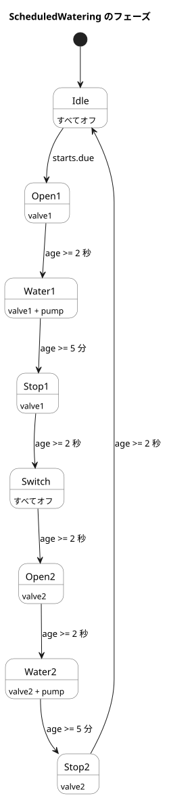

<!-- translation-source: examples/scheduled-watering.ghost.en.md -->
[英語の原文](scheduled-watering.ghost.en.md)
> 閲覧用の翻訳です。コンパイルには、リンク先の原本 `.ghost.md` ファイルを使用してください。

# 日次スケジュールによる順次灌水

この文書は、説明と GhostFlow コードを混在させたものです。control/literate コンパイラがこれをビルドし、マニフェスト対応のホストが実行します。これは仮想的なチュートリアルであり、物理出力は一切駆動しません。リンク先の韓国語の原本が正本の実行可能プログラムです。`scheduled-watering.ghost` は実行できない過去の証拠です。

課題は、選択した各時刻に区画 1、続いて区画 2 に灌水することです。2 つの区画は 1 台のポンプを共有します。

```ghost
// Executable with ghostc and the manifest-aware virtual host; no GPIO driver.
control ScheduledWatering {
```

## 灌水はいつ始まるか

スケジュールは 1 日を 15 分ずつの 96 個のスロットに分割します。必要なスロットを選択します。この例では、韓国時間の 06:00、06:15、12:30、18:45 に開始します。

```ghost
  schedule starts: DailySlots<15min> {
    timezone = "Asia/Seoul";
    selected = [06:00, 06:15, 12:30, 18:45];
  }
```

## 灌水はどれくらい続くか

タイミングのルールは次のとおりです。

- 各区画に 5 分間灌水します。
- バルブを開いたら、2 秒待ってからポンプをオンにします。
- ポンプを停止したら、そのバルブをさらに 2 秒間開いたままにします。
- 区画を切り替える間は、両方のバルブを閉じたまま 2 秒待ちます。

これらは設定された継続時間です。デバイスが実際に何をしたかを確認するセンサ値ではありません。

```ghost
  let water1_time = 5min;
  let water2_time = 5min;
  let valve_delay = 2s;
  let pump_stop_delay = 2s;
  let switch_delay = 2s;

  output pump, valve1, valve2: Bool;
```

## シーケンスはどこまで進んだか

`phase` は現在のステップで、`age` はそのステップで経過した時間です。フェーズ遷移が確定すると、`age` は 0 にリセットされます。ゴースト実行では、フェーズとタイマーの状態をまとめて復元します。

```ghost
  type Phase =
      Idle
    | Open1
    | Water1
    | Stop1
    | Switch
    | Open2
    | Water2
    | Stop2;

  state phase: Phase = Idle;
  timer age = elapsed(phase);
```

## 次のステップは何か

スケジュールの開始信号は `Idle` のときにだけ受け付けられます。サイクルの実行中に到来したスケジュールのオカレンスは、キューに入れられずにスキップされます。各フェーズは自身の経過時間を確認するだけなので、制御ループがブロックされることはありません。

次の状態図は、サイクル全体を示しています。各矢印には、設定値を使った条件がラベルとして付いています（`valve_delay`、`pump_stop_delay`、`switch_delay` は 2 秒、`water1_time` と `water2_time` は 5 分です）。



```ghost
  phase' = case phase {
    Idle =>
      if starts.due then Open1 else Idle;

    Open1 =>
      if age >= valve_delay then Water1 else Open1;

    Water1 =>
      if age >= water1_time then Stop1 else Water1;

    Stop1 =>
      if age >= pump_stop_delay then Switch else Stop1;

    Switch =>
      if age >= switch_delay then Open2 else Switch;

    Open2 =>
      if age >= valve_delay then Water2 else Open2;

    Water2 =>
      if age >= water2_time then Stop2 else Water2;

    Stop2 =>
      if age >= pump_stop_delay then Idle else Stop2;
  };
```

## どの出力が要求されるか

このステップでは、次のフェーズ（`phase'`）に対して意図されるバルブとポンプを計算します。出力の定義はブロックごとに実行されるわけではありません。1 tick のすべての候補出力がまとめて計算され、その後に制約が適用されます。ポンプには開いたバルブが必要であり、2 つのバルブが同時に開くよう要求されることは決してありません。

```ghost
  valve1 <- phase' in {Open1, Water1, Stop1};
  valve2 <- phase' in {Open2, Water2, Stop2};
  pump   <- phase' in {Water1, Water2};

  require pump => (valve1 || valve2);
  require !(valve1 && valve2);
}
```

## 期待されるシーケンス

次の表は説明のための資料です。実行可能なコードやプログラムへの入力ではありません。設定上、1 サイクルは約 10 分 10 秒かかります。実際のフェーズ遷移には、tick の分解能による誤差も含まれます。

| フェーズ | 継続時間 | ポンプ | バルブ 1 | バルブ 2 |
|---|---|---|---|---|
| Open1 | 2 秒 | オフ | 開を要求 | 閉を要求 |
| Water1 | 5 分 | オン | 開を要求 | 閉を要求 |
| Stop1 | 2 秒 | オフ | 開を要求 | 閉を要求 |
| Switch | 2 秒 | オフ | 閉を要求 | 閉を要求 |
| Open2 | 2 秒 | オフ | 閉を要求 | 開を要求 |
| Water2 | 5 分 | オン | 閉を要求 | 開を要求 |
| Stop2 | 2 秒 | オフ | 閉を要求 | 開を要求 |
| Idle | 次のスケジュールまで | オフ | 閉を要求 | 閉を要求 |
