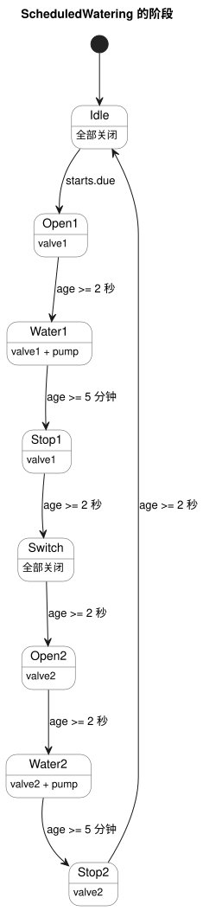

<!-- translation-source: examples/scheduled-watering.ghost.en.md -->
[英文原文](scheduled-watering.ghost.en.md)
> 本文为阅读用译本。编译时请使用原始文件 `scheduled-watering.ghost.md`（韩文原文）。

# 按每日调度计划依次浇水

本文档将说明与 GhostFlow 代码混合在一起。它由 control/文学式源文件（literate）编译器构建，并由支持清单（manifest）的宿主（host）运行。这是一个虚拟教程：它不驱动任何物理输出。上方链接的韩文原文才是规范的可执行程序；`scheduled-watering.ghost` 是不可执行的历史证据。

任务：在每个选定时刻，先给区域 1 浇水，再给区域 2 浇水。两个区域共用一台泵。

```ghost
// Executable with ghostc and the manifest-aware virtual host; no GPIO driver.
control ScheduledWatering {
```

## 何时开始浇水？

调度计划把一天划分为 96 个时段，每个时段 15 分钟。你可以选择需要的时段。本示例在韩国时间 06:00、06:15、12:30 和 18:45 开始。

```ghost
  schedule starts: DailySlots<15min> {
    timezone = "Asia/Seoul";
    selected = [06:00, 06:15, 12:30, 18:45];
  }
```

## 浇水持续多久？

时间规则如下：

- 每个区域浇水五分钟。
- 打开阀门后，等待两秒再开启泵。
- 停泵后，该阀门再保持打开两秒。
- 在两个区域之间，两个阀门都关闭并等待两秒。

这些是配置的持续时间，并不是确认设备实际动作的传感器值。

```ghost
  let water1_time = 5min;
  let water2_time = 5min;
  let valve_delay = 2s;
  let pump_stop_delay = 2s;
  let switch_delay = 2s;

  output pump, valve1, valve2: Bool;
```

## 顺序进行到哪一步了？

`phase` 是当前步骤，`age` 是在该步骤中经过的时间。阶段转换被提交时，`age` 归零。ghost（影子运行）会同时恢复阶段和定时器状态。

```ghost
  type Phase =
      Idle
    | Open1
    | Water1
    | Stop1
    | Switch
    | Open2
    | Water2
    | Stop2;

  state phase: Phase = Idle;
  timer age = elapsed(phase);
```

## 下一步是什么？

调度计划的启动信号只在 `Idle` 中被接受。循环运行期间到来的调度触发实例会被跳过，而不会排队。每个阶段只检查自己的经过时间，因此控制循环永远不会被阻塞。

状态图展示了完整的循环。每条箭头都标注了其条件，并使用配置值（`valve_delay`、`pump_stop_delay` 和 `switch_delay` 为 2 秒；`water1_time` 和 `water2_time` 为 5 分钟）。



```ghost
  phase' = case phase {
    Idle =>
      if starts.due then Open1 else Idle;

    Open1 =>
      if age >= valve_delay then Water1 else Open1;

    Water1 =>
      if age >= water1_time then Stop1 else Water1;

    Stop1 =>
      if age >= pump_stop_delay then Switch else Stop1;

    Switch =>
      if age >= switch_delay then Open2 else Switch;

    Open2 =>
      if age >= valve_delay then Water2 else Open2;

    Water2 =>
      if age >= water2_time then Stop2 else Water2;

    Stop2 =>
      if age >= pump_stop_delay then Idle else Stop2;
  };
```

## 请求哪些输出？

这一步为下一阶段（`phase'`）计算预期的阀门和泵。输出定义并不是逐块执行的。一个 tick（逻辑决策步）中的所有候选输出会一起计算，然后应用约束：泵需要有一个打开的阀门，两个阀门绝不会同时被请求打开。

```ghost
  valve1 <- phase' in {Open1, Water1, Stop1};
  valve2 <- phase' in {Open2, Water2, Stop2};
  pump   <- phase' in {Water1, Water2};

  require pump => (valve1 || valve2);
  require !(valve1 && valve2);
}
```

## 预期顺序

下表是说明材料，不是可执行代码，也不是程序输入。按配置，一个循环大约需要 10 分 10 秒。实际的阶段转换还包含 tick 分辨率带来的误差。

| 阶段 | 持续时间 | 泵 | 阀门 1 | 阀门 2 |
|---|---|---|---|---|
| Open1 | 2 秒 | 关 | 请求打开 | 请求关闭 |
| Water1 | 5 分钟 | 开 | 请求打开 | 请求关闭 |
| Stop1 | 2 秒 | 关 | 请求打开 | 请求关闭 |
| Switch | 2 秒 | 关 | 请求关闭 | 请求关闭 |
| Open2 | 2 秒 | 关 | 请求关闭 | 请求打开 |
| Water2 | 5 分钟 | 开 | 请求关闭 | 请求打开 |
| Stop2 | 2 秒 | 关 | 请求关闭 | 请求打开 |
| Idle | 直到下一次调度 | 关 | 请求关闭 | 请求关闭 |
