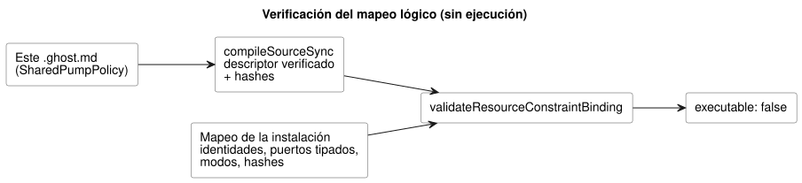

<!-- translation-source: examples/shared-constraint-contract.ghost.md -->
[Original en inglés](shared-constraint-contract.ghost.md)
> Traducción de lectura. Para compilar, use el archivo original `.ghost.md` enlazado.

# Un contrato completo y verificado de recurso compartido

Este documento contiene un control y se compila en un **descriptor no
ejecutable** verificado: un artefacto que el compilador ha comprobado pero que
ningún runtime ejecutará. Su mapeo lógico, solo de software, se muestra
completo a continuación.

Lo que este documento **no** hace:

- No instala un control.
- No protege salidas físicas. La aplicación en tiempo de ejecución es un
  contrato aparte, del que se hace seguimiento en #158.

Los nombres de entrada y salida son puertos lógicos. Los ID de recurso nombran
recursos virtuales, no hardware descubierto.

Los valores seguros explícitos seleccionan `pump=false` y `valve=true` para
este lazo virtual. Estos valores cumplen el requisito definido por el autor de
que la bomba necesita una válvula abierta (pump-needs-valve). No son un valor
predeterminado de todo apagado, ni una instrucción de secuenciación física.

```ghost
// Source revision: issue531-quality-shared-contract-v1
control SharedPumpPolicy {
  resource station: Station;
  resource pump1: BoolActuator;
  resource valve1: BoolActuator;
  input automatic, manual, pump_request, valve_request: Bool;
  output pump, valve: Bool;
  pump <- pump_request |> recover(false);
  valve <- valve_request |> recover(true);
  constraints SharedRules for station {
    exclusive at admission { automatic, manual };
    require at safe_output pump1.on => any_on({ valve1 });
    safe { pump1 = false; valve1 = true; }
  }
}
```

Ejecute el siguiente JavaScript desde la raíz del repositorio. Solo valida el
mapeo lógico:

- Los hashes proceden de este documento exacto y de su artefacto verificado.
- El mapeo de la instalación suministra identidades y puertos tipados. No
  suministra otro programa ni una política de reemplazo.
- Cada alias de recurso y cada modo tienen un mapeo explícito.
- Cambiar la política, la revisión de la prosa, el artefacto o la vinculación
  exige validar de nuevo.

El diagrama muestra el flujo de datos de esta comprobación. Su único resultado
es un mapeo validado que sigue informando `executable: false`.



```js
import fs from 'node:fs';
import { compileSourceSync } from './tools/compile-source.mjs';
import { validateResourceConstraintBinding } from './runtimes/node/resource-constraints-binding.mjs';

const filename = 'examples/shared-constraint-contract.ghost.md';
const compilation = compileSourceSync(fs.readFileSync(filename, 'utf8'), { filename });
const mapping = {
  format: 'GhostFlow/resource-constraints-binding-v1',
  revision: 'virtual-installation-r1',
  sourceDocumentSha256: compilation.sourceDocument.sha256,
  artifactSha256: compilation.manifest.bytecodeSha256,
  resources: [
    { name: 'station', resourceId: 'virtual/loop' },
    { name: 'pump1', resourceId: 'virtual/pump', output: 'pump' },
    { name: 'valve1', resourceId: 'virtual/valve', output: 'valve' },
  ],
  modes: [
    { group: 'SharedRules', name: 'automatic', input: 'automatic' },
    { group: 'SharedRules', name: 'manual', input: 'manual' },
  ],
};
const validated = validateResourceConstraintBinding(compilation, mapping);
console.log(validated.executable); // false: validation grants no execution
```

El validador rechaza un mapeo que presente cualquiera de los siguientes
problemas:

- identidades o puertos ausentes o que no coinciden;
- hashes obsoletos;
- ID de recurso con alias (dos nombres para el mismo recurso);
- entradas exclusivas duplicadas;
- campos de política dentro del mapeo.

Tanto el cargador de módulos nativo como el de WASM rechazan los bytes de este
descriptor, incluso si quien llama cambia el indicador JSON `executable`. Antes
de que este contrato compartido pueda ejecutarse, debe implementarse y
verificarse lo siguiente: el arbitraje de admisión, las transiciones seguras
continuas, la recuperación y un escritor único que cubra todas las rutas de
uso. Este mapeo lógico no define ninguna ABI de salida física.
