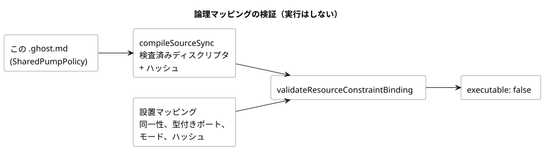

<!-- translation-source: examples/shared-constraint-contract.ghost.md -->
[英語の原文](shared-constraint-contract.ghost.md)
> 閲覧用の翻訳です。コンパイルには、リンク先の原本 `.ghost.md` ファイルを使用してください。

# 検査済みの完全な共有リソース契約

この文書には 1 つの control が含まれ、検査済みの**実行不能なディスクリプタ（descriptor）**にコンパイルされます。これは、コンパイラが検査したものの、どのランタイムも実行しない成果物です。そのソフトウェアのみの論理マッピングを、以下にすべて示します。

この文書が**行わない**こと：

- 制御をインストールしません。
- 物理出力を保護しません。ランタイムでの強制は別の契約であり、#158 で追跡されています。

入力名と出力名は論理ポートです。リソース ID は仮想リソースを指しており、検出されたハードウェアではありません。

明示的な安全値として、この仮想ループでは `pump=false` と `valve=true` を選択しています。これらの値は、ポンプには開いたバルブが必要という作成者が記述した要件（pump-needs-valve）を満たします。すべてを OFF にする既定値ではなく、物理的な順序付けの指示でもありません。

```ghost
// Source revision: issue531-quality-shared-contract-v1
control SharedPumpPolicy {
  resource station: Station;
  resource pump1: BoolActuator;
  resource valve1: BoolActuator;
  input automatic, manual, pump_request, valve_request: Bool;
  output pump, valve: Bool;
  pump <- pump_request |> recover(false);
  valve <- valve_request |> recover(true);
  constraints SharedRules for station {
    exclusive at admission { automatic, manual };
    require at safe_output pump1.on => any_on({ valve1 });
    safe { pump1 = false; valve1 = true; }
  }
}
```

リポジトリのルートで次の JavaScript を実行します。これが検証するのは論理マッピングだけです。

- ハッシュは、まさにこの文書とその検査済み成果物から得られます。
- 設置マッピングは、同一性と型付きのポートを供給します。別のプログラムや代替のポリシーを供給するものではありません。
- すべてのリソース別名とすべてのモードに、明示的なマッピングがあります。
- ポリシー、文章のリビジョン、成果物、またはバインディングを変更した場合は、再度の検証が必要です。

次の図は、この検査のデータの流れを示しています。唯一の結果は検証済みのマッピングであり、それは引き続き `executable: false` を報告します。



```js
import fs from 'node:fs';
import { compileSourceSync } from './tools/compile-source.mjs';
import { validateResourceConstraintBinding } from './runtimes/node/resource-constraints-binding.mjs';

const filename = 'examples/shared-constraint-contract.ghost.md';
const compilation = compileSourceSync(fs.readFileSync(filename, 'utf8'), { filename });
const mapping = {
  format: 'GhostFlow/resource-constraints-binding-v1',
  revision: 'virtual-installation-r1',
  sourceDocumentSha256: compilation.sourceDocument.sha256,
  artifactSha256: compilation.manifest.bytecodeSha256,
  resources: [
    { name: 'station', resourceId: 'virtual/loop' },
    { name: 'pump1', resourceId: 'virtual/pump', output: 'pump' },
    { name: 'valve1', resourceId: 'virtual/valve', output: 'valve' },
  ],
  modes: [
    { group: 'SharedRules', name: 'automatic', input: 'automatic' },
    { group: 'SharedRules', name: 'manual', input: 'manual' },
  ],
};
const validated = validateResourceConstraintBinding(compilation, mapping);
console.log(validated.executable); // false: validation grants no execution
```

検証器は、次のいずれかを含むマッピングを拒否します。

- 欠落した、または一致しない同一性やポート
- 古い（stale）ハッシュ
- 別名関係にあるリソース ID（同じリソースに 2 つの名前）
- 重複した排他入力
- マッピング内のポリシーフィールド

ネイティブと WASM のどちらのモジュールローダーも、呼び出し側が JSON の `executable` フラグを変更したとしても、これらのディスクリプタのバイト列を拒否します。この共有契約を実行できるようにするには、その前に、受け入れ（アドミッション）の調停、継続的な安全遷移、復旧、そしてすべての使用経路をカバーする唯一の書き込み主体を実装し、検証しなければなりません。この論理マッピングは、物理出力の ABI を一切定義しません。
