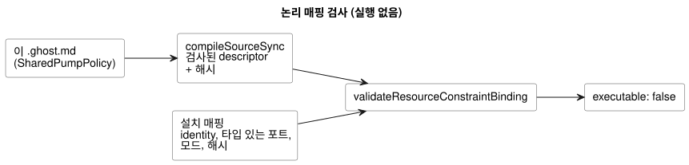

<!-- translation-source: examples/shared-constraint-contract.ghost.md -->
[영문 원문](shared-constraint-contract.ghost.md)

# 검사를 마친 완전한 공유 자원 계약

이 문서는 control 하나를 담고 있으며, 검사된 **실행 불가능한 descriptor**로
컴파일됩니다. 즉 컴파일러가 검사했지만 어떤 런타임도 실행하지 않는 산출물입니다.
소프트웨어 전용 논리 매핑 전체를 아래에 보입니다.

이 문서가 하지 **않는** 일은 다음과 같습니다.

- control을 설치하지 않습니다.
- 물리 출력을 보호하지 않습니다. 런타임 집행은 #158에서 추적하는 별도
  계약입니다.

입력과 출력 이름은 논리 포트입니다. 자원 ID는 발견된 하드웨어가 아니라 가상
자원을 가리킵니다.

명시적 안전 값은 이 가상 루프에 대해 `pump=false`와 `valve=true`를 선택합니다.
이 값은 펌프에 열린 밸브가 필요하다는, 작성된 요구 조건(pump-needs-valve)을
만족합니다. 모든 출력을 OFF로 두는 기본값이 아니며, 물리적 순서 지시도
아닙니다.

```ghost
// Source revision: issue531-quality-shared-contract-v1
control SharedPumpPolicy {
  resource station: Station;
  resource pump1: BoolActuator;
  resource valve1: BoolActuator;
  input automatic, manual, pump_request, valve_request: Bool;
  output pump, valve: Bool;
  pump <- pump_request |> recover(false);
  valve <- valve_request |> recover(true);
  constraints SharedRules for station {
    exclusive at admission { automatic, manual };
    require at safe_output pump1.on => any_on({ valve1 });
    safe { pump1 = false; valve1 = true; }
  }
}
```

저장소 루트에서 다음 JavaScript를 실행하세요. 논리 매핑만 검사합니다.

- 해시는 이 정확한 문서와 그 검사된 산출물에서 가져옵니다.
- 설치 매핑은 identity(정체성)와 타입 있는 포트를 제공합니다. 다른 프로그램이나
  대체 정책은 제공하지 않습니다.
- 모든 자원 별칭과 모든 모드에 명시적 매핑이 있습니다.
- 정책, 설명문 revision, 산출물, 바인딩 중 하나라도 바뀌면 다시 검사해야
  합니다.

아래 다이어그램은 이 검사의 데이터 흐름을 보여 줍니다. 유일한 결과는 여전히
`executable: false`를 보고하는, 검사를 통과한 매핑입니다.



```js
import fs from 'node:fs';
import { compileSourceSync } from './tools/compile-source.mjs';
import { validateResourceConstraintBinding } from './runtimes/node/resource-constraints-binding.mjs';

const filename = 'examples/shared-constraint-contract.ghost.md';
const compilation = compileSourceSync(fs.readFileSync(filename, 'utf8'), { filename });
const mapping = {
  format: 'GhostFlow/resource-constraints-binding-v1',
  revision: 'virtual-installation-r1',
  sourceDocumentSha256: compilation.sourceDocument.sha256,
  artifactSha256: compilation.manifest.bytecodeSha256,
  resources: [
    { name: 'station', resourceId: 'virtual/loop' },
    { name: 'pump1', resourceId: 'virtual/pump', output: 'pump' },
    { name: 'valve1', resourceId: 'virtual/valve', output: 'valve' },
  ],
  modes: [
    { group: 'SharedRules', name: 'automatic', input: 'automatic' },
    { group: 'SharedRules', name: 'manual', input: 'manual' },
  ],
};
const validated = validateResourceConstraintBinding(compilation, mapping);
console.log(validated.executable); // false: validation grants no execution
```

검사기는 다음 중 하나라도 해당하는 매핑을 거부합니다.

- 누락되었거나 일치하지 않는 identity 또는 포트
- 오래된(stale) 해시
- 별칭이 붙은 자원 ID(같은 자원에 이름이 두 개)
- 중복된 exclusive 입력
- 매핑 안에 들어 있는 정책 필드

호출자가 JSON의 `executable` 플래그를 바꾸더라도 native와 WASM 모듈 로더는 모두
이 descriptor 바이트를 거부합니다. 이 공유 계약을 실행하려면 먼저 다음을 구현하고
검증해야 합니다. admission(수용) 중재, 실행 중 안전 전환, 복구, 그리고 모든 사용
경로를 담당하는 단일 writer입니다. 이 논리 매핑은 물리 출력 ABI를 정의하지
않습니다.
