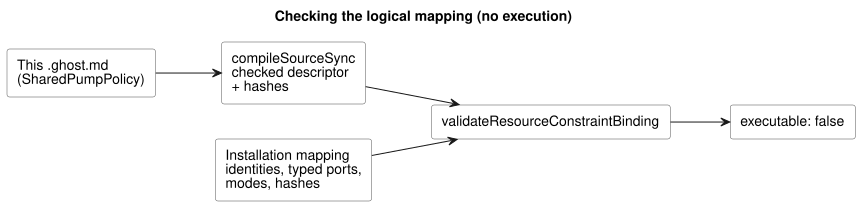

# A complete checked shared resource contract

This document holds one control, and it compiles to a checked
**nonexecutable descriptor**: an artifact that the compiler has checked but
that no runtime will run. Its software-only logical mapping is shown in full
below.

What this document does **not** do:

- It does not install a control.
- It does not protect physical outputs. Runtime enforcement is a separate
  contract, tracked by #158.

Input and output names are logical ports. The resource IDs name virtual
resources, not discovered hardware.

The explicit safe values select `pump=false` and `valve=true` for this virtual
loop. These values satisfy the authored requirement that the pump needs an open
valve (pump-needs-valve). They are not an all-OFF default, and they are not a
physical sequencing instruction.

```ghost
// Source revision: issue531-quality-shared-contract-v1
control SharedPumpPolicy {
  resource station: Station;
  resource pump1: BoolActuator;
  resource valve1: BoolActuator;
  input automatic, manual, pump_request, valve_request: Bool;
  output pump, valve: Bool;
  pump <- pump_request |> recover(false);
  valve <- valve_request |> recover(true);
  constraints SharedRules for station {
    exclusive at admission { automatic, manual };
    require at safe_output pump1.on => any_on({ valve1 });
    safe { pump1 = false; valve1 = true; }
  }
}
```

Run the following JavaScript from the repository root. It validates only the
logical mapping:

- The hashes come from this exact document and its checked artifact.
- The installation mapping supplies identities and typed ports. It does not
  supply another program or a replacement policy.
- Every resource alias and every mode has an explicit mapping.
- Changing the policy, the prose revision, the artifact, or the binding
  requires validating again.

The diagram shows the data flow of this check. Its only result is a validated
mapping that still reports `executable: false`.



```js
import fs from 'node:fs';
import { compileSourceSync } from './tools/compile-source.mjs';
import { validateResourceConstraintBinding } from './runtimes/node/resource-constraints-binding.mjs';

const filename = 'examples/shared-constraint-contract.ghost.md';
const compilation = compileSourceSync(fs.readFileSync(filename, 'utf8'), { filename });
const mapping = {
  format: 'GhostFlow/resource-constraints-binding-v1',
  revision: 'virtual-installation-r1',
  sourceDocumentSha256: compilation.sourceDocument.sha256,
  artifactSha256: compilation.manifest.bytecodeSha256,
  resources: [
    { name: 'station', resourceId: 'virtual/loop' },
    { name: 'pump1', resourceId: 'virtual/pump', output: 'pump' },
    { name: 'valve1', resourceId: 'virtual/valve', output: 'valve' },
  ],
  modes: [
    { group: 'SharedRules', name: 'automatic', input: 'automatic' },
    { group: 'SharedRules', name: 'manual', input: 'manual' },
  ],
};
const validated = validateResourceConstraintBinding(compilation, mapping);
console.log(validated.executable); // false: validation grants no execution
```

The validator rejects a mapping that has any of the following:

- missing or mismatched identities or ports;
- stale hashes;
- aliased resource IDs (two names for the same resource);
- duplicate exclusive inputs;
- policy fields inside the mapping.

Both the native and the WASM module loaders reject these descriptor bytes, even
if a caller changes the JSON `executable` flag. Before this shared contract can
execute, the following must be implemented and verified: admission arbitration,
ongoing safe transitions, recovery, and a sole writer that covers every use
path. This logical mapping defines no physical output ABI.
