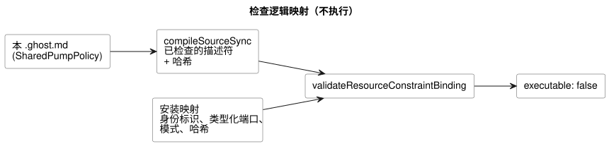

<!-- translation-source: examples/shared-constraint-contract.ghost.md -->
[英文原文](shared-constraint-contract.ghost.md)
> 本文为阅读用译本。编译时请使用上方链接的原始 `.ghost.md` 文件。

# 一份完整且已检查的共享资源契约

本文档包含一个 control，它会被编译为一个已检查的**不可执行描述符**：即编译器已经检查过、但任何运行时都不会运行的产物。下面完整展示了它的纯软件逻辑映射。

本文档**不**做的事情：

- 它不安装任何 control。
- 它不保护物理输出。运行时强制执行是另一份独立的契约，由 #158 跟踪。

输入和输出名称是逻辑端口。资源 ID 指代的是虚拟资源，而不是已发现的硬件。

显式安全值为这个虚拟回路选择了 `pump=false` 和 `valve=true`。这些值满足所编写的要求：泵需要一个打开的阀门（pump-needs-valve）。它们既不是全部关闭的默认值，也不是物理上的顺序操作指令。

```ghost
// Source revision: issue531-quality-shared-contract-v1
control SharedPumpPolicy {
  resource station: Station;
  resource pump1: BoolActuator;
  resource valve1: BoolActuator;
  input automatic, manual, pump_request, valve_request: Bool;
  output pump, valve: Bool;
  pump <- pump_request |> recover(false);
  valve <- valve_request |> recover(true);
  constraints SharedRules for station {
    exclusive at admission { automatic, manual };
    require at safe_output pump1.on => any_on({ valve1 });
    safe { pump1 = false; valve1 = true; }
  }
}
```

从仓库根目录运行下面的 JavaScript。它只验证逻辑映射：

- 哈希值来自这份确切的文档及其已检查的产物。
- 安装映射提供身份标识和类型化端口，不提供另一个程序或替代策略。
- 每个资源别名和每种模式都有显式映射。
- 更改策略、文字修订版、产物或绑定后都需要重新验证。

下图展示了这次检查的数据流。它唯一的结果是一份经过验证、但仍报告 `executable: false` 的映射。



```js
import fs from 'node:fs';
import { compileSourceSync } from './tools/compile-source.mjs';
import { validateResourceConstraintBinding } from './runtimes/node/resource-constraints-binding.mjs';

const filename = 'examples/shared-constraint-contract.ghost.md';
const compilation = compileSourceSync(fs.readFileSync(filename, 'utf8'), { filename });
const mapping = {
  format: 'GhostFlow/resource-constraints-binding-v1',
  revision: 'virtual-installation-r1',
  sourceDocumentSha256: compilation.sourceDocument.sha256,
  artifactSha256: compilation.manifest.bytecodeSha256,
  resources: [
    { name: 'station', resourceId: 'virtual/loop' },
    { name: 'pump1', resourceId: 'virtual/pump', output: 'pump' },
    { name: 'valve1', resourceId: 'virtual/valve', output: 'valve' },
  ],
  modes: [
    { group: 'SharedRules', name: 'automatic', input: 'automatic' },
    { group: 'SharedRules', name: 'manual', input: 'manual' },
  ],
};
const validated = validateResourceConstraintBinding(compilation, mapping);
console.log(validated.executable); // false: validation grants no execution
```

验证器会拒绝具有以下任一情况的映射：

- 身份标识或端口缺失或不匹配；
- 陈旧的哈希值；
- 互为别名的资源 ID（同一资源有两个名称）；
- 重复的互斥输入；
- 映射中包含策略字段。

原生加载器和 WASM 模块加载器都会拒绝这些描述符字节，即使调用方修改了 JSON 中的 `executable` 标志也一样。在这份共享契约能够执行之前，必须实现并验证以下内容：准入仲裁、持续的安全转换、恢复，以及覆盖所有使用路径的唯一写入者。这份逻辑映射不定义任何物理输出 ABI。
