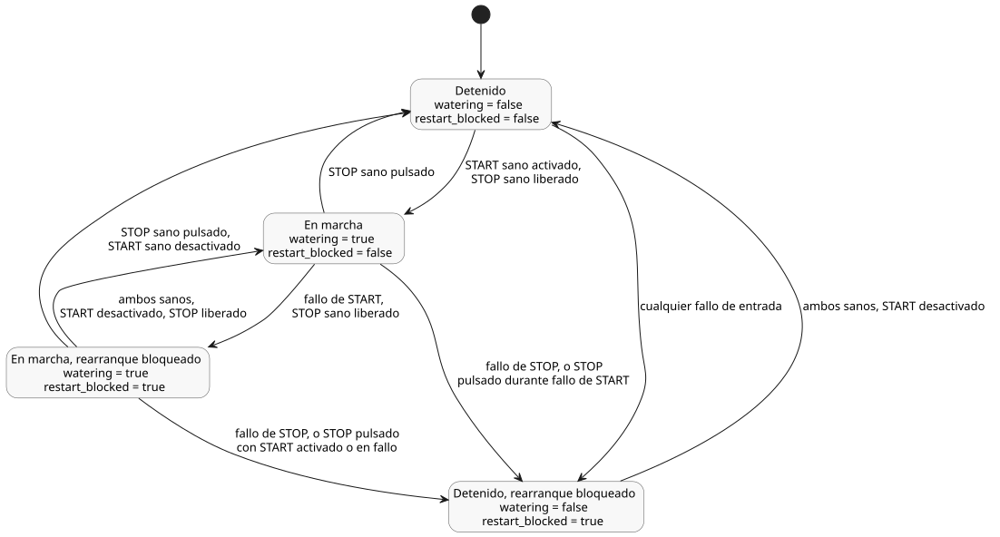

<!-- translation-source: examples/tutorial/01-latch.ghost.md -->
[Original en inglés](01-latch.ghost.md)
> Traducción de lectura. Para compilar, use el archivo original `.ghost.md` enlazado.

# Tutorial de bomba con latch (retención)

Este archivo es la fuente canónica del pequeño control de bomba con latch. Solo se
compila el bloque `ghost` de nivel superior que aparece a continuación; la prosa en
Markdown no es ejecutable. `01-latch.ghost` se conserva únicamente como evidencia
histórica no ejecutable.

`watering` es un latch: cuando no hay una nueva solicitud de arranque, conserva su
valor anterior. Una solicitud de parada prevalece sobre una solicitud de arranque,
incluso cuando ambas son verdaderas en el mismo tick.

```ghost
control LatchingPump {
  input start: Bool;
  input stop: Bool;

  output pump, valve: Bool;
  state watering: Bool = false;
  state restart_blocked: Bool = false;

  let start_good = case start { ok(_) => true; fault(_) => false; };
  let stop_good = case stop { ok(_) => true; fault(_) => false; };
  let start_requested = start |> recover(false);
  let stop_requested = stop |> recover(true);

  // Revision issue531-approved-fault-restart-v1: explicit authored fault policy.
  // Faults block restart until a healthy START off-to-on request.
  restart_blocked' = if !start_good || !stop_good then true
                     else if !start_requested then false else restart_blocked;
  watering' = !stop_requested && (watering || (start_requested && !restart_blocked));

  valve <- watering';
  pump  <- watering';
  require pump => valve;
}
```

La revisión `issue531-approved-fault-restart-v1` hace explícita en la fuente la
política ante fallos de entrada:

- **Fallo de START.** Se inhiben los arranques nuevos. Una marcha que ya está activa
  puede continuar mientras STOP esté sano y liberado.
- **Fallo de STOP.** La marcha se libera (la bomba y la válvula se apagan).
- **Rearranque después de un fallo.** Una vez que un fallo ha detenido o bloqueado una
  marcha, START debe estar sano y debe pasar a desactivado y luego de nuevo a activado
  antes de que la bomba pueda volver a arrancar.

START es una solicitud lógica. Este ejemplo no requiere un botón físico.
La fuente anterior exacta se conserva en tests/fixtures/history/issue531.

El diagrama siguiente muestra los estados combinados de `watering` y `restart_blocked`
y las condiciones evaluadas en cada tick que producen las transiciones entre ellos.



Traza esperada en condiciones sanas para el CSV complementario sin cambios ([01-latch.csv](01-latch.csv)).
El tick 3 muestra que STOP prevalece cuando ambas entradas son verdaderas:

| tick | start | stop | watering' | pump / valve |
|---:|:---:|:---:|:---:|:---:|
| 1 | true | false | true | encendida / abierta |
| 2 | false | false | true | encendida / abierta |
| 3 | true | true | false | apagada / cerrada |
| 4 | false | false | false | apagada / cerrada |
| 5 | true | false | true | encendida / abierta |
