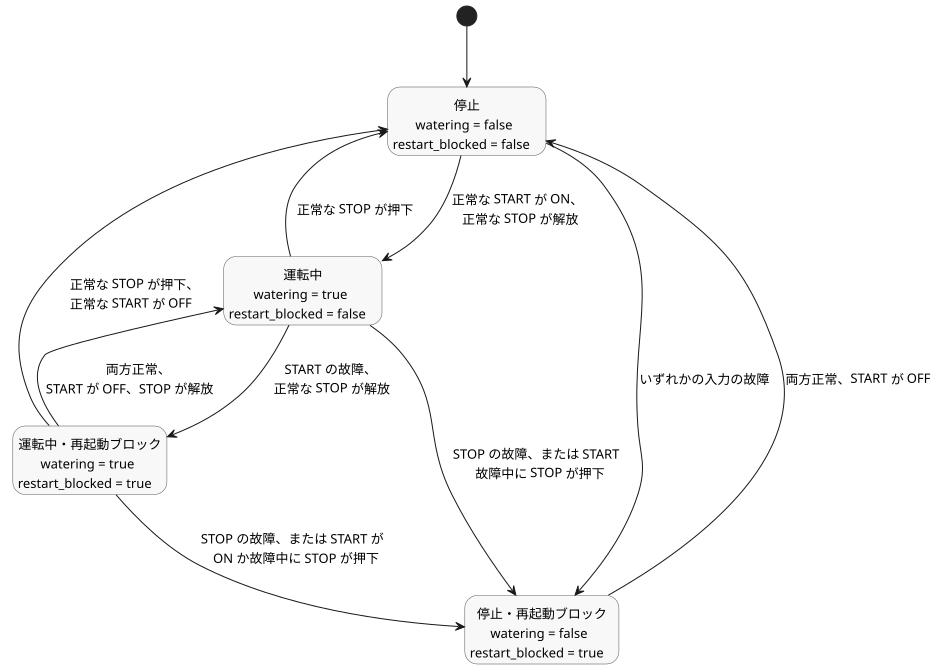

<!-- translation-source: examples/tutorial/01-latch.ghost.md -->
[英語の原文](01-latch.ghost.md)
> 閲覧用の翻訳です。コンパイルには、リンク先の原本 `.ghost.md` ファイルを使用してください。

# 自己保持ポンプのチュートリアル

このファイルは、小さな自己保持ポンプ制御の正本ソースです。コンパイルされるのは、下にあるトップレベルの `ghost` フェンスだけです。Markdown の本文は実行されません。`01-latch.ghost` は、実行されない過去の証拠としてのみ残されています。

`watering` はラッチです。新しい起動要求がないとき、前の値を保持します。停止要求は起動要求より優先されます。1 つの tick（論理判断の単位）で両方が true の場合も同じです。

```ghost
control LatchingPump {
  input start: Bool;
  input stop: Bool;

  output pump, valve: Bool;
  state watering: Bool = false;
  state restart_blocked: Bool = false;

  let start_good = case start { ok(_) => true; fault(_) => false; };
  let stop_good = case stop { ok(_) => true; fault(_) => false; };
  let start_requested = start |> recover(false);
  let stop_requested = stop |> recover(true);

  // Revision issue531-approved-fault-restart-v1: explicit authored fault policy.
  // Faults block restart until a healthy START off-to-on request.
  restart_blocked' = if !start_good || !stop_good then true
                     else if !start_requested then false else restart_blocked;
  watering' = !stop_requested && (watering || (start_requested && !restart_blocked));

  valve <- watering';
  pump  <- watering';
  require pump => valve;
}
```

リビジョン `issue531-approved-fault-restart-v1` は、入力の故障（fault）時のポリシーをソース内で明示します。

- **START の故障。** 新しい起動は禁止されます。すでに動作中の運転は、STOP が正常で解放されている間は継続してもかまいません。
- **STOP の故障。** 運転は解除されます（ポンプとバルブが OFF になります）。
- **故障後の再起動。** 故障によって運転が停止またはブロックされた後は、ポンプを再起動する前に、START が正常であり、かつ一度 OFF になってから再び ON にならなければなりません。

START は論理的な要求です。この例は物理的なボタンを必要としません。変更前のソースそのものは tests/fixtures/history/issue531 に保持されています。

次の図は、`watering` と `restart_blocked` を組み合わせた状態と、それらの間を移る tick ごとの条件を示しています。



変更されていない付属 CSV（[01-latch.csv](01-latch.csv)）に対する、正常時の期待トレースです。tick 3 は、両方の入力が true のときに STOP が優先されることを示しています。

| tick | start | stop | watering' | pump / valve |
|---:|:---:|:---:|:---:|:---:|
| 1 | true | false | true | on / on |
| 2 | false | false | true | on / on |
| 3 | true | true | false | off / off |
| 4 | false | false | false | off / off |
| 5 | true | false | true | on / on |
