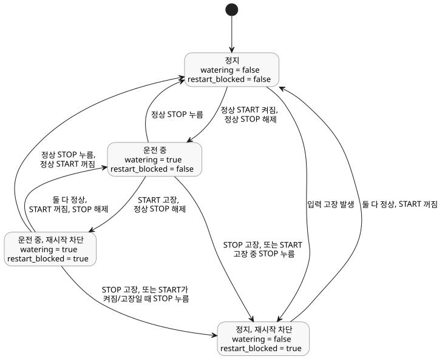

<!-- translation-source: examples/tutorial/01-latch.ghost.md -->
[영문 원문](01-latch.ghost.md)

# 자기유지 펌프 튜토리얼

이 파일은 작은 자기유지 펌프 제어의 정본 소스(canonical source)입니다. 아래의
최상위 `ghost` 펜스만 컴파일되며, Markdown 설명은 실행되지 않습니다.
`01-latch.ghost`는 실행할 수 없는 과거 증거로만 보존합니다. 이 한국어 파일은 읽기용
번역본이므로, 컴파일할 때는 영문 원문 `.ghost.md`를 사용하세요.

`watering`은 래치입니다. 새 시작 요청이 없으면 이전 값을 유지합니다. 한 tick에서
시작 요청과 정지 요청이 모두 true여도 정지 요청이 이깁니다.

```ghost
control LatchingPump {
  input start: Bool;
  input stop: Bool;

  output pump, valve: Bool;
  state watering: Bool = false;
  state restart_blocked: Bool = false;

  let start_good = case start { ok(_) => true; fault(_) => false; };
  let stop_good = case stop { ok(_) => true; fault(_) => false; };
  let start_requested = start |> recover(false);
  let stop_requested = stop |> recover(true);

  // Revision issue531-approved-fault-restart-v1: explicit authored fault policy.
  // Faults block restart until a healthy START off-to-on request.
  restart_blocked' = if !start_good || !stop_good then true
                     else if !start_requested then false else restart_blocked;
  watering' = !stop_requested && (watering || (start_requested && !restart_blocked));

  valve <- watering';
  pump  <- watering';
  require pump => valve;
}
```

revision `issue531-approved-fault-restart-v1`은 입력 고장 정책을 소스에
명시합니다.

- **START 고장.** 새 시작을 막습니다. 이미 진행 중인 운전은 STOP이 정상이고
  해제되어 있는 동안 계속될 수 있습니다.
- **STOP 고장.** 운전을 해제합니다(펌프와 밸브가 꺼집니다).
- **고장 후 재시작.** 고장으로 운전이 정지되거나 차단되면, 펌프를 다시 시작하기 전에
  START가 정상이어야 하고 꺼졌다가 다시 켜져야 합니다.

START는 논리적인 요청입니다. 이 예제는 물리 버튼을 요구하지 않습니다.
이전 소스의 정확한 내용은 tests/fixtures/history/issue531에 보존되어 있습니다.

아래 다이어그램은 `watering`과 `restart_blocked`를 묶은 상태와, 그 사이를 이동하는
tick별 조건을 보여 줍니다.



변경되지 않은 동반 CSV([01-latch.csv](01-latch.csv))에 대한 정상 동작의 기대 추적입니다.
tick 3은 두 입력이 모두 true일 때 STOP이 이기는 것을 보여 줍니다.

| tick | start | stop | watering' | pump / valve |
|---:|:---:|:---:|:---:|:---:|
| 1 | true | false | true | on / on |
| 2 | false | false | true | on / on |
| 3 | true | true | false | off / off |
| 4 | false | false | false | off / off |
| 5 | true | false | true | on / on |
