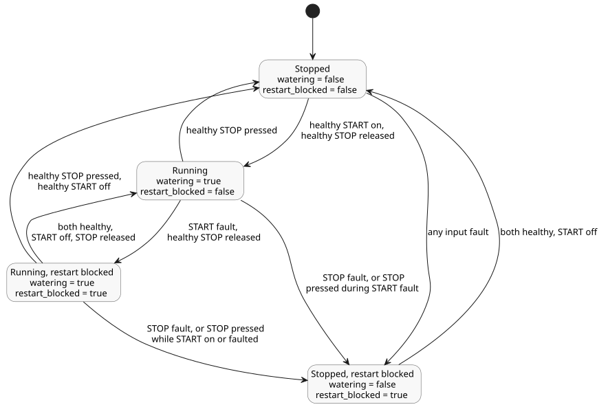

# Latching pump tutorial

This file is the canonical source of the small latching-pump control. Only the
top-level `ghost` fence below is compiled; the Markdown prose is not executable.
`01-latch.ghost` is kept only as non-executable historical evidence.

`watering` is a latch: when there is no new start request, it keeps its previous
value. A stop request beats a start request, even when both are true in one tick.

```ghost
control LatchingPump {
  input start: Bool;
  input stop: Bool;

  output pump, valve: Bool;
  state watering: Bool = false;
  state restart_blocked: Bool = false;

  let start_good = case start { ok(_) => true; fault(_) => false; };
  let stop_good = case stop { ok(_) => true; fault(_) => false; };
  let start_requested = start |> recover(false);
  let stop_requested = stop |> recover(true);

  // Revision issue531-approved-fault-restart-v1: explicit authored fault policy.
  // Faults block restart until a healthy START off-to-on request.
  restart_blocked' = if !start_good || !stop_good then true
                     else if !start_requested then false else restart_blocked;
  watering' = !stop_requested && (watering || (start_requested && !restart_blocked));

  valve <- watering';
  pump  <- watering';
  require pump => valve;
}
```

The revision `issue531-approved-fault-restart-v1` makes the input fault policy
explicit in the source:

- **START fault.** New starts are inhibited. A run that is already active may
  continue while STOP is healthy and released.
- **STOP fault.** The run is released (the pump and valve turn off).
- **Restart after a fault.** Once a fault has stopped or blocked a run, START
  must be healthy and must go off and then on again before the pump can restart.

START is a logical request. This example does not require a physical button.
The exact previous source is retained under tests/fixtures/history/issue531.

The diagram below shows the combined `watering` and `restart_blocked` states and
the per-tick conditions that move between them.



Expected healthy trace for the unchanged companion CSV ([01-latch.csv](01-latch.csv)).
Tick 3 shows STOP winning when both inputs are true:

| tick | start | stop | watering' | pump / valve |
|---:|:---:|:---:|:---:|:---:|
| 1 | true | false | true | on / on |
| 2 | false | false | true | on / on |
| 3 | true | true | false | off / off |
| 4 | false | false | false | off / off |
| 5 | true | false | true | on / on |
