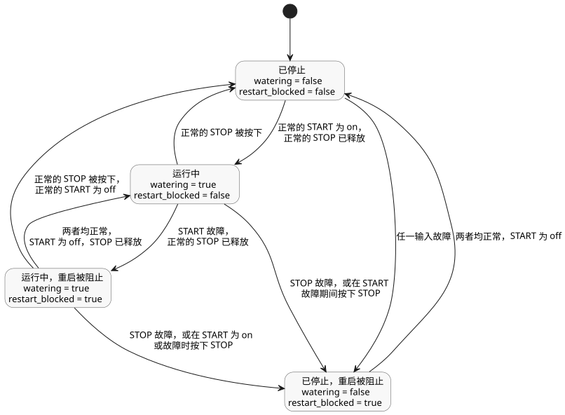

<!-- translation-source: examples/tutorial/01-latch.ghost.md -->
[英文原文](01-latch.ghost.md)
> 本文为阅读用译本。编译时请使用上方链接的原始 `.ghost.md` 文件。

# 自锁泵教程

本文件是小型自锁泵控制的规范源。只有下方顶层的 `ghost` 围栏会被编译；Markdown
正文不可执行。`01-latch.ghost` 仅作为不可执行的历史证据保留。

`watering` 是一个锁存：没有新的启动请求时，它保持前一个值。即使在同一个 tick（逻辑决策步）中
两者都为 true，停止请求也优先于启动请求。

```ghost
control LatchingPump {
  input start: Bool;
  input stop: Bool;

  output pump, valve: Bool;
  state watering: Bool = false;
  state restart_blocked: Bool = false;

  let start_good = case start { ok(_) => true; fault(_) => false; };
  let stop_good = case stop { ok(_) => true; fault(_) => false; };
  let start_requested = start |> recover(false);
  let stop_requested = stop |> recover(true);

  // Revision issue531-approved-fault-restart-v1: explicit authored fault policy.
  // Faults block restart until a healthy START off-to-on request.
  restart_blocked' = if !start_good || !stop_good then true
                     else if !start_requested then false else restart_blocked;
  watering' = !stop_requested && (watering || (start_requested && !restart_blocked));

  valve <- watering';
  pump  <- watering';
  require pump => valve;
}
```

修订版 `issue531-approved-fault-restart-v1` 在源中显式写出了输入故障策略：

- **START 故障。** 禁止新的启动。已在运行的过程在 STOP 正常且处于释放状态时可以继续。
- **STOP 故障。** 运行被释放（泵和阀门关闭）。
- **故障后的重启。** 一旦故障停止或阻止了某次运行，START 必须正常，并且必须先变为
  off 再变为 on，泵才能重新启动。

START 是一个逻辑请求。本示例不要求物理按钮。
原先的源原样保留在 tests/fixtures/history/issue531 下。

下图展示了 `watering` 与 `restart_blocked` 的组合状态，以及在它们之间转换的每个 tick 的条件。



未改动的配套 CSV（[01-latch.csv](01-latch.csv)）对应的预期正常追踪如下。
tick 3 展示了两个输入都为 true 时 STOP 优先：

| tick | start | stop | watering' | pump / valve |
|---:|:---:|:---:|:---:|:---:|
| 1 | true | false | true | on / on |
| 2 | false | false | true | on / on |
| 3 | true | true | false | off / off |
| 4 | false | false | false | off / off |
| 5 | true | false | true | on / on |
