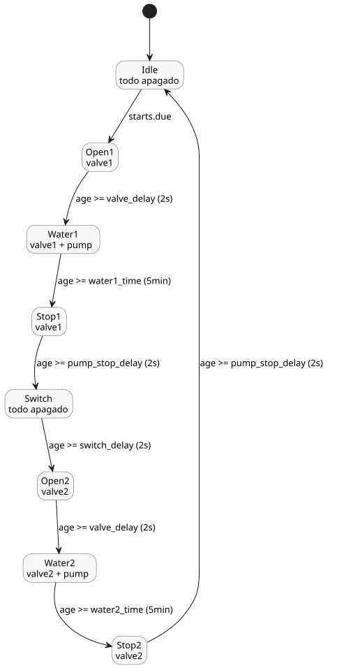

<!-- translation-source: examples/tutorial/02-watering.ghost.md -->
[Original en inglés](02-watering.ghost.md)
> Traducción de lectura. Para compilar, use el archivo original `.ghost.md` enlazado.

# Riego programado

Este control canónico del tutorial riega dos zonas por turnos en franjas diarias
seleccionadas. Abre cada válvula en secuencia y hace funcionar la bomba solo durante
una fase de riego.

```ghost
control ScheduledWatering {

  schedule starts: DailySlots<15min> {
    timezone = "Asia/Seoul";
    selected = [06:00, 06:15, 12:30, 18:45];
  }

  let water1_time = 5min;
  let water2_time = 5min;
  let valve_delay = 2s;
  let pump_stop_delay = 2s;
  let switch_delay = 2s;

  output pump, valve1, valve2: Bool;

  type Phase =
      Idle
    | Open1
    | Water1
    | Stop1
    | Switch
    | Open2
    | Water2
    | Stop2;

  state phase: Phase = Idle;
  timer age = elapsed(phase);

  phase' = case phase {
    Idle => if starts.due then Open1 else Idle;
    Open1 => if age >= valve_delay then Water1 else Open1;
    Water1 => if age >= water1_time then Stop1 else Water1;
    Stop1 => if age >= pump_stop_delay then Switch else Stop1;
    Switch => if age >= switch_delay then Open2 else Switch;
    Open2 => if age >= valve_delay then Water2 else Open2;
    Water2 => if age >= water2_time then Stop2 else Water2;
    Stop2 => if age >= pump_stop_delay then Idle else Stop2;
  };

  valve1 <- phase' in {Open1, Water1, Stop1};
  valve2 <- phase' in {Open2, Water2, Stop2};
  pump <- phase' in {Water1, Water2};
  require pump => (valve1 || valve2);
  require !(valve1 && valve2);
}
```

Cómo funciona:

- **Programación.** `starts` es una programación (`schedule`) `DailySlots<15min>` en la
  zona horaria `Asia/Seoul`. Pasa a pendiente (due) a las 06:00, 06:15, 12:30 y 18:45.
- **Fases.** `phase` recorre ocho estados. Solo `Idle` consulta `starts.due`, de modo
  que una franja que pasa a pendiente mientras un ciclo sigue en curso no inicia un
  segundo ciclo.
- **Temporizador.** `age = elapsed(phase)` es el tiempo transcurrido desde que `phase`
  consolidó su último cambio, por lo que cada fase mide su propia duración.
- **Secuencia de válvulas y bomba.** Cada válvula se abre 2 s (`valve_delay`) antes de
  que arranque la bomba, riega durante 5 min y permanece abierta 2 s
  (`pump_stop_delay`) después de que la bomba se detiene. Entre las dos zonas, todo
  permanece apagado durante 2 s (`switch_delay`).
- **Salidas.** Las salidas se calculan a partir de la fase siguiente `phase'`, de modo
  que coinciden con la fase elegida en el mismo tick.
- **Requisitos.** `require` establece dos reglas de seguridad: la bomba solo puede
  funcionar cuando hay una válvula abierta, y las dos válvulas nunca están abiertas a
  la vez.

El ciclo de fases y las salidas que están activas en cada fase:


