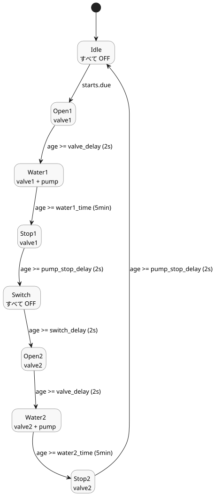

<!-- translation-source: examples/tutorial/02-watering.ghost.md -->
[英語の原文](02-watering.ghost.md)
> 閲覧用の翻訳です。コンパイルには、リンク先の原本 `.ghost.md` ファイルを使用してください。

# スケジュール灌水

このチュートリアル用の正本制御は、選択した毎日のスロットで 2 つの区画を順番に灌水します。各バルブを順に開き、灌水フェーズの間だけポンプを運転します。

```ghost
control ScheduledWatering {

  schedule starts: DailySlots<15min> {
    timezone = "Asia/Seoul";
    selected = [06:00, 06:15, 12:30, 18:45];
  }

  let water1_time = 5min;
  let water2_time = 5min;
  let valve_delay = 2s;
  let pump_stop_delay = 2s;
  let switch_delay = 2s;

  output pump, valve1, valve2: Bool;

  type Phase =
      Idle
    | Open1
    | Water1
    | Stop1
    | Switch
    | Open2
    | Water2
    | Stop2;

  state phase: Phase = Idle;
  timer age = elapsed(phase);

  phase' = case phase {
    Idle => if starts.due then Open1 else Idle;
    Open1 => if age >= valve_delay then Water1 else Open1;
    Water1 => if age >= water1_time then Stop1 else Water1;
    Stop1 => if age >= pump_stop_delay then Switch else Stop1;
    Switch => if age >= switch_delay then Open2 else Switch;
    Open2 => if age >= valve_delay then Water2 else Open2;
    Water2 => if age >= water2_time then Stop2 else Water2;
    Stop2 => if age >= pump_stop_delay then Idle else Stop2;
  };

  valve1 <- phase' in {Open1, Water1, Stop1};
  valve2 <- phase' in {Open2, Water2, Stop2};
  pump <- phase' in {Water1, Water2};
  require pump => (valve1 || valve2);
  require !(valve1 && valve2);
}
```

動作の仕組み：

- **スケジュール。** `starts` は `Asia/Seoul` タイムゾーンの `DailySlots<15min>` スケジュールです。06:00、06:15、12:30、18:45 に到来（due）します。
- **フェーズ。** `phase` は 8 つの状態を順に進みます。`starts.due` を見るのは `Idle` だけです。そのため、サイクルの実行中にスロットが到来しても、2 回目のサイクルは開始されません。
- **タイマー。** `age = elapsed(phase)` は、`phase` が最後に変化を確定してからの時間です。そのため、各フェーズは自分自身の継続時間を測ります。
- **バルブとポンプのタイミング。** 各バルブはポンプ起動の 2 s（`valve_delay`）前に開き、5 min 灌水し、ポンプ停止後も 2 s（`pump_stop_delay`）開いたままです。2 つの区画の間では、2 s（`switch_delay`）の間すべてが OFF になります。
- **出力。** 出力は次のフェーズ `phase'` から計算されます。そのため、同じ tick で選ばれたフェーズと一致します。
- **要件。** `require` は 2 つの安全ルールを表します。ポンプはバルブが開いているときだけ運転してもかまいません。また、2 つのバルブが同時に開くことは決してありません。

フェーズのサイクルと、各フェーズで ON になる出力：


