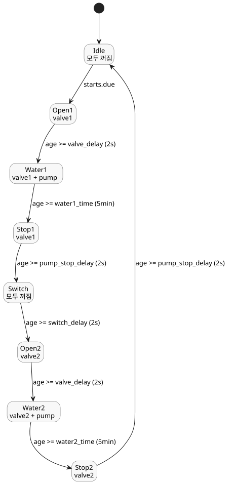

<!-- translation-source: examples/tutorial/02-watering.ghost.md -->
[영문 원문](02-watering.ghost.md)

# 예약 관수

이 정본 튜토리얼 제어는 선택된 매일의 슬롯에 두 구역을 차례로 관수합니다.
각 밸브를 순서대로 열고, 관수 단계에서만 펌프를 돌립니다. 이 한국어 파일은 읽기용
번역본이므로, 컴파일할 때는 영문 원문 `.ghost.md`를 사용하세요.

```ghost
control ScheduledWatering {

  schedule starts: DailySlots<15min> {
    timezone = "Asia/Seoul";
    selected = [06:00, 06:15, 12:30, 18:45];
  }

  let water1_time = 5min;
  let water2_time = 5min;
  let valve_delay = 2s;
  let pump_stop_delay = 2s;
  let switch_delay = 2s;

  output pump, valve1, valve2: Bool;

  type Phase =
      Idle
    | Open1
    | Water1
    | Stop1
    | Switch
    | Open2
    | Water2
    | Stop2;

  state phase: Phase = Idle;
  timer age = elapsed(phase);

  phase' = case phase {
    Idle => if starts.due then Open1 else Idle;
    Open1 => if age >= valve_delay then Water1 else Open1;
    Water1 => if age >= water1_time then Stop1 else Water1;
    Stop1 => if age >= pump_stop_delay then Switch else Stop1;
    Switch => if age >= switch_delay then Open2 else Switch;
    Open2 => if age >= valve_delay then Water2 else Open2;
    Water2 => if age >= water2_time then Stop2 else Water2;
    Stop2 => if age >= pump_stop_delay then Idle else Stop2;
  };

  valve1 <- phase' in {Open1, Water1, Stop1};
  valve2 <- phase' in {Open2, Water2, Stop2};
  pump <- phase' in {Water1, Water2};
  require pump => (valve1 || valve2);
  require !(valve1 && valve2);
}
```

동작 방식:

- **예약.** `starts`는 `Asia/Seoul` 시간대의 `DailySlots<15min>` 예약입니다.
  06:00, 06:15, 12:30, 18:45에 due가 됩니다.
- **단계.** `phase`는 여덟 개의 상태를 차례로 거칩니다. `starts.due`를 보는 것은
  `Idle`뿐이므로, 한 주기가 아직 진행 중일 때 due가 된 슬롯은 두 번째 주기를
  시작하지 않습니다.
- **타이머.** `age = elapsed(phase)`는 `phase`가 마지막으로 변경을 확정한 뒤
  지난 시간입니다. 따라서 각 단계는 자신의 지속 시간을 측정합니다.
- **밸브와 펌프 타이밍.** 각 밸브는 펌프가 시작되기 2 s(`valve_delay`) 전에 열리고,
  5 min 동안 관수한 뒤, 펌프가 멈춘 후에도 2 s(`pump_stop_delay`) 동안 열려 있습니다.
  두 구역 사이에서는 2 s(`switch_delay`) 동안 모든 출력이 꺼집니다.
- **출력.** 출력은 다음 단계 `phase'`로부터 계산되므로, 같은 tick에서 선택된
  단계와 일치합니다.
- **요구 조건.** `require`는 두 가지 안전 규칙을 기술합니다. 펌프는 밸브가 열려
  있을 때만 돌 수 있고, 두 밸브는 절대 동시에 열리지 않습니다.

단계 주기와 각 단계에서 켜지는 출력:


