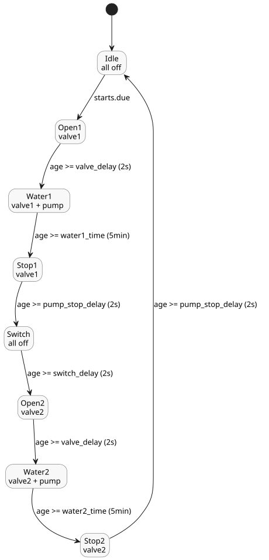

# Scheduled watering

This canonical tutorial control waters two zones in turn at selected daily slots.
It opens each valve in sequence and runs the pump only during a watering phase.

```ghost
control ScheduledWatering {

  schedule starts: DailySlots<15min> {
    timezone = "Asia/Seoul";
    selected = [06:00, 06:15, 12:30, 18:45];
  }

  let water1_time = 5min;
  let water2_time = 5min;
  let valve_delay = 2s;
  let pump_stop_delay = 2s;
  let switch_delay = 2s;

  output pump, valve1, valve2: Bool;

  type Phase =
      Idle
    | Open1
    | Water1
    | Stop1
    | Switch
    | Open2
    | Water2
    | Stop2;

  state phase: Phase = Idle;
  timer age = elapsed(phase);

  phase' = case phase {
    Idle => if starts.due then Open1 else Idle;
    Open1 => if age >= valve_delay then Water1 else Open1;
    Water1 => if age >= water1_time then Stop1 else Water1;
    Stop1 => if age >= pump_stop_delay then Switch else Stop1;
    Switch => if age >= switch_delay then Open2 else Switch;
    Open2 => if age >= valve_delay then Water2 else Open2;
    Water2 => if age >= water2_time then Stop2 else Water2;
    Stop2 => if age >= pump_stop_delay then Idle else Stop2;
  };

  valve1 <- phase' in {Open1, Water1, Stop1};
  valve2 <- phase' in {Open2, Water2, Stop2};
  pump <- phase' in {Water1, Water2};
  require pump => (valve1 || valve2);
  require !(valve1 && valve2);
}
```

How it works:

- **Schedule.** `starts` is a `DailySlots<15min>` schedule in the `Asia/Seoul`
  time zone. It becomes due at 06:00, 06:15, 12:30 and 18:45.
- **Phases.** `phase` walks through eight states. Only `Idle` looks at
  `starts.due`, so a slot that becomes due while a cycle is still running does not
  start a second cycle.
- **Timer.** `age = elapsed(phase)` is the time since `phase` last committed a
  change, so each phase measures its own duration.
- **Valve and pump timing.** Each valve opens 2 s (`valve_delay`) before the
  pump starts, waters for 5 min, and stays open 2 s (`pump_stop_delay`) after the
  pump stops. Between the two zones, everything is off for 2 s (`switch_delay`).
- **Outputs.** Outputs are computed from the next phase `phase'`, so they match
  the phase chosen in the same tick.
- **Requirements.** `require` states two safety rules: the pump may run only
  when a valve is open, and the two valves are never open together.

The phase cycle and the outputs that are on in each phase:


