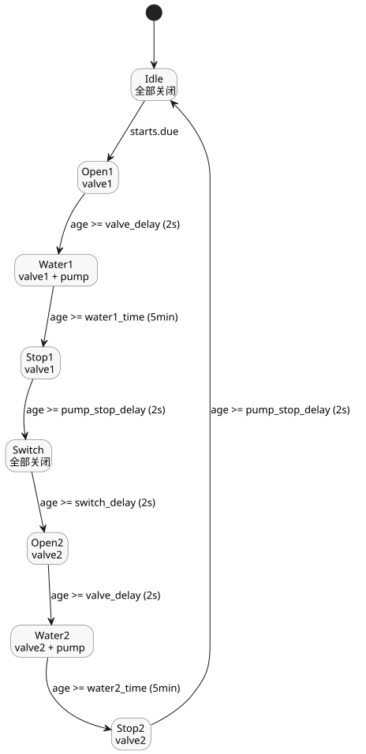

<!-- translation-source: examples/tutorial/02-watering.ghost.md -->
[英文原文](02-watering.ghost.md)
> 本文为阅读用译本。编译时请使用上方链接的原始 `.ghost.md` 文件。

# 定时浇水

这个规范教程控制在每天选定的时段依次为两个区域浇水。
它按顺序打开每个阀门，并且只在浇水阶段运行泵。

```ghost
control ScheduledWatering {

  schedule starts: DailySlots<15min> {
    timezone = "Asia/Seoul";
    selected = [06:00, 06:15, 12:30, 18:45];
  }

  let water1_time = 5min;
  let water2_time = 5min;
  let valve_delay = 2s;
  let pump_stop_delay = 2s;
  let switch_delay = 2s;

  output pump, valve1, valve2: Bool;

  type Phase =
      Idle
    | Open1
    | Water1
    | Stop1
    | Switch
    | Open2
    | Water2
    | Stop2;

  state phase: Phase = Idle;
  timer age = elapsed(phase);

  phase' = case phase {
    Idle => if starts.due then Open1 else Idle;
    Open1 => if age >= valve_delay then Water1 else Open1;
    Water1 => if age >= water1_time then Stop1 else Water1;
    Stop1 => if age >= pump_stop_delay then Switch else Stop1;
    Switch => if age >= switch_delay then Open2 else Switch;
    Open2 => if age >= valve_delay then Water2 else Open2;
    Water2 => if age >= water2_time then Stop2 else Water2;
    Stop2 => if age >= pump_stop_delay then Idle else Stop2;
  };

  valve1 <- phase' in {Open1, Water1, Stop1};
  valve2 <- phase' in {Open2, Water2, Stop2};
  pump <- phase' in {Water1, Water2};
  require pump => (valve1 || valve2);
  require !(valve1 && valve2);
}
```

工作原理：

- **调度计划。** `starts` 是位于 `Asia/Seoul` 时区的 `DailySlots<15min>` 调度计划。
  它在 06:00、06:15、12:30 和 18:45 到期。
- **阶段。** `phase` 依次经过八个状态。只有 `Idle` 会查看 `starts.due`，因此在一个周期
  仍在运行时到期的时段不会启动第二个周期。
- **定时器。** `age = elapsed(phase)` 是自 `phase` 上次提交变化以来的时间，因此每个阶段
  都测量自身的持续时间。
- **阀门与泵的时序。** 每个阀门在泵启动前 2 s（`valve_delay`）打开，浇水 5 min，
  并在泵停止后继续保持打开 2 s（`pump_stop_delay`）。在两个区域之间，所有输出关闭
  2 s（`switch_delay`）。
- **输出。** 输出根据下一阶段 `phase'` 计算，因此与同一 tick 中选定的阶段一致。
- **要求。** `require` 声明了两条安全规则：只有在某个阀门打开时泵才可以运行，
  并且两个阀门绝不会同时打开。

阶段循环以及每个阶段中处于开启状态的输出：


