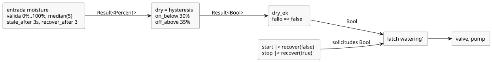

<!-- translation-source: examples/tutorial/03-moisture.ghost.md -->
[Original en inglés](03-moisture.ghost.md)
> Traducción de lectura. Para compilar, use el archivo original `.ghost.md` enlazado.

# Riego condicionado por la humedad

La intención del autor: el riego permanece activo solo mientras una señal de humedad
válida indique suelo seco. Una solicitud de STOP, un fallo de humedad o un suelo que
ya no está seco liberan el latch.

Esta revisión de calidad del productor (`issue531-producer-quality-tutorial03-v1`) conserva la rama de fallo de humedad escrita por el autor. START y STOP tratan de forma explícita las observaciones no disponibles del productor: un START no disponible cuenta como ausencia de solicitud de arranque, y un STOP no disponible cuenta como una solicitud de parada. Los valores sanos de los botones nunca se usan para inferir un fallo físico. La versión anterior se conserva en `tests/fixtures/history/issue531/03-moisture.ghost.md.pre-input.txt`.

```ghost
// Source revision: issue531-producer-quality-tutorial03-v1
control MoistureDemand {
  input start, stop: Bool;
  input moisture: Percent {
    sample = 1s;
    valid = 0% .. 100%;
    filter = median(5);
    stale_after = 3s;
    recover_after = 3 samples;
  }
  signal dry = hysteresis(moisture,
    on_below: 30%, off_above: 35%, initial: false);
  let dry_ok = case dry { ok(value) => value; fault(_) => false; };
  state watering: Bool = false;
  output pump, valve: Bool;
  let start_requested = start |> recover(false);
  let stop_requested = stop |> recover(true);
  watering' = !stop_requested && dry_ok && (start_requested || watering);
  valve <- watering';
  pump <- watering';
  require pump => valve;
}
```

Cómo el valor de humedad se convierte en una decisión:

- **Contrato de entrada.** `moisture` espera una muestra cada 1 s y acepta valores de
  0% a 100%. Aplica un filtro de mediana de 5 muestras. Pasa a obsoleto (stale) 3 s
  después de la última muestra válida real. Después de un fallo, necesita 3 muestras
  válidas nuevas consecutivas (y un filtro listo) antes de volver a estar sano.
- **Histéresis.** `dry` pasa a verdadero por debajo de 30% y a falso por encima de 35%.
  Entre ambos límites conserva su decisión anterior, lo que evita conmutaciones
  rápidas de encendido/apagado. Un fallo de humedad se propaga a través de `dry`.
- **Política ante fallos.** `dry_ok` convierte cualquier fallo en `false`, de modo que
  un sensor obsoleto, inválido o desconectado apaga el riego.
- **Sin rearranque automático.** Una vez liberado, el latch vuelve a activarse solo
  cuando hay una solicitud de arranque. Cuando el sensor se recupera después de un
  fallo, la bomba no vuelve a arrancar por sí sola; se requiere una nueva solicitud de
  arranque.

El flujo de datos desde el sensor y los botones hasta las salidas:


